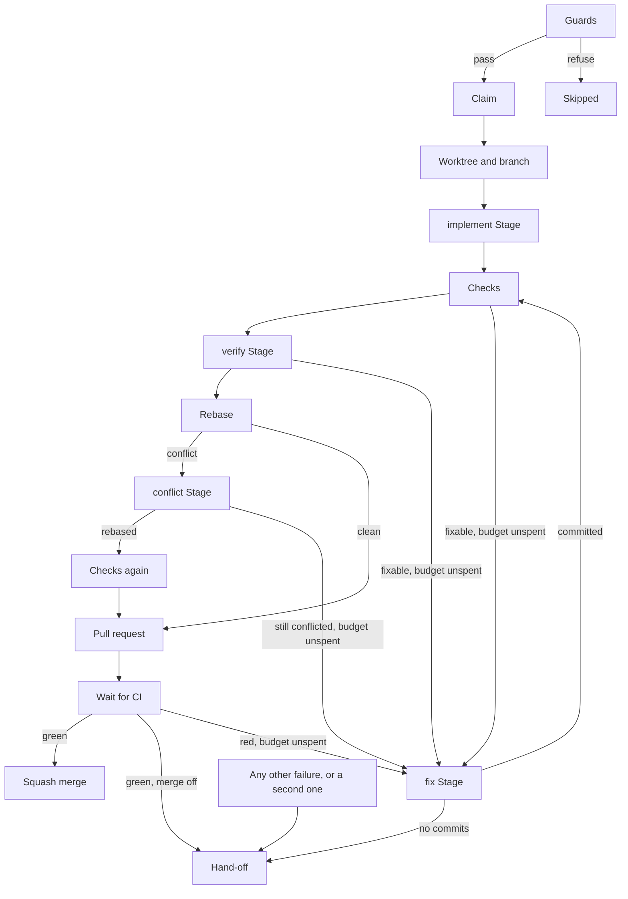
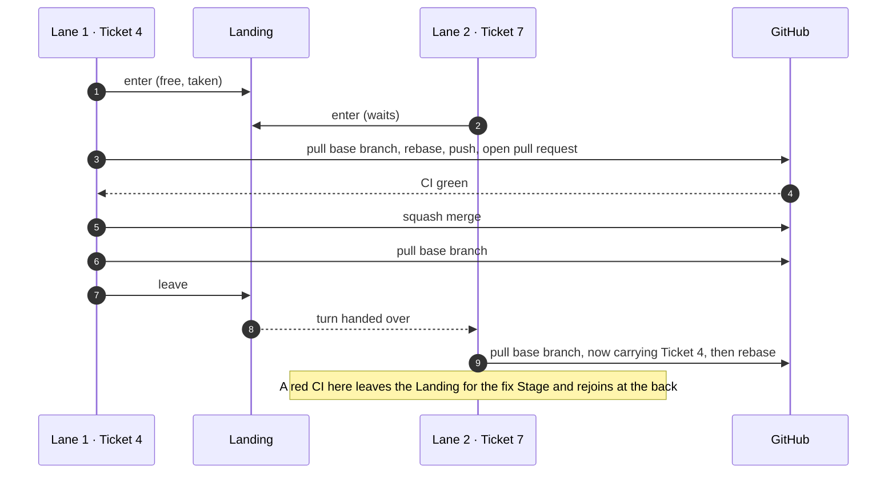

# From Ticket to merge

Nobody watches a Run, so nothing may merge on a single session's word. Every [Ticket](https://github.com/jjongs2/ticket-runner/blob/main/GLOSSARY.md) goes through the same gates in the same order: deterministic Checks, a second session that tries to prove the work wrong, and CI. A failure a fresh session could mend buys exactly one fix Stage; anything else goes to a human. The Tickets of a Run are implemented side by side, but they land one at a time, so what CI graded is what reaches the base branch. A Target that [merges by hand](./configuration.md#merge) has each green Ticket handed off instead, and a human merges it.

This page follows one Ticket from its claim to its merge. What happens when it stops short, whether by a Hand-off, a Release, a Stop or a Run that never came back, is on [Hand-offs, stopping and resuming](./stopping-and-resuming.md).

| Step | What happens | Who decides |
|---|---|---|
| Claim | Guards, state file, assign, `ready-for-agent` → `in-progress` | the pipeline |
| Worktree | `agent/<n>` in `.worktrees/ticket-<n>`, named `agent/<n>-<slug>` after the implement Stage | git, and the implement Stage's slug |
| implement Stage | `/mattpocock-skills:implement` in the worktree | an agent |
| Checks | Nothing uncommitted, then each Check command | exit codes |
| verify Stage | Adversarial grading of the Acceptance Criteria, and of defects the branch made | the pipeline, from the verdict |
| fix Stage | One fresh session given the failure, once per Ticket | the fix budget |
| Landing | Rebase, conflict Stage, pull request, CI, squash merge | one Lane at a time |
| After the merge | Tick met criteria, clean up | the pipeline |


<!-- Sources: src/orchestrator.ts, src/lifecycle.ts -->

Every edge to the fix Stage is taken at most once per Ticket. A second failure of any kind, or any failure the fix Stage cannot act on, is a Hand-off. A Stage stopped by the rate limit, an API failure or the API budget, a failure the base branch shares ([below](#a-failure-the-base-branch-shares)), and [GitHub or the git remote failing](./stopping-and-resuming.md#release-over-a-github-or-remote-failure) at any step, leave this diagram entirely: they [release](./stopping-and-resuming.md#release-on-a-rate-limit) the Ticket.

A [Hand-off](./stopping-and-resuming.md#hand-off) undoes the claim, puts `ready-for-human` on, comments the failure and where the work is, and puts an open pull request back into draft. The branch and the state file stay on the Target's remote, since the Host the work was done on may be gone by the time a human looks. The handed-off Stages' transcripts are kept beside them or on the Host, as [`keepTranscripts`](./configuration.md#keeptranscripts) decides, and the hand-off comment says where. A human who relabels the Ticket `ready-for-agent` hands it back, and it carries on from what it reached rather than paying for the implement Stage again. On a Target that [merges by hand](./configuration.md#merge), a Ticket whose CI is green is [handed off at `merge`](./stopping-and-resuming.md#when-nothing-failed) with nothing failed. A [Hand-off at setup](./stopping-and-resuming.md#when-a-hand-off-does-less) that leaves no work of the pipeline's removes the state file: the Ticket started fresh and either failed before its worktree existed, or found a branch in the way that the Run would not branch over. No Stage of this Run worked there, so nothing is the pipeline's to resume.

## The claim

The claim marks a Ticket as taken, so no other Run picks it: the Frontier leaves out every assigned Ticket. The [guards](./planning.md) run before anything is written. An issue the pipeline will not take is never marked as taken.

Then, in this order:

1. The **state file** is written: the Ticket's branch, the state it reached (`claimed`) and whether the fix budget is spent.
2. The Ticket is assigned to the `gh` user, `in-progress` goes on and `ready-for-agent` comes off. A Stranded Ticket already wears this claim, so it is not written again.
3. Any hand-off comment still current on the Ticket is marked as history ([Handing a Ticket back](./stopping-and-resuming.md#handing-a-ticket-back)).

## The worktree and branch

| | Value |
|---|---|
| Branch | `agent/<n>` at the claim. Once the implement Stage has finished with commits, `agent/<n>-<slug>`, with the slug the Stage answered |
| Worktree | `.worktrees/ticket-<n>` under the Target's root, gitignored |
| Branched from | The remote's base branch, freshly fetched, with no upstream set |

A branch of that name that already exists is never reused. The Ticket is handed off at `setup`, and the comment says whose branch it is and the command that clears it. A resumed Ticket carries on in the branch its state file names instead; see [Hand-offs, stopping and resuming](./stopping-and-resuming.md).

Nothing is cut from the Ticket title, which says nothing in a branch name when it is not written in English. The implement Stage, which has read the Ticket, answers a `branch` slug instead: at most 40 characters matching `^[a-z0-9]+(-[a-z0-9]+)*$`, in English words saying what the Ticket does, whatever language the Target writes in. When the Stage finishes with commits, before the branch is first pushed, the Run records `agent/<n>-<slug>` in the state file, renames the branch, then pushes it under that name, so the remote never holds `agent/<n>` for it. Every later write names the new branch: the progress comment, the pull request and any hand-off.

The branch keeps `agent/<n>` when the slug is empty, in silence, and, logging `#<n> keeps agent/<n> · <why>`, when the slug is out of shape, the state file write fails, a branch of the new name is on the Host or on the remote, or `agent/<n>` already reached the remote, which an implement Stage that did not finish pushed. A Ticket whose state file already names another branch keeps it. A Host that dies between the state file write and the rename leaves its next Run there a branch in the way, and the Ticket is handed off at `setup` with the worktree it is in; a Run on another Host takes it from the top, since nothing was pushed.

## How a Stage runs

A [Stage](https://github.com/jjongs2/ticket-runner/blob/main/GLOSSARY.md) is one `claude -p` child process with one job ([ADR-0002](https://github.com/jjongs2/ticket-runner/blob/main/docs/adr/0002-claude-p-child-process-per-stage.md)).

Every Stage runs in the Ticket's worktree with `--permission-prompts none`, the configured `permissionMode`, and its own `model`, `effort`, `maxTurns` and `maxMinutes` (see [Configuration](./configuration.md)). The wall-clock limit is enforced by killing the process and everything it started.

**What a Stage sees.** The branch's files, the Target's `CLAUDE.md` among them, so what `init` wrote reaches a Stage once it is on the base branch. No MCP server, the claude.ai connectors included, no auto memory, and none of the tools that act beyond the session, such as scheduling. Work that needs an MCP server cannot be done by a Stage.

| Stage | Prompt opens with | Structured answer |
|---|---|---|
| implement | `/mattpocock-skills:implement <issue URL>` | optional `title`, `body`, `problem`, `solution`, [`notes`](#notes) and `noCommitReason` |
| verify | `Ticket: <issue URL>` and the criteria by number, no skill | the verdict, optional `notes` |
| fix | `Ticket: <issue URL>`, no skill but `/mattpocock-skills:pr` | optional `title`, `body`, `problem`, `solution`, `notes` and `noCommitReason` |
| conflict | `Ticket: <issue URL>`, no skill | none |

The prompt ends with the Stage's [`extraPrompt`](./configuration.md#stages).

**What a Stage writes, and in what language.** `title` titles the [pull request](#pull-request) and the squash commit; `body` is the pull request body below `Closes #<n>`; `problem` and `solution` open the [squash commit](#squash-merge-and-its-commit). A Target's own shapes come first:

| Answer | Shape |
|---|---|
| `title`, commit subjects | `<type>[(<scope>)]: <summary>`, with the types, scopes and wording the contributing guide sets for a commit subject or pull request title; where it sets none, the shape alone. A fix Stage answers the title blank, which keeps the one before it, unless its fix changes what it says |
| `body` | What the Target's contributing guide or `.github/PULL_REQUEST_TEMPLATE.md` sets beyond the `Closes` line; where neither does, `/mattpocock-skills:pr`'s Summary, Evidence and Merge Danger |
| `problem`, `solution` | What the contributing guide sets for a commit body; where it sets none, the state before the change and its effect, and what the change does and why, each in at most two sentences, readable without the Ticket |

None of `body`, `problem` and `solution` carries a title, a closing keyword before an issue reference, a screenshot or a local path. Every Stage that answers writes its Notes, its verdict's evidence and these answers in the language the Target's contributing guide sets for issues and commits, or else in the language the Ticket is written in; a criterion's text stays as the Ticket writes it. The lines the pipeline writes itself, such as the progress table, stay in English.

**What a Stage is billed to.** A Stage runs on the Claude login, with the Host's `ANTHROPIC_API_KEY` taken out of its environment, unless the Run was started with [`--api-key`](./running.md#api-key), when it runs on that key. When the session's `apiKeySource` says otherwise, the Run's log and summary name the Stage.

What each Stage leaves on disk is on [Logs and transcripts](./running.md#logs-and-transcripts).

**How a Stage can end.** The runner reads the session's last `result` event, never what the session talked about:

| Failure | Progress cell | Meaning |
|---|---|---|
| `timed-out` | `❌ timed out` | Killed at `maxMinutes` |
| `turn-capped` | `❌ turn capped` | Reached `maxTurns` |
| `out-of-budget` | `⏸ out of API budget` | The API key's credit or spend limit, met only on an `--api-key` Run. Releases the Ticket |
| `rate-limited` | `⏸ rate limited`, `⏸ API rate limited` on an `--api-key` Run | The plan's rate limit, or the API's on an `--api-key` Run. Releases the Ticket |
| `api-error` | `⏸ API failure` | A transient API failure the CLI gave up retrying. Releases the Ticket |
| `nonzero-exit` | `❌ exited non-zero` | Any other failed session |
| `invalid-result` | `❌ invalid result` | The verify Stage answered no verdict at all |

## The implement Stage

The implement skill reads the Ticket, builds it and reviews it. Once the review's fixes are committed, the Stage answers `title`, `body`, `problem` and `solution` for the whole branch, and the `branch` slug ([above](#the-worktree-and-branch)). It is told not to push. When the session ends, the pipeline routes its [Notes](#notes) and records each answer that is not blank in the state file. Then:

- A Stage that did not finish pushes its commits, if it has any, on `agent/<n>`, so a Run on another Host can resume from them, and is a Hand-off at `implement`. Nothing is renamed.
- A branch with no commits beyond the base branch is a Hand-off: an agent that gave up silently leaves nothing to grade. The hand-off comment quotes the reason the Stage gave in `noCommitReason`, when it gave one.
- Otherwise the branch is named and pushed, the Run prints `#<n> implemented · <branch>`, and the state file moves to `implemented`, so no later Run pays for this Stage again.

## The Checks

Two gates, run by the pipeline itself rather than by an agent:

1. **Nothing uncommitted.** A worktree holding changes no commit carries fails, naming every path. Gitignored files, such as installed dependencies, do not count.
2. **The Check commands**, in order, each through a shell in the worktree, each under `checkTimeoutMinutes` (default 15). The first failure stops the rest. A command killed at the limit is reported as timed out, with a line appended to its output saying it hung rather than failed.

The commands are [`checks`](./configuration.md#checks). Both failures spend the fix budget. An empty `checks`, which only `"checks": []` written in the config allows, runs nothing, so the row reads `⚠️ no checks` rather than `✅ passed`, here and after a conflict Stage alike.

### A failure the base branch shares

A test on the base branch that starts failing, one that reads the wall clock say, fails on every branch at once. Charged to each Ticket, it costs every one its fix budget, and each fix Stage mends it differently in its own pull request. So before a failure is charged, the pipeline asks whether the branch brought it or inherited it:

| What failed | Run at the merge-base |
|---|---|
| A Check command | that command |
| CI on the pull request | every Check command, stopping at the first that fails |

The merge-base, as the remote holds it, is checked out clean, and the command runs there under the same `checkTimeoutMinutes`, once per Run however many Lanes fail on it. Nothing is installed there: the command finds its dependencies in the main checkout, as a Ticket's worktree does, so a command that needs an install or a build step of its own fails there too, and the Note's output shows why.

| The merge-base | Progress cell | Result |
|---|---|---|
| passes | ``❌ `<command>` failed``, or CI's `❌ failed` | Spends the fix budget, as above |
| fails too | ``⏸ `<command>` fails on the base branch`` | A Release; the budget stays as it was, spent or not |
| could not be checked out or run | as if it passed | Spends the fix budget, and the Run log says why |

The Release posts the pipeline's own Note on the standing Notes issue, naming the command and quoting the tail of its output, once per Run and merge-base commit however many Tickets it releases. Only the command is compared, so a branch that fails it differently is released all the same; the Note quotes the branch's own failure beside the merge-base's, marked as the branch's: the tail of the failing Check's output, or for CI the failing jobs' logs a fix Stage would have been handed. It is the failure of the Ticket that posted the Note; a Ticket released later over the same commit adds nothing. What to do next is on [Release over a failing base branch](./stopping-and-resuming.md#release-over-a-failing-base-branch).

## The verify Stage and its verdict

No human reviews the code before it merges, and the session that wrote it is the last one to trust on whether it works. So a fresh session, with no plugin skill, tries to prove each Acceptance Criterion is **not** met. The pipeline lists the Ticket's unticked criteria by number, each with the indented lines under its box ([Planning the work](./planning.md#acceptance-criteria)), and the session runs the code, may write throwaway tests, and must not commit. A criterion that cannot be met without overturning a documented decision or another criterion is `unmet`, with evidence saying a human decision is needed. An `unmet` criterion's evidence states the failure: where it sits, what was run or read, what was expected, what came back, and the counterexample. It proposes no fix, though it may quote a limit the Ticket, a documented decision or another criterion sets, naming where it comes from. Its scratch files are discarded afterwards, so they never reach the pull request.

It also grades the branch itself. A defect the branch introduced, or one in code it added, shown with the evidence an `unmet` criterion needs, goes in the verdict's `defects` rather than a Note, unless the Ticket leaves it out of scope or a documented decision accepts it. The session is shown the Notes this Ticket's implement and fix Stages wrote in the Run, so such a defect among them is graded too. Anything else it finds leaves the session as a [Note](#notes).

The **verdict** answers each criterion by its number, `met`, `unmet` or `unverifiable`, with evidence, and lists the defects of the branch. The agent's own pass or fail is advisory; the pipeline decides for itself: **no criterion unmet, no defect of the branch, and at least one criterion met.** Wherever a criterion is shown afterwards, in the fix and retry verify prompts, the hand-off and the squash commit, it is its checkbox line as the Ticket reads, never the verdict's copy.

| Verdict | Progress cell | Result |
|---|---|---|
| Passes | `✅ <k> met · <v> unverifiable` | On to the Landing |
| Some `unmet` | `❌ <u> unmet` | Spends the fix budget; the fix Stage gets each unmet criterion with its evidence |
| A defect the branch made | `❌ <d> defects`, or `❌ <u> unmet · <d> defects` | As `unmet`: spends the fix budget, and the fix Stage gets each defect with its evidence |
| A listed number left out, answered twice, or one answered that was not listed | `❌ misnumbered` | Hand-off: it has not graded the Ticket |
| All `unverifiable` | `❌ no evidence` | Hand-off: there is nothing to merge on |
| Missing or malformed | `❌ no verdict` | Hand-off |

A verify after a fix for unmet criteria or defects gets the first verdict's unmet criteria and defects with their evidence, and is told such a criterion is met only when that counterexample is gone and the whole criterion holds. A defect it finds in the fix's own code is a Hand-off like any second failure, so the gate cannot loop.

## The fix Stage and the fix budget

The fix budget is one fix Stage per Ticket, and whatever still fails after it goes to a human. The fix Stage is a fresh session on the same branch, with no plugin skill but `/mattpocock-skills:pr`, given the failure and its evidence to mend that one defect. It is also given the latest `title`, `body`, `problem` and `solution` answered for the branch: one its fix changes it answers again, revised for the whole branch, and one it leaves true it answers blank, which keeps the earlier one. Sent in for unmet criteria or defects of the branch, it commits nothing and says why in `noCommitReason` when one cannot be met or fixed without overturning a documented decision or another criterion, which hands the Ticket to a human. Otherwise it takes a fix the evidence proposes as a lead, not the answer: it finds the cause itself, looks for a fix of that cause within the Ticket's scope before settling for a narrower one, and before committing tests its fix with inputs built from that cause, not only with the counterexample it was given.

Only a defect a fresh session could mend spends the budget:

| Failure | At | Spends the budget? |
|---|---|---|
| Changes no commit carries | checks | Yes |
| A Check failed or timed out | checks | Yes |
| A Check failed that the merge-base fails too | checks | No, a Release |
| A criterion `unmet` | verify | Yes |
| A defect the branch made | verify | Yes |
| The conflict Stage did not finish the rebase | rebase | Yes |
| A pull request check failed | ci | Yes |
| A pull request check failed, and the merge-base fails a Check | ci | No, a Release |
| A Stage that did not finish (timed out, turn-capped, non-zero, invalid result) | its Stage | No, Hand-off |
| implement left no commits | implement | No, Hand-off |
| A verdict with no evidence, or none at all | verify | No, Hand-off |
| A verdict that leaves out a listed number or adds one | verify | No, Hand-off |
| The conflict Stage could not be run, or git could not be asked | rebase | No, Hand-off |
| The base branch could not be pulled | rebase | No, Hand-off |
| Pushing or opening the pull request failed | pr | No, Hand-off |
| CI timed out or found conflicting | ci | No, Hand-off |
| The merge failed | merge | No, Hand-off |
| A rate limit, a transient API failure or an API key out of budget, anywhere | any | No, a Release |
| GitHub failing on its own side, or git unable to reach or log in to the remote, anywhere | any | No, a [Release](./stopping-and-resuming.md#release-over-a-github-or-remote-failure) |

After a fix Stage, the Ticket starts again at the Checks. Every gate grades the fix, the verify Stage included, so a fix is held to the same bar as the first attempt. A fix Stage whose branch did not grow is a Hand-off straight away: re-grading an untouched branch could only fail the same way. A squashed or amended branch counts as not grown. Its hand-off comment carries the evidence the fix Stage was sent in with, and quotes the reason the Stage gave in `noCommitReason` for committing nothing, whatever it was sent in for.

A fix Stage stopped by the rate limit, an API failure or the API budget spends nothing. The fix budget is one fix Stage each time the pipeline takes the Ticket up: a Release carries a spent budget over to the next Run, having changed nothing about the Ticket, and a Hand-off restores it, because the Ticket only comes back through a human's hands and whatever they did to it is what the fresh budget is for. More on [Handing a Ticket back](./stopping-and-resuming.md#handing-a-ticket-back).

## Lanes and the Frontier refill

A Run holds one Ticket per [Lane](https://github.com/jjongs2/ticket-runner/blob/main/GLOSSARY.md) and refills a Lane the moment its Ticket ends. While another Lane is busy, a free Lane also looks at the Frontier again at intervals, so a Ticket that joins it mid-Run need not wait for a busy Lane to end. The order it fills them in is on [Running](./running.md#run), when more Lanes help on [`lanes`](./configuration.md#lanes), and what keeps two Tickets out of each other's way on [Blockers](./planning.md#blockers).

## The Landing

The [Landing](https://github.com/jjongs2/ticket-runner/blob/main/GLOSSARY.md), from the pull of the base branch before the rebase to the pull after the merge, holds one Ticket at a time, in arrival order, so the base branch cannot move between a Ticket's rebase and its merge, and what CI graded is what lands ([ADR-0005](https://github.com/jjongs2/ticket-runner/blob/main/docs/adr/0005-landing-is-a-serialized-section.md)). implement and verify, where the time goes, stay parallel. The cost is that one Lane's conflict Stage or slow CI holds the others' Landing. A Target that [merges by hand](./configuration.md#merge) leaves the Landing without a merge, so there the guarantee holds only as far as its configuration page says.


<!-- Sources: src/landing.ts, src/orchestrator.ts -->

A Ticket also leaves the Landing for a fix Stage, a Hand-off or a Release, so nobody waits behind a session; one back from a fix Stage rejoins at the back. A Ticket [released over a failing base branch](#a-failure-the-base-branch-shares) passes through the Landing once when a later Run takes it up, for the pull and the rebase alone, before its Checks, and leaves it again at once, since nothing is merged behind them.

### Rebase

The base branch is first brought up to the remote's, then `git rebase <base>` runs in the worktree. A clean rebase goes straight to the pull request. A conflict is left exactly where git stopped, for the conflict Stage.

### The conflict Stage

A conflict is not a defect in the branch: the base branch moved on underneath it. So one conflict Stage runs in the stopped rebase with git's output and no plugin skill, and **it does not spend the fix budget.** It is told to finish the rebase and never abort it, to keep both intents where they are compatible and the Ticket's where they are not, and to change a file the conflict did not touch only to repair what the merge broke, such as a renamed name or a moved field. It implements nothing new and changes no behaviour the criteria cover.

**The worktree decides, not the session's exit.** The rebase counts as resolved only when it has finished, the branch sits on top of the base branch with no merge commit between them, and no unmerged path or conflict marker is left.

| What the worktree shows | Result |
|---|---|
| Resolved, however the session ended (even rate-limited or stopped by an API failure) | `✅ rebased`; push, then **the Checks again** |
| Unresolved, session rate-limited or stopped by an API failure or the API budget | Abort the rebase, Release |
| Unresolved otherwise | `❌ unresolved`; abort the rebase, spend the fix budget |
| The Stage could not run, or git could not be asked | `❌ unknown`; abort the rebase, Hand-off |

The Checks run again because the resolution is code no gate has seen. verify is not asked again: the Stage changes no behaviour the criteria cover. An unresolved rebase hands the fix Stage the conflict and what is still wrong as its evidence. The abort always happens, so a fix Stage or a human never inherits a half-finished rebase.

### Pull request

The branch is pushed with `--force-with-lease`, since the rebase rewrote it. The pipeline opens a ready (non-draft) pull request against the base branch, or updates the one it already has: a new title and body, and out of draft (a draft often runs no workflows, so a draft left from a Hand-off would read as "no checks"). A pull request already open on the branch counts as the one it has, since an attempt GitHub failed to answer may have opened it all the same.

**The title** is the first of these in the commit convention's shape, `<type>[(<scope>)]: <summary>` on one line (a trailing `(#<n>)` is dropped):

1. The latest `title` the implement or fix Stage answered for the whole branch, in this Run or recorded in the state file by an earlier one.
2. The branch's first commit subject.
3. The Ticket title, as it is.

**The body** is `Closes #<n>`, a blank line, and the latest `body` the implement or fix Stage answered, in this Run or recorded in the state file by an earlier one; with none, `Closes #<n>` alone. The pipeline adds nothing else: the verify row of the progress comment carries the verdict, and the merge ticks the met criteria. A draft pull request a [Hand-off](./stopping-and-resuming.md#hand-off) leaves keeps its own body until a Run publishes it again.

### CI wait and grace period

The pipeline polls the head commit's check runs and commit statuses until they settle or [`ciTimeoutMinutes`](./configuration.md#ci) runs out.

| What GitHub shows | Progress cell | Result |
|---|---|---|
| Every check passed or skipped | `✅ passed` | Merge, or on a Target that [merges by hand](./configuration.md#merge) a Hand-off whose `merge` row reads `👤 left to a human` |
| A check failed, was cancelled, timed out, needs action or could not start | `❌ failed` | Spends the fix budget |
| The same, and the merge-base fails a Check command | ``⏸ `<command>` fails on the base branch`` | A Release ([above](#a-failure-the-base-branch-shares)) |
| GitHub still failing on its own side after a minute of tries | `⏸ GitHub failure` | A [Release](./stopping-and-resuming.md#release-over-a-github-or-remote-failure) |
| Checks still pending at the timeout, or never listed | `❌ timed out` | Hand-off |
| No checks, and GitHub finds the pull request conflicting | `❌ conflicting` | Hand-off at once |
| No checks after the grace period | `⚠️ no checks` | Merge, with the warning row |
| No checks at the first reading, and no workflow can run on the pull request | `⚠️ no workflow runs` | Merge at once, with the warning row |

A failed check hands the fix Stage the tail of the failing Actions jobs' logs. A conflicting pull request is handed off without waiting, because GitHub runs no checks on it; only a human merging meanwhile can cause it. A reading where GitHub would not list the check runs or statuses is no answer, and is asked again like a pending one.

A pull request with no checks merges: whether one runs CI is a fact about it, such as a docs-only change a `paths` filter skips, and a Target that needs CI before a merge says so on GitHub ([Requiring CI before a merge](./configuration.md#requiring-ci-before-a-merge)).

**The grace period.** Right after a pull request opens, GitHub reports no checks for a while, so "no checks" counts only after [`ciGraceMinutes`](./configuration.md#ci). Under `ciGraceMinutes: 0`, a pull request merges before a slow check run registers.

**No grace when no workflow can run.** Before the wait, the Run reads the workflow files in `.github/workflows/` as the pull request's branch has them, and the wait skips `ciGraceMinutes` when none of them can run on the pull request. Checks already registered at the first reading are still waited for. A Target with no workflow file is one where none can run. A workflow cannot run when each of its events is one of these:

| Event | Cannot run on the pull request when |
|---|---|
| `schedule`, `workflow_dispatch`, `repository_dispatch`, `workflow_call` | always |
| `pull_request` | `branches` or `branches-ignore` excludes the base branch, or `paths` or `paths-ignore` excludes every changed file, a renamed file counting under both paths |
| `push` | `branches` or `branches-ignore` excludes the pull request's branch |

Patterns are read as GitHub's filter pattern cheat sheet reads them, not as shell globs: `**.js` matches `src/js/app.js`. Anything the Run cannot rule out for certain counts as a workflow that can run, and the grace applies: a file that does not parse, any other event, a filter it does not read (`types`, a `push` `paths`, `tags`) unless one it reads rules the event out, a pattern with `?`, `+`, `[]` or a leading `!`, a path written from `/` or `./` or ending in `/`, and a wildcard that would have to match a name starting with `.`. Wrong that way, it costs the grace; wrong the other way, a pull request would merge before its CI registers.

### Squash merge and its commit

The pipeline squash-merges through GitHub's REST API with a commit message it composed itself:

```text
<title> (#<pr>)

Closes #<n>

<problem>

<solution>

Unverified:
- <criterion> — <evidence>

Co-authored-by: <name> <email>
```

The subject is the pull request title. `<problem>` and `<solution>` are the latest the Stages answered, each line wider than 72 columns broken at its spaces, a wide character such as Hangul counting as two; the lines the Stage wrote stay, so a list stays a list. With no solution answered, the branch's commit subjects stand in for it as `- <subject>` lines, after the problem when there is one; nothing is made up for a missing answer. `Unverified:` appears only when a criterion was `unverifiable`, one line each with its evidence joined into one line, since nowhere else keeps that reason. Commit subjects and `Co-authored-by` trailers are read after the rebase, since those are the commits that land. On a Target that [merges by hand](./configuration.md#merge) none of this is composed: the human merging gets the Target's own default message.

### After the merge

The Ticket is merged, so nothing below can hand it off. Each step's failure is logged and the next step still runs:

1. Remove the state file, so the Ticket never looks resumable again.
2. Tick the met criteria (below).
3. Remove `in-progress`. The merge closed the issue.
4. Pull the base branch. This ends the Landing, and the next Lane's Ticket rebases onto a base branch that already carries this one.
5. Remove the worktree and the local branch, and delete the remote branch unless GitHub already did.

## What the board is told

**The progress comment.** A Ticket gets one progress comment, found again by a hidden marker and rewritten in place as each step ends, so only the first write notifies anyone. It is posted when the first row is recorded. Each Run that works the Ticket has its own section below earlier Runs' sections, headed by the version, the Run id and the branch:

```text
**ticket-runner** `0.4.0` · run `2026-09-17T09-00-00-000` · `agent/4-planning-guards`

| Stage | Outcome | Turns | Duration |
|---|---|---|---|
| implement | ✅ committed | 46 | 21m 14s |
| checks | ❌ `npm test` failed | – | 1m 48s |
| fix | ✅ committed | 12 | 6m 2s |
| checks | ✅ passed | – | 1m 52s |
| verify | ✅ 6 met · 1 unverifiable | 9 | 4m 31s |
| ci | ✅ passed | – | 2m 40s |
| merge | ✅ #31 | – | – |
```

Rows carry a few words only. Anything a human has to act on is its own comment, since those are worth a notification: a hand-off, a guard warning, a Note. The exception is a green Ticket [handed off with nothing failed](./stopping-and-resuming.md#when-nothing-failed) and no criterion unverifiable, which gets no comment.

**Ticking met criteria.** After the merge, every criterion the verdict marked `met` is ticked by its number (`- [ ]` → `- [x]`) wherever it is written: the body, or any comment, such as the one triage posted its brief in. The box ticked is the unticked line, across the body and every comment together, that still reads as the line the number named when verify got the list. When no line, or more than one, reads so, because the Ticket was edited in between, none is ticked and the Run log names the criterion: an untouched box is safer than a wrong one. An `unverifiable` criterion stays unticked, because nobody gathered evidence for it.

## Notes

A Stage keeps meeting defects that are not its Ticket's. Fixing them widens the Ticket past what verify grades; ignoring them loses them in a transcript. So the implement, verify and fix Stages end with a list of [Notes](https://github.com/jjongs2/ticket-runner/blob/main/GLOSSARY.md), and the pipeline posts each one where a human will meet it. A Note is a defect outside the Ticket, something that behaves wrongly or breaks, never a preference, a refactor or a test that would be nice to have, and never acted on in it. What the Ticket's own deliverable already records, such as a report section the Ticket asks for, is not a Note either. A defect the branch itself introduced, one that behaves correctly on the base branch and wrongly on the branch or sits in code the branch added, belongs to the Ticket: the implement and fix Stages fix it rather than note it, and verify, which fixes nothing, reports it in its verdict, [failing it](#the-verify-stage-and-its-verdict). Notes are routed before the Stage's own outcome is judged, so a Stage that ran out of turns still reports what it noticed.

| The Note names | Where it goes |
|---|---|
| An open, unclaimed Ticket that is not a Spec | A comment on that Ticket |
| No Ticket, or the Stage's own Ticket (about to close) | The standing Notes issue |
| A closed, claimed (`in-progress`) or Spec issue | The standing Notes issue, saying which Ticket it was meant for and why it did not go there |
| A number that will not take the comment (invented, locked) | The standing Notes issue, with the number it was meant for |

**The standing Notes issue** is one open `needs-triage` issue, titled "Notes from the pipeline", that collects Notes as comments. It is found by a marker in its body, not by its title, so renaming it opens no second one. It is opened by the first Note that needs it and shared by every Lane of the Run. Work through it as triage does: turn each Note worth doing into a Ticket, or a comment on one, then close the issue. The next Note opens a fresh one. When one is open, each noting Stage's prompt carries its number, so the Stage can read what is already reported and add only what would change a reader's action.

A `- [ ]` at the head of a line in a Note is escaped, so a Note is never read as Acceptance Criteria. The Run summary lists each Note as a `noted` row under the Ticket that made it.

## Related pages

- [Planning](./planning.md): the guards that run before the claim, and how to write Acceptance Criteria verify can grade.
- [Running](./running.md): starting a Run, `--lanes`, `--api-key`, a narrowed Run, the summary, exit codes and transcripts.
- [Configuration](./configuration.md): `checks`, the Stage limits, `ciTimeoutMinutes`, `ciGraceMinutes`, and requiring CI before a merge.
- [Hand-offs, stopping and resuming](./stopping-and-resuming.md): Hand-off, Release, Stop, Stranded Tickets and handing a Ticket back.
- [Internals](./internals.md): the ports and adapters behind each step.

## References

- [`src/branch.ts`](https://github.com/jjongs2/ticket-runner/blob/main/src/branch.ts)
- [`src/orchestrator.ts`](https://github.com/jjongs2/ticket-runner/blob/main/src/orchestrator.ts): `processTicket`, `takeTicket`, `nameBranch`, `verify`, `fix`, `resolveConflict`, `requireGreenCi`
- [`src/workflows.ts`](https://github.com/jjongs2/ticket-runner/blob/main/src/workflows.ts): whether any workflow can run on a pull request
- [`src/failing-base.ts`](https://github.com/jjongs2/ticket-runner/blob/main/src/failing-base.ts): the Checks run at a merge-base, once per Run
- [`src/run.ts`](https://github.com/jjongs2/ticket-runner/blob/main/src/run.ts), [`src/frontier.ts`](https://github.com/jjongs2/ticket-runner/blob/main/src/frontier.ts), [`src/landing.ts`](https://github.com/jjongs2/ticket-runner/blob/main/src/landing.ts)
- [`src/prompts.ts`](https://github.com/jjongs2/ticket-runner/blob/main/src/prompts.ts), [`src/self-hosting.ts`](https://github.com/jjongs2/ticket-runner/blob/main/src/self-hosting.ts), [`src/verdict.ts`](https://github.com/jjongs2/ticket-runner/blob/main/src/verdict.ts), [`src/title.ts`](https://github.com/jjongs2/ticket-runner/blob/main/src/title.ts), [`src/note-schema.ts`](https://github.com/jjongs2/ticket-runner/blob/main/src/note-schema.ts), [`src/lifecycle.ts`](https://github.com/jjongs2/ticket-runner/blob/main/src/lifecycle.ts)
- [`src/progress.ts`](https://github.com/jjongs2/ticket-runner/blob/main/src/progress.ts), [`src/acceptance-criteria.ts`](https://github.com/jjongs2/ticket-runner/blob/main/src/acceptance-criteria.ts), [`src/criteria.ts`](https://github.com/jjongs2/ticket-runner/blob/main/src/criteria.ts), [`src/notes.ts`](https://github.com/jjongs2/ticket-runner/blob/main/src/notes.ts), [`src/templates.ts`](https://github.com/jjongs2/ticket-runner/blob/main/src/templates.ts), [`src/handoff.ts`](https://github.com/jjongs2/ticket-runner/blob/main/src/handoff.ts)
- [`src/stage-guard.ts`](https://github.com/jjongs2/ticket-runner/blob/main/src/stage-guard.ts), [`src/run-log.ts`](https://github.com/jjongs2/ticket-runner/blob/main/src/run-log.ts), [`src/startup.ts`](https://github.com/jjongs2/ticket-runner/blob/main/src/startup.ts), [`src/config.ts`](https://github.com/jjongs2/ticket-runner/blob/main/src/config.ts)
- [`src/adapters/claude-agent-runner.ts`](https://github.com/jjongs2/ticket-runner/blob/main/src/adapters/claude-agent-runner.ts), [`src/adapters/git-workspace.ts`](https://github.com/jjongs2/ticket-runner/blob/main/src/adapters/git-workspace.ts), [`src/adapters/gh-tracker.ts`](https://github.com/jjongs2/ticket-runner/blob/main/src/adapters/gh-tracker.ts), [`src/adapters/process-tree.ts`](https://github.com/jjongs2/ticket-runner/blob/main/src/adapters/process-tree.ts)
- [ADR-0002](https://github.com/jjongs2/ticket-runner/blob/main/docs/adr/0002-claude-p-child-process-per-stage.md): one `claude -p` child process per Stage
- [ADR-0005](https://github.com/jjongs2/ticket-runner/blob/main/docs/adr/0005-landing-is-a-serialized-section.md): the Landing is a serialized section
- [`docs/templates/`](https://github.com/jjongs2/ticket-runner/blob/main/docs/templates/README.md): the exact shapes of the progress comment, pull request body, squash commit and Note comment
