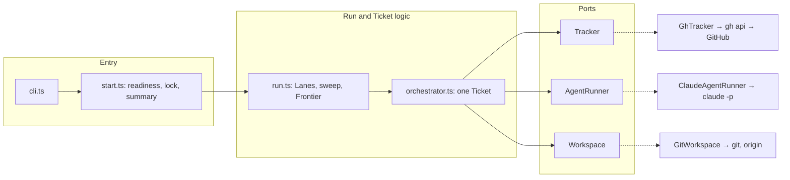
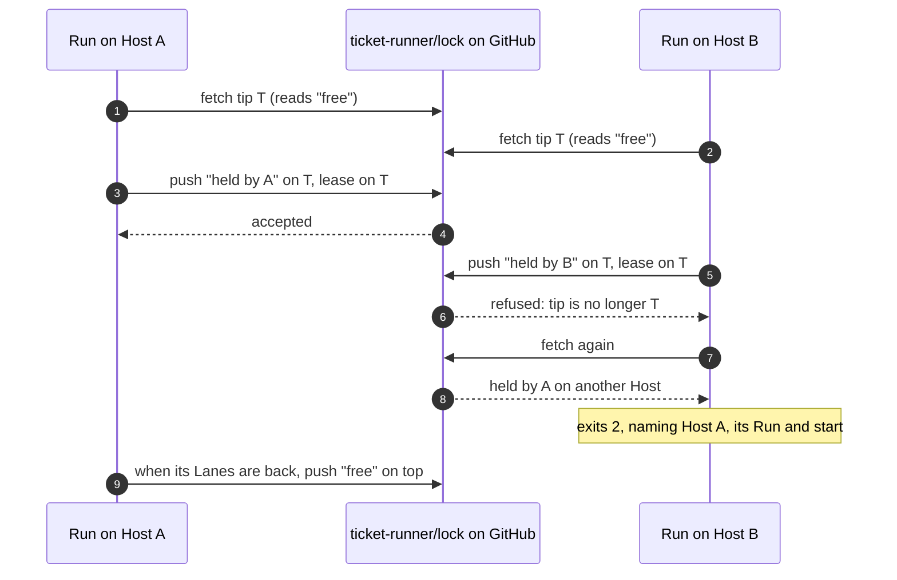

# Internals

The pipeline touches three things outside itself: GitHub, Claude and git. Each is reached through a port, an interface the orchestrator depends on, so the whole unattended flow can be tested in memory, with no subscription spent and nothing written to GitHub. The adapters behind the ports are kept thin. They build arguments and parse output; decisions live in the modules above them.

This page is for anyone curious how the pipeline works inside, and links the modules it names. To use the pipeline, start at [Install and remove](./installation.md).

## At a glance

| Port | The effect it isolates | Adapter · fake for tests |
|---|---|---|
| `Tracker` | GitHub: issues, labels, comments, pull requests, CI, merges | `GhTracker` · `FakeTracker` |
| `AgentRunner` | Claude: one Stage session | `ClaudeAgentRunner` · `FakeAgentRunner` |
| `Workspace` | git: worktrees, Checks, rebase, push, the State and the Run lock | `GitWorkspace` · `FakeWorkspace` |


<!-- Sources: src/cli.ts, src/start.ts, src/run.ts, src/orchestrator.ts, src/ports/tracker.ts, src/ports/agent-runner.ts, src/ports/workspace.ts -->

The CLI is the only place that constructs adapters. Everything under `start.ts` receives them as interfaces.

## The adapters

### `GhTracker`

[`GhTracker`](https://github.com/jjongs2/ticket-runner/blob/main/src/adapters/gh-tracker.ts) makes every GitHub call, through `gh api`.

- It speaks REST on every Host, because a cloud Host refuses GraphQL outright.
- The one exception is moving a pull request into or out of draft, which REST cannot do. A workstation uses the GraphQL mutation; a cloud Host uses the proxy's `/pulls/{n}/ccr/convert_to_draft` and `/ready_for_review` routes.
- It polls CI every 15 seconds.

### `ClaudeAgentRunner`

[`ClaudeAgentRunner`](https://github.com/jjongs2/ticket-runner/blob/main/src/adapters/claude-agent-runner.ts) runs one Stage as one child process, with `--json-schema` only where the Stage answers one:

```text
claude --print <prompt> --output-format stream-json --verbose \
  --permission-prompts none --permission-mode … \
  --strict-mcp-config \
  --disallowedTools CronCreate CronDelete RemoteTrigger PushNotification ScheduleWakeup Workflow \
  --model … --effort … --max-turns … [--json-schema …]
```

- `--strict-mcp-config` leaves the session no MCP server, the claude.ai connectors of the Host user's account included. `--disallowedTools` takes away the tools that act beyond the worktree and the session.
- It sets the child's environment:

  | Variable | Value | Why |
  |---|---|---|
  | `ANTHROPIC_API_KEY` | removed, unless the Run was started with `--api-key` | under `-p` a key outranks the Claude login without asking, so a stray one would be billed |
  | `TICKET_RUNNER_STAGE` | the Stage | the [Stage mark](https://github.com/jjongs2/ticket-runner/blob/main/GLOSSARY.md), which makes the CLI refuse inside a Stage |
  | `TICKET_RUNNER_SESSION` | a UUID per Stage session | the Session mark the [kill at `maxMinutes`](#smaller-adapters) looks for |
  | `CLAUDE_CODE_DISABLE_AUTO_MEMORY` | `1` | the Host user's memory is about their projects, not the Target |
  | `CLAUDE_CODE_SHELL` | `/bin/bash`, only where it exists | a zsh shell aborts a command on a glob that matches nothing |
  `ANTHROPIC_AUTH_TOKEN` and every other variable are inherited as they are.
- It writes the [Stage's files](./running.md#logs-and-transcripts) from the moment the Stage starts, never with the key's value in them: command files reach the Target's remote with a Hand-off.
- It reads the `apiKeySource` of the session's `system/init` event, which the orchestrator sets against the Run's credential.
- It kills the child at `maxMinutes`, with everything it started, and classifies a failure as `rate-limited`, `api-error`, `out-of-budget`, `timed-out`, `turn-capped`, `nonzero-exit` or `invalid-result`. A session that succeeds is never any of the first three, and they are read off a failed one like this:

  | Failure | Read off |
  |---|---|
  | `out-of-budget` | `api_error_status: 400` with a message naming `credit balance is too low` or `workspace API usage limits`; the spend limit's message also names a usage limit, but it is the budget |
  | `rate-limited` | `api_error_status: 429`, a `rate_limit_event` whose status is `rejected` (a warning-only one is not a stop), or, read last because its wording has changed before, `usage limit`, `session limit`, `rate limit` or `rate_limit` in the result or stderr |
  | `api-error` | `terminal_reason: "api_error"` with a 5xx `api_error_status` or none |

### `GitWorkspace`

[`GitWorkspace`](https://github.com/jjongs2/ticket-runner/blob/main/src/adapters/git-workspace.ts) keeps the worktrees under `.worktrees/`, a Ticket's and the detached one at a merge-base a failing Check runs again in, runs the Checks, rebases and pushes, and keeps the `ticket-runner/state` and `ticket-runner/lock` branches ([Hand-offs, stopping and resuming](./stopping-and-resuming.md)).

- Commands in the main checkout run one at a time, because git fails on a held ref or index lock rather than waiting. Commands inside a worktree stay parallel.
- The state branch is rewritten as one snapshot commit with no parent, built from git objects and a scratch index so the main checkout's tree is never touched. It is pushed unsigned, with `--no-verify` and `--force-with-lease` on the tip it read, and an edit a newer snapshot beat is reapplied, up to three tries. Within one Run, changes take turns, so two Lanes never push snapshots that each miss the other's Ticket.
- The lock is taken by compare-and-swap: each take and release is a commit on the tip it read, pushed with a lease on that tip.


<!-- Sources: src/adapters/git-workspace.ts, src/lock.ts, src/start.ts -->

### Smaller adapters

- [`exec.ts`](https://github.com/jjongs2/ticket-runner/blob/main/src/adapters/exec.ts) spawns a child with a timeout and streaming sinks. It reports `timedOut` separately, because a command may exit 124 on its own.
- [`process-tree.ts`](https://github.com/jjongs2/ticket-runner/blob/main/src/adapters/process-tree.ts) kills a command at its time limit together with its descendants and the process groups they lead: SIGTERM, then SIGKILL after 5 seconds. The command's own group would not do, since a Stage shares the Run's ([ADR-0006](#adr-0006)) and Claude Code runs each Bash command in a session of its own. A background process whose shell has exited descends from nothing the Stage holds, so the kill also takes every process carrying the Stage's Session mark.
- [`repo-root.ts`](https://github.com/jjongs2/ticket-runner/blob/main/src/adapters/repo-root.ts) finds the main checkout, even from inside a worktree, so the lock, `.worktrees/` and the logs land in one place per clone.
- [`version.ts`](https://github.com/jjongs2/ticket-runner/blob/main/src/adapters/version.ts) reads which [Version](#versions) this copy is.

## A map of `src/`

Tests sit beside each module as `*.test.ts`.

**Entry**

| Module | One line |
|---|---|
| [`cli.ts`](https://github.com/jjongs2/ticket-runner/blob/main/src/cli.ts) | reads the Version, dispatches `init`, `run`, `stop`, `remove`, `-v`; builds the adapters |
| [`command-line.ts`](https://github.com/jjongs2/ticket-runner/blob/main/src/command-line.ts) | parses arguments and holds the usage text, before anything is looked at |
| [`stage-guard.ts`](https://github.com/jjongs2/ticket-runner/blob/main/src/stage-guard.ts) | refuses every command inside a Stage's shell (the Stage mark) |
| [`start.ts`](https://github.com/jjongs2/ticket-runner/blob/main/src/start.ts) | refusals, the Run lock, the Stop listener, the summary and the exit code |
| [`startup.ts`](https://github.com/jjongs2/ticket-runner/blob/main/src/startup.ts) | refuses a Run with nothing to gate a merge; warns about gates turned off |

**Run and Ticket**

| Module | One line |
|---|---|
| [`run.ts`](https://github.com/jjongs2/ticket-runner/blob/main/src/run.ts) | fills Lanes from the Stranded Tickets, then the Frontier; stops claiming on a Release or Stop |
| [`orchestrator.ts`](https://github.com/jjongs2/ticket-runner/blob/main/src/orchestrator.ts) | one Ticket from guards to merge, Hand-off or Release, with the Fix budget |
| [`frontier.ts`](https://github.com/jjongs2/ticket-runner/blob/main/src/frontier.ts) | splits candidates into the Frontier and the blocked |
| [`guards.ts`](https://github.com/jjongs2/ticket-runner/blob/main/src/guards.ts) | why a candidate is skipped: the Guards and the refusals |
| [`landing.ts`](https://github.com/jjongs2/ticket-runner/blob/main/src/landing.ts) | the Landing: one Lane between rebase and pull at a time, in arrival order |
| [`lifecycle.ts`](https://github.com/jjongs2/ticket-runner/blob/main/src/lifecycle.ts) | where a Ticket failed, and which failures a fix Stage may mend |
| [`failing-base.ts`](https://github.com/jjongs2/ticket-runner/blob/main/src/failing-base.ts) | runs a failing Check at the merge-base, once per Run per commit, and its Note once |
| [`base-branch.ts`](https://github.com/jjongs2/ticket-runner/blob/main/src/base-branch.ts) | resolves the Base branch once per Run |
| [`branch.ts`](https://github.com/jjongs2/ticket-runner/blob/main/src/branch.ts) | `agent/<n>-<slug>`, `.worktrees/ticket-<n>` and `.worktrees/base-<commit>` |
| [`stranded.ts`](https://github.com/jjongs2/ticket-runner/blob/main/src/stranded.ts) | the sweep for Stranded Tickets |
| [`resume.ts`](https://github.com/jjongs2/ticket-runner/blob/main/src/resume.ts) | the State file's shape and name |
| [`handoff.ts`](https://github.com/jjongs2/ticket-runner/blob/main/src/handoff.ts) | marks old hand-off comments as history when a Ticket is taken again |
| [`stop.ts`](https://github.com/jjongs2/ticket-runner/blob/main/src/stop.ts) | `ticket-runner stop`, and the Run's end of SIGTERM |
| [`lock.ts`](https://github.com/jjongs2/ticket-runner/blob/main/src/lock.ts) | what the Run lock file says, and whether its holder is alive |
| [`host.ts`](https://github.com/jjongs2/ticket-runner/blob/main/src/host.ts) | workstation or cloud, and which one |
| [`credential.ts`](https://github.com/jjongs2/ticket-runner/blob/main/src/credential.ts) | the subscription or the API key, what each Stage should report, and when `--api-key` is refused |

**What Stages are told and what they answer**

| Module | One line |
|---|---|
| [`prompts.ts`](https://github.com/jjongs2/ticket-runner/blob/main/src/prompts.ts) | each Stage's prompt, which expands `/mattpocock-skills:<skill>` |
| [`self-hosting.ts`](https://github.com/jjongs2/ticket-runner/blob/main/src/self-hosting.ts) | whether the Target is the pipeline's own repository, which decides what a Stage is told about its checkout |
| [`verdict.ts`](https://github.com/jjongs2/ticket-runner/blob/main/src/verdict.ts) | the Verdict schema and whether it passes |
| [`title.ts`](https://github.com/jjongs2/ticket-runner/blob/main/src/title.ts) | the pull request title from the Stages' answers, then the commits, then the Ticket |
| [`note-schema.ts`](https://github.com/jjongs2/ticket-runner/blob/main/src/note-schema.ts), [`notes.ts`](https://github.com/jjongs2/ticket-runner/blob/main/src/notes.ts) | Notes: how a Stage declares them and where they are routed |
| [`acceptance-criteria.ts`](https://github.com/jjongs2/ticket-runner/blob/main/src/acceptance-criteria.ts), [`criteria.ts`](https://github.com/jjongs2/ticket-runner/blob/main/src/criteria.ts) | what a criterion looks like; ticking the `met` ones after a merge |
| [`progress.ts`](https://github.com/jjongs2/ticket-runner/blob/main/src/progress.ts) | the one Progress comment per Ticket, edited in place |
| [`templates.ts`](https://github.com/jjongs2/ticket-runner/blob/main/src/templates.ts) | every shape written to GitHub, and the Run summary; `docs/templates/` is the source of truth |
| [`log-tail.ts`](https://github.com/jjongs2/ticket-runner/blob/main/src/log-tail.ts) | the end of a log, under 40 lines and 4,000 characters, that a CI excerpt and a failing Base branch's Note both quote |
| [`run-log.ts`](https://github.com/jjongs2/ticket-runner/blob/main/src/run-log.ts) | `.ticket-runner/runs/<runId>/` and what a Hand-off keeps of it |

**Target setup**

| Module | One line |
|---|---|
| [`init.ts`](https://github.com/jjongs2/ticket-runner/blob/main/src/init.ts) | `ticket-runner init`: writes, sets up GitHub, reports the rest |
| [`readiness.ts`](https://github.com/jjongs2/ticket-runner/blob/main/src/readiness.ts) | Target readiness, which `init` provides and `run` checks |
| [`conventions.ts`](https://github.com/jjongs2/ticket-runner/blob/main/src/conventions.ts) | the conventions document's text and its Version mark |
| [`operator-skill.ts`](https://github.com/jjongs2/ticket-runner/blob/main/src/operator-skill.ts) | the Operator's skill `init` writes into a Target |
| [`labels.ts`](https://github.com/jjongs2/ticket-runner/blob/main/src/labels.ts) | the six triage labels and their colours |
| [`config.ts`](https://github.com/jjongs2/ticket-runner/blob/main/src/config.ts) | `ticket-runner.json`: schema and defaults |
| [`remove.ts`](https://github.com/jjongs2/ticket-runner/blob/main/src/remove.ts) | `ticket-runner remove` |

**Versions**

| Module | One line |
|---|---|
| [`version-number.ts`](https://github.com/jjongs2/ticket-runner/blob/main/src/version-number.ts) | number comparison, shared by every Version question |
| [`staleness.ts`](https://github.com/jjongs2/ticket-runner/blob/main/src/staleness.ts) | the newer-Version line and the conventions-document warning |
| [`version-pr.ts`](https://github.com/jjongs2/ticket-runner/blob/main/src/version-pr.ts) | what a Version PR must get right; the notes a Release publishes |

**Tests only**: [`testing/`](https://github.com/jjongs2/ticket-runner/blob/main/src/testing/fakes.ts) holds the in-memory fakes of the three ports that the tests reach the orchestrator through; how each layer is tested is in [`CONTRIBUTING.md`](https://github.com/jjongs2/ticket-runner/blob/main/CONTRIBUTING.md#code).

## Versions

A [Version](https://github.com/jjongs2/ticket-runner/blob/main/GLOSSARY.md) is a number that `main` carries as a tag `v<x.y.z>`, published to npm and with a GitHub Release. An installed copy reports it. Machines install a Version, never `main`, so two machines that report `0.5.2` run the same code ([ADR-0007](https://github.com/jjongs2/ticket-runner/blob/main/docs/adr/0007-a-version-is-cut-by-a-human-and-installs-follow-tags.md)).

A human cuts one by merging a Version PR, which [`/cut-a-version`](https://github.com/jjongs2/ticket-runner/blob/main/.claude/skills/cut-a-version/SKILL.md) drafts; the steps and the checks on it are in [`CONTRIBUTING.md`](https://github.com/jjongs2/ticket-runner/blob/main/CONTRIBUTING.md#versions).

### The stamp

The Version is resolved once, in the CLI, and handed down. Every stamp one Run writes is therefore the same string.

| `-v` prints | When |
|---|---|
| `0.5.2` | an installed copy: the number is the whole of it |
| `0.5.2+331d79c` | a development checkout, clean |
| `0.5.2+331d79c.dirty` | a development checkout with uncommitted changes |
| `unknown` | no readable `package.json` |

The same string is stamped on:

| Where | So that |
|---|---|
| the Run summary's header, the `init` report's first line | a terminal says which pipeline ran |
| each Run's section of a Progress comment | the board says which pipeline wrote it |
| each State file's `version` | an unreadable file can still name what wrote it |
| `version.txt` in the Run's directory | a transcript sits beside the pipeline that wrote it |
| the conventions document's first line (the number only) | `init` and a Run can tell which side is behind |
| the refusal of a config key the install does not know | a stale install is told apart from a wrong config |

### The newer-Version check

A Run and `init` each look up the highest published Version of the pipeline's own repository. They read it from `package.json`'s `repository` field, so a fork asks about itself. The lookup reads GitHub Releases rather than tags, skipping drafts and prereleases. The tag workflow makes a Release only once npm has the Version, so a Release names one the upgrade can install. Only numbers are compared, so a checkout running past the latest Version is not stale.

What it prints is on [Install](./installation.md#install).

## The ADRs in brief

The full records are in [`docs/adr/`](https://github.com/jjongs2/ticket-runner/tree/main/docs/adr). Several have amendments; this is where they stand now.

### [ADR-0001: Humans plan, the pipeline executes](https://github.com/jjongs2/ticket-runner/blob/main/docs/adr/0001-humans-plan-the-pipeline-executes.md) {#adr-0001}

- **Decision**: Humans plan; only Execution is unattended.
- **Why**: A wrong answer to a grilling question hardens into a Spec, Tickets and merged code with no gate left.
- **Cost**: Planning quality is a human's job; the pipeline only guards against known defects.

### [ADR-0002: One `claude -p` child process per Stage](https://github.com/jjongs2/ticket-runner/blob/main/docs/adr/0002-claude-p-child-process-per-stage.md) {#adr-0002}

- **Decision**: Each Stage is its own `claude -p` child process.
- **Why**: Only headless mode expands a user-invoked `/plugin:skill`. A process also gives per-Stage limits, `--json-schema`, and a command line to replay.
- **Cost**: One to two seconds of startup per Stage. No shared context, so each Stage reads the Ticket and the branch.

### [ADR-0003: Trust only GitHub-native issue relations](https://github.com/jjongs2/ticket-runner/blob/main/docs/adr/0003-github-native-relations-only.md) {#adr-0003}

- **Decision**: Only GitHub-native blockers and sub-issues count.
- **Why**: Two sources of truth would let a stale body silently block or unblock work.
- **Cost**: Humans must create the native edges; blockers named only in a body are skipped with a warning.

### [ADR-0004: Resume state lives on the Target's remote, not in a tracker comment](https://github.com/jjongs2/ticket-runner/blob/main/docs/adr/0004-resume-state-lives-on-the-targets-remote.md) {#adr-0004}

- **Decision**: Resume state is a State file kept off the board, now on the Target's remote. A Hand-off keeps it too.
- **Why**: The board is for humans. A cloud Host is discarded, so the state must outlive it. A relabel should resume a Ticket.
- **Cost**: No migration of old local State; the State branch goes through `Workspace`.

### [ADR-0005: Landing is a serialized section, not a merge queue](https://github.com/jjongs2/ticket-runner/blob/main/docs/adr/0005-landing-is-a-serialized-section.md) {#adr-0005}

- **Decision**: The Landing is a section one Lane is in at a time, not a merge queue.
- **Why**: What CI graded is exactly what lands, without paying for CI twice. GitHub's merge queue would have made a repository setting part of Target readiness.
- **Cost**: One slow CI or Conflict Stage holds every other Lane's Landing.

### [ADR-0006: Stop is a signal, and Ctrl+C stays a kill](https://github.com/jjongs2/ticket-runner/blob/main/docs/adr/0006-stop-is-a-signal-and-ctrl-c-is-a-kill.md) {#adr-0006}

- **Decision**: A Stop is SIGTERM and nothing else, sent only from the Run's own Host; Ctrl+C stays a kill.
- **Why**: A signal arrives at once and leaves nothing to clean up. The Stages share the Run's process group, so Ctrl+C reaches every `claude` session too, and making it graceful would mean detaching the Stages into their own group.
- **Cost**: A Stop cannot be taken back, and a Run on another Host cannot be stopped from here.

### [ADR-0007: A Version is cut by a human, and installs follow tags](https://github.com/jjongs2/ticket-runner/blob/main/docs/adr/0007-a-version-is-cut-by-a-human-and-installs-follow-tags.md) {#adr-0007}

- **Decision**: A human cuts a Version by merging a Version PR; the tag workflow publishes it to npm, and installs come from there. The GitHub tag range keeps working.
- **Why**: When to cut is a Planning decision. A number is only a useful stamp if two machines with it run the same code.
- **Cost**: Version notes are written by hand, with an agent's help.

### [ADR-0008: A cloud Host is a Claude Code cloud session, and the Run lock lives on GitHub](https://github.com/jjongs2/ticket-runner/blob/main/docs/adr/0008-a-cloud-host-is-a-claude-code-cloud-session.md) {#adr-0008}

- **Decision**: A cloud Host is a Claude Code cloud session with an Operator; the Run lock lives on GitHub.
- **Why**: No Actions minutes, and a Run steered from the app. Every Host must see the lock. A lease that expires unless renewed was rejected: a live Run would lose its Target to one missed heartbeat.
- **Cost**: REST only. Nothing on the remote may depend on deleting a ref. A lock from a vanished Host needs a human to release it.

## Working on the pipeline itself

To change the pipeline, run it from a checkout. `bin/ticket-runner.js` loads the TypeScript through `tsx`, so there is no build step:

```bash
git clone https://github.com/jjongs2/ticket-runner && cd ticket-runner
npm install
npm run ticket-runner -- run         # drain this repository's Frontier
npm run ticket-runner -- run 3 7     # a Run narrowed to #3 and #7
npm test                             # vitest
npm run typecheck                    # tsc --noEmit
```

A checkout reports its commit beside the number (see [the stamp](#the-stamp)). CI runs `npm run typecheck` and `npm test` on every pull request, and the Version PR check beside them.

This repository is a Target of its own pipeline. Its conventions are in [`CONTRIBUTING.md`](https://github.com/jjongs2/ticket-runner/blob/main/CONTRIBUTING.md).

## Related pages

- [Hand-offs, stopping and resuming](./stopping-and-resuming.md): the State branch and the Run lock that `GitWorkspace` keeps
- [From Ticket to merge](./ticket-to-merge.md): the lifecycle `orchestrator.ts` drives
- [Running](./running.md): the commands `cli.ts` dispatches, and `-v`
- [Installation](./installation.md): installing a Version, `init`, and `remove`

## References

- [`src/ports/`](https://github.com/jjongs2/ticket-runner/tree/main/src/ports), [`src/adapters/`](https://github.com/jjongs2/ticket-runner/tree/main/src/adapters), [`src/testing/`](https://github.com/jjongs2/ticket-runner/tree/main/src/testing)
- [`src/cli.ts`](https://github.com/jjongs2/ticket-runner/blob/main/src/cli.ts), [`src/start.ts`](https://github.com/jjongs2/ticket-runner/blob/main/src/start.ts), [`src/run.ts`](https://github.com/jjongs2/ticket-runner/blob/main/src/run.ts), [`src/orchestrator.ts`](https://github.com/jjongs2/ticket-runner/blob/main/src/orchestrator.ts)
- [`src/adapters/version.ts`](https://github.com/jjongs2/ticket-runner/blob/main/src/adapters/version.ts), [`src/version-number.ts`](https://github.com/jjongs2/ticket-runner/blob/main/src/version-number.ts), [`src/version-pr.ts`](https://github.com/jjongs2/ticket-runner/blob/main/src/version-pr.ts), [`src/staleness.ts`](https://github.com/jjongs2/ticket-runner/blob/main/src/staleness.ts)
- [`scripts/version.ts`](https://github.com/jjongs2/ticket-runner/blob/main/scripts/version.ts), [`.github/workflows/`](https://github.com/jjongs2/ticket-runner/tree/main/.github/workflows)
- [`CONTRIBUTING.md`](https://github.com/jjongs2/ticket-runner/blob/main/CONTRIBUTING.md), [`CHANGELOG.md`](https://github.com/jjongs2/ticket-runner/blob/main/CHANGELOG.md)
- [ADR-0001](https://github.com/jjongs2/ticket-runner/blob/main/docs/adr/0001-humans-plan-the-pipeline-executes.md) to [ADR-0008](https://github.com/jjongs2/ticket-runner/blob/main/docs/adr/0008-a-cloud-host-is-a-claude-code-cloud-session.md)
