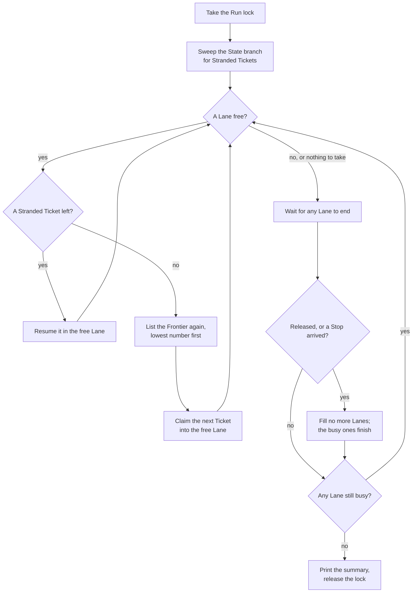

# Running

A [Run](https://github.com/jjongs2/ticket-runner/blob/main/GLOSSARY.md) exists so you can start one command and walk away. It takes every Ticket that is ready, carries each to a merge or to a human, and ends on its own when nothing it may take is left. Everything you might want to know afterwards is in its summary, on the board, and in the transcripts it leaves on disk.

| Command | What it does | Exit codes |
|---|---|---|
| `ticket-runner run` | Drains the Frontier | `0` · `1` a Hand-off · `2` nothing taken |
| `ticket-runner run 3 7` | The same Run, narrowed to #3 and #7 | as above |
| `ticket-runner run --lanes 2` | The same Run, two Tickets at once | as above |
| `ticket-runner run --api-key` | The same Run, billed to the `ANTHROPIC_API_KEY` your shell exports | as above |
| `ticket-runner stop` | Asks the Run in this Target to finish what it holds and take no more | `0` sent · `2` nobody to send it to |
| `ticket-runner -v` | Prints which Version this is | `0` |
| `ticket-runner -h` | Prints the usage | `0` (`2` when no command is given) |

`init` and `remove` are on [Install and remove](./installation.md). An unknown command or option, or a bad argument, is refused with the usage and exit code `2`.

## `/implement-spec` or a Run

The plugin's `/implement-spec` also carries a Spec's Tickets to code. It runs in your own session and a Run runs unattended, and the other differences follow from that:

| | `/implement-spec` | A Run |
|---|---|---|
| Who watches | You, in your own session, free to steer it | Nobody; you read the summary and the board afterwards |
| Unit of work | A whole Spec, in one session | A Ticket, with its own branch and pull request |
| Gates | The skill's own steps, then your review | The Checks, the verify Stage and CI, for every Ticket |
| How it ends | When the session is done, with the Spec's work waiting for your review | With each Ticket merged into the Base branch or handed to a human |
| Resuming | Nothing on the board records how far it got, so what is left is yours to work out | A [Stranded Ticket](./stopping-and-resuming.md) resumes in the next Run, on any Host |
| Mark on the board | None while it works | `in-progress` and an assignee while a Run holds a Ticket |

The two do not share a Spec: take `ready-for-agent` off its Tickets before you run `/implement-spec` on it ([Labels](./planning.md#labels)). What the skill does step by step, when it opens a pull request and its known rough edges are on its [upstream page](https://www.aihero.dev/skills-implement-spec).

## `run`

`run` drains the [Frontier](https://github.com/jjongs2/ticket-runner/blob/main/GLOSSARY.md): the open Tickets labelled `ready-for-agent` that nobody is assigned to and whose native blockers have all closed ([Planning](./planning.md)). Before it takes anything it can be [refused](#refused-before-it-starts), with exit code `2` and nothing left behind.

It then takes Tickets through its [Lanes](https://github.com/jjongs2/ticket-runner/blob/main/GLOSSARY.md), one Ticket per Lane, one Lane by default:


<!-- Sources: src/run.ts, src/start.ts, src/stranded.ts, src/frontier.ts -->

- **A Ticket that fails is handed off** and its Lane takes the next one; one bad Ticket does not cost the rest of the night.
- **A [Release](./stopping-and-resuming.md#release-on-a-rate-limit) stops the filling**: the busy Lanes finish, and the next Run is yours or an Operator's to start.
- **The Run ends** when no Lane is busy and nothing is left to take: the Frontier is empty, or everything on it is blocked.

What happens to each Ticket inside a Lane is on [From Ticket to merge](./ticket-to-merge.md). Stranded Tickets and Releases are on [Hand-offs, stopping and resuming](./stopping-and-resuming.md).

### `--lanes`

`--lanes <n>` gives this one Run `n` Lanes, over whatever [`lanes`](./configuration.md#lanes) in `ticket-runner.json` says, which is also where to read what more Lanes speed up and when to keep one. It may go before or after Ticket numbers.

### `--api-key`

Every Stage is a `claude -p` session. Under `-p` an `ANTHROPIC_API_KEY` outranks your Claude login without asking, so a Run starts each Stage without that key, whatever your shell exports, and the Stages run on your plan. `ANTHROPIC_AUTH_TOKEN` is passed on as it is, for a gateway or proxy.

`--api-key` bills every Stage of this one Run to the `ANTHROPIC_API_KEY` your shell exports instead. It is how the monthly API credits of a Max or Team plan are spent: they cover `claude -p` only on a key. It is refused before the lock where no key is exported and on a cloud Host ([Refused before it starts](#refused-before-it-starts)). A Run the plan's limit stops does not switch to the key by itself.

| On an `--api-key` Run | What happens |
|---|---|
| The key's organization is out of credit, or its workspace reached its spend limit | The Ticket is released, and the Run ends `Out of API budget.` |
| A 429 | Released as the API's rate limit, not the plan's: `API rate limit` |

The pipeline keeps no budget of its own. Give the key a workspace of its own in the Console, with a spend limit. The limit is not exact: a Run can spend past it before the API refuses, further with several Lanes at once.

### A narrowed Run

`ticket-runner run 12 13 14` is the same Run in every way (its Lanes, the Landing, the Run lock, a Release, a Stop) except that it takes only #12, #13 and #14, from the Stranded Tickets and the Frontier alike. Every other Ticket is left exactly as it was, stranded ones included.

- The numbers say which Tickets, not the order: stranded ones first, then the rest lowest number first.
- Blockers still hold. A named Ticket blocked by another named Ticket is taken once that one merges in the same Run.

Every named Ticket the Run did not take gets a `skipped` row saying why. Only a Guard's reason is also commented on the issue.

| Row | Meaning |
|---|---|
| `blocked` | An open blocker still held it back when the Run ended |
| `claimed` | Somebody else is assigned to it |
| `not-ready` | It is not labelled `ready-for-agent`, or it has closed |
| `no-issue` | No issue has that number |
| `pull-request` | The number is a pull request |
| `spec`, `no-criteria`, `body-only-blockers` | A [Guard](./planning.md#guards) refused it |

A named Ticket that a Stop or a Release kept the Run from reaching has no row; the last line of the summary says why the Run stopped.

## `stop`

```bash
ticket-runner stop
```

A Stop asks the Run to finish the Tickets its Lanes hold, to merge or Hand-off, and take no more. `stop` reads the Run lock from GitHub, sends SIGTERM to the process it names, and says which Run it asked:

```text
`ticket-runner run` (run 2026-09-17T09-00-00-000, pid 4321) will stop once the Tickets it holds are finished. It claims no more.
Ctrl+C in that Run's own terminal stops it at once instead, at the cost of killing the Stages it is running and leaving their Tickets stranded for the next Run.
```

It needs nothing of the Target but the lock: no config, no `gh` login, no readiness.

| Finds | Prints | Exit |
|---|---|---|
| a Run on this Host | the two lines above | `0` |
| nobody holds the lock, or its Run on this Host is gone | `No Run to stop: …`. A dead lock is left for the next Run to take over. | `2` |
| a Run on another Host, which only that Host can signal | names the Host, the Run and its start; `Nothing was sent.` | `2` |
| the signal could not be delivered | `Could not ask … to stop: <reason>` | `2` |

A second `stop` prints the same, and the Run ignores the second signal. What a Stop and a kill each leave behind: [Stop and kill](./stopping-and-resuming.md#stop-and-kill).

## `-v`

`-v`, or `--version`, prints which Version this is, such as `0.5.2`. The same string is stamped on everything a Run writes ([The stamp](./internals.md#the-stamp)).

## Refused before it starts

| Situation | What you see |
|---|---|
| Another Run holds the Target, on this Host | ``Another ticket-runner is running on this Host: `ticket-runner run` as run … Wait for it to finish, or ask it to with `ticket-runner stop`.`` |
| Another Run holds the Target, on another Host | The Host, the Run and when it started, and how to release the lock if that Run is gone |
| The shell belongs to a Stage | ``Refusing to start: TICKET_RUNNER_STAGE is set to `implement`, …`` |
| `--api-key` with no key exported | `` `--api-key` runs every Stage on the `ANTHROPIC_API_KEY` this shell exports, and it exports none. … `` |
| `--api-key` on a cloud Host | `` `--api-key` needs a workstation Host: a cloud session runs every Stage on the subscription, … `` |
| The Target is not set up, still holds local State files, or has no Check | See [Target readiness](./installation.md#target-readiness-what-run-refuses) |

One Run at a time per Target, whichever Host it is on. [The Run lock](./stopping-and-resuming.md#the-run-lock) says when a lock is taken over by itself and how to release one another Host left.

## The summary

When a Run ends it prints one row per Ticket, in the order the Tickets ended, then one line saying why it stopped:

```text
ticket-runner 0.5.2 run 2026-09-17T09-00-00-000 · 84m · subscription

  merged   #4 Planning guards (PR #12)
  noted    #8 comment · from #4 implement · the CLI help drifts
  handed   #5 Fix Stage with a single retry · verify · 1 unmet
  skipped  #7 no-criteria
  skipped  #9 blocked

Frontier blocked.
```

The header ends with what the Stages were billed to: `subscription`, or `API key` on an `--api-key` Run. A Run that took nothing prints `  nothing to do` in place of the rows.

| Row | Meaning |
|---|---|
| `merged` | Merged; the pull request is named |
| `handed` | Handed off to a human: the Stage it stopped at, and why |
| `released` | Released at the named Stage by the `rate limit` (`API rate limit` on an `--api-key` Run), an `API failure`, or `out of API budget`, or at `checks` or `ci` by a `failing Base branch`. Nobody has to do anything about the Ticket |
| `skipped` | Passed over, with the reason ([Guards](./planning.md#guards), or the table above) |
| `billed` | A Stage of the Ticket above that said, in its `apiKeySource`, it ran on another credential than the header's: an `apiKeyHelper` in the Host's settings, say, which no environment variable removes |
| `noted` | A [Note](https://github.com/jjongs2/ticket-runner/blob/main/GLOSSARY.md) the row above made, `from #<n> pipeline` when it is the pipeline's own about a failing Base branch, and where it went: `comment` on an issue already there, the Notes issue included, or `new` for the one Note that opened the Notes issue |

| Last line | Why the Run ended |
|---|---|
| `Frontier empty.` | Nothing left to take |
| `Frontier blocked.` | Everything left has an open blocker |
| `Rate limited · resets 2026-09-20 03:40 UTC.` | A Release by the rate limit stopped it. The time is the one the CLI gave for the limit's reset, in UTC; a Run it gave none ends `Rate limited.`. An `--api-key` Run says `API rate limited` |
| `API failure.` | A Release by a transient API failure stopped it, and the rate limit released no Ticket after it: the rate limit outranks an API failure on the last line |
| `Out of API budget.` | A Release by the key's credit or spend limit stopped it. It outranks the rate limit and an API failure, since only it needs you: look at the Console |
| ``Base branch `main` fails `npm test` at 1a2b3c4.`` | A Release over a failing Base branch stopped it: the Check, and the merge-base it failed at. Mend it on the Base branch; the Note on the standing Notes issue has its output |
| `Stopped at 22:07 · finishing #4 #9.` | A Stop arrived at that time (UTC), while those Tickets were in its Lanes |

A Run a Stop or a Release ended prints no `blocked` rows, since it never reached the end of the Frontier.

## Exit codes

| Code | `run` |
|---|---|
| `0` | Nothing was handed off. A Release counts as taken, and so does a Run given no numbers that skipped everything |
| `1` | At least one Ticket was handed off |
| `2` | Nothing was taken: the Run was refused, or it was given numbers and took none of them |

A stopped Run exits with its outcomes' code as usual. The codes of the other commands are in the table at the top of this page, and those of `init` and `remove` on [Install and remove](./installation.md).

## Logs and transcripts

The Run's own lines go to the terminal. It opens with `ticket-runner run <runId> · 1 lane`, adding the named Tickets for a narrowed Run, and every line about a Ticket starts with its number, so interleaved Lanes can be read one Ticket at a time. A Stage that ran on another credential than the Run's is named as it comes back: `#4 implement ran on apiKeySource apiKeyHelper, not the subscription (none)`. Warnings and refusals go to stderr.

Everything a Stage did goes to disk, under the Target's gitignored `.ticket-runner/`. The run id is the start time in UTC, such as `2026-09-17T09-00-00-000`.

| Path under `.ticket-runner/runs/<runId>/` | Holds |
|---|---|
| `version.txt` | The Version that ran, written before the first Stage |
| `<n>/<stage>.command` | The exact command line, environment included, to rerun the Stage by hand: `env -u ANTHROPIC_API_KEY …` for a Stage run without the key, `ANTHROPIC_API_KEY="$ANTHROPIC_API_KEY" …` for one run on it, never its value |
| `<n>/<stage>.stdout`, `<n>/<stage>.stderr` | Output as the Stage printed it, appended live |
| `<n>/<stage>.transcript.jsonl` | The session's stream-json events |
| `<n>/retry/` | The fix Stage and the pass it bought, so the failing pass's files survive beside them |

The command line is written before the Stage starts and output as it arrives, so a Run killed mid-Stage still leaves what it had reached. Wherever a Stage printed the `ANTHROPIC_API_KEY` your shell exports, its files say `<ANTHROPIC_API_KEY>` instead. A handed-off Ticket's command lines and transcripts are also kept on the Target's remote ([What stays where](./stopping-and-resuming.md#what-stays-where)).

## From the Claude app

On a workstation, a Run lasts only while the machine stays on: one that sleeps, reboots or is switched off stops the Frontier draining until you are back, and the Run can be watched or stopped only from the terminal that started it. A Run started from the Claude app has neither limit: open a Claude Code cloud session on the Target from the app and say "run it". The session's own Claude is the [Operator](https://github.com/jjongs2/ticket-runner/blob/main/GLOSSARY.md): it follows the skill `init` wrote into the Target, `.claude/skills/ticket-runner/SKILL.md`, because a cloud session carries nothing over but the repository ([ADR-0008](https://github.com/jjongs2/ticket-runner/blob/main/docs/adr/0008-a-cloud-host-is-a-claude-code-cloud-session.md)).

| You say | The Operator |
|---|---|
| "run it" | Readies the Host, then starts `ticket-runner run` in the background |
| "run 12 and 14" | Starts `ticket-runner run 12 14` |
| "three at once" | Passes `--lanes 3`, so the cloud can carry a different count from your workstation |
| "on my API key" | Passes `--api-key` only when you ask, and tells you such a Run needs a workstation: the cloud Host refuses it |
| "stop" | Runs `ticket-runner stop` and keeps reporting until the Run ends |
| "release the lock" | Commits a free `lock.json` to `ticket-runner/lock`, only when no Run of its own is running |

Readying the Host installs only what the cloud environment's setup script did not:

1. **The pipeline.** A copy the setup script installed is used as it is, whichever Version it is. Otherwise the Operator installs the Version stamped on the Target's conventions document; with no stamp, it installs nothing and asks you to run `init` from a workstation.
2. **The `mattpocock-skills` plugin**, from the official marketplace.
3. **`gh`**, from apt.
4. **The Target's own dependencies**, in the main checkout, where every worktree's Checks find them.

It reports each Ticket as the Run ends it, then the summary and what the exit code means.

A cloud Host differs from a workstation in a few ways the pipeline accounts for:

- **Nothing can be deleted on the remote.** That is why `init` switches on deleting a pull request's branch at merge, and why `remove` refuses to run on a cloud Host.
- **Every issue body, comment and pull request body gets a "Generated by Claude Code" line**, which the proxy appends and nobody can turn off. The squash commit is composed by the pipeline, so none of it reaches the base branch.
- **A reclaimed VM is a kill.** It leaves Stranded Tickets, which the next Run on any Host resumes, and a lock no other Host will presume dead: a human releases it, through an Operator or on GitHub.
- **Transcripts go with the VM**, except a handed-off Ticket's, which are kept on the State branch.
- **Stages always run on your plan.** A cloud session ignores `ANTHROPIC_API_KEY`, so `--api-key` is refused there rather than accepted and not honoured.

## Related pages

- [Planning the work](./planning.md): what puts a Ticket on the Frontier.
- [Configuration](./configuration.md): `lanes`, the Checks and the Stage limits a Run uses.
- [From Ticket to merge](./ticket-to-merge.md): what a Lane does with one Ticket.
- [Hand-offs, stopping and resuming](./stopping-and-resuming.md): Stop against kill, Releases, Stranded Tickets, the Run lock.
- [Install and remove](./installation.md): what a Run refuses before it starts.

## References

- [`src/cli.ts`](https://github.com/jjongs2/ticket-runner/blob/main/src/cli.ts), [`src/command-line.ts`](https://github.com/jjongs2/ticket-runner/blob/main/src/command-line.ts), [`src/start.ts`](https://github.com/jjongs2/ticket-runner/blob/main/src/start.ts), [`src/run.ts`](https://github.com/jjongs2/ticket-runner/blob/main/src/run.ts)
- [`src/credential.ts`](https://github.com/jjongs2/ticket-runner/blob/main/src/credential.ts), [`src/adapters/claude-agent-runner.ts`](https://github.com/jjongs2/ticket-runner/blob/main/src/adapters/claude-agent-runner.ts)
- [`src/stop.ts`](https://github.com/jjongs2/ticket-runner/blob/main/src/stop.ts), [`src/lock.ts`](https://github.com/jjongs2/ticket-runner/blob/main/src/lock.ts), [`src/stage-guard.ts`](https://github.com/jjongs2/ticket-runner/blob/main/src/stage-guard.ts), [`src/host.ts`](https://github.com/jjongs2/ticket-runner/blob/main/src/host.ts)
- [`src/templates.ts` · `runSummary`](https://github.com/jjongs2/ticket-runner/blob/main/src/templates.ts), [`src/run-log.ts`](https://github.com/jjongs2/ticket-runner/blob/main/src/run-log.ts), [`src/adapters/version.ts`](https://github.com/jjongs2/ticket-runner/blob/main/src/adapters/version.ts)
- [`docs/templates/run-summary.txt`](https://github.com/jjongs2/ticket-runner/blob/main/docs/templates/run-summary.txt), [`docs/templates/stop-report.txt`](https://github.com/jjongs2/ticket-runner/blob/main/docs/templates/stop-report.txt), [`docs/templates/operator-skill.md`](https://github.com/jjongs2/ticket-runner/blob/main/docs/templates/operator-skill.md)
- [ADR-0006](https://github.com/jjongs2/ticket-runner/blob/main/docs/adr/0006-stop-is-a-signal-and-ctrl-c-is-a-kill.md), [ADR-0007](https://github.com/jjongs2/ticket-runner/blob/main/docs/adr/0007-a-version-is-cut-by-a-human-and-installs-follow-tags.md), [ADR-0008](https://github.com/jjongs2/ticket-runner/blob/main/docs/adr/0008-a-cloud-host-is-a-claude-code-cloud-session.md)
