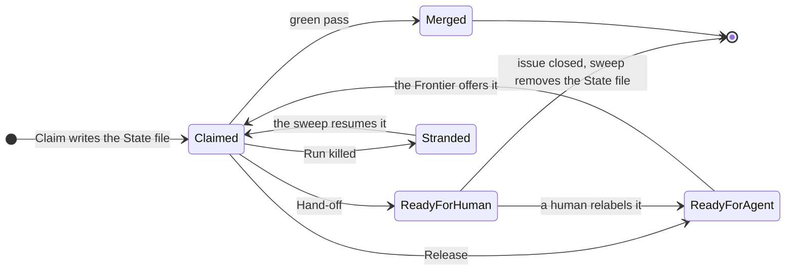
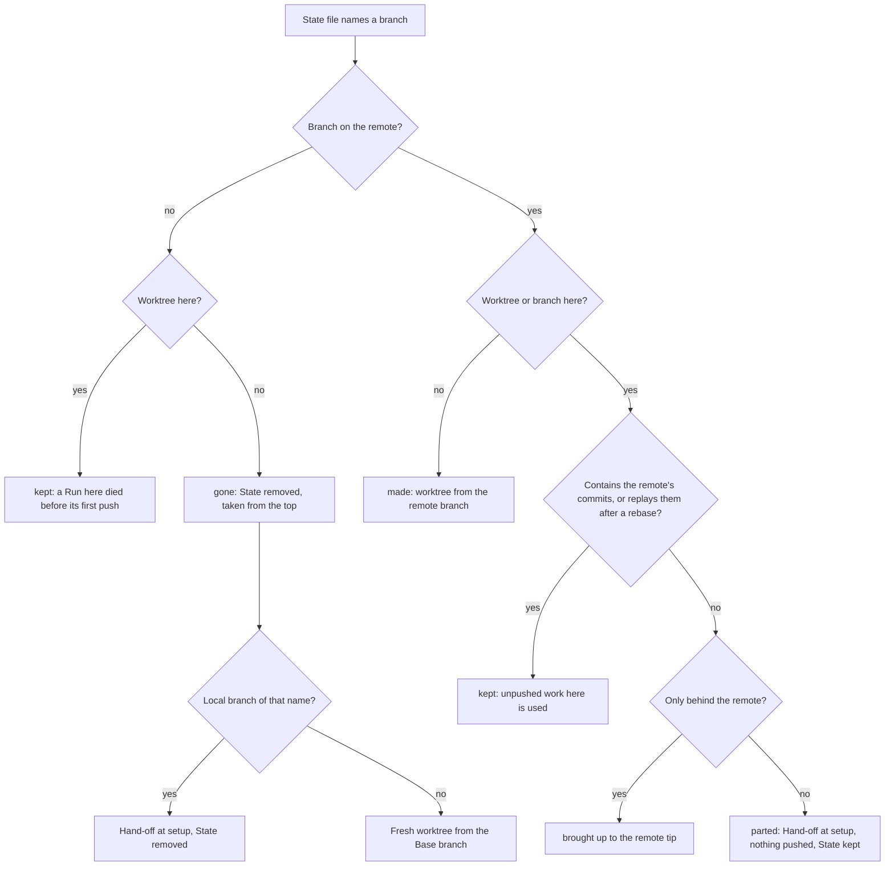

# Hand-offs, stopping and resuming

Nobody watches a Run, so it has to end well when something goes wrong: a Ticket it cannot finish, a subscription or an API key that runs out, a human who wants it to stop, a machine that disappears. Each of these leaves the Ticket where a later Run can pick it up, on this Host or another. That Run does not pay again for Stages already done, and no human has to unpick labels first.

## At a glance

| Ending | Caused by | Leaves behind |
|---|---|---|
| Merge | a green pass through every gate | a closed issue; branch and State file gone |
| [Hand-off](#hand-off) | a failure the Fix budget cannot cover | `ready-for-human`, a comment, a draft pull request; work and State kept |
| [Release](#release-on-a-rate-limit) | the subscription or API rate limit, a transient API failure, an [API key out of budget](#release-out-of-api-budget), or a [failing Base branch](#release-over-a-failing-base-branch) | `ready-for-agent`, no comment on the Ticket; work and State kept |
| [Stop](#stop-and-kill) | `ticket-runner stop` (SIGTERM) | nothing new |
| [Kill](#stop-and-kill) | Ctrl+C, SIGKILL, a vanished Host | the Claim; work as last pushed, and State |

After a merge or a Hand-off the Run refills the Lane. After a Release or a Stop it claims nothing more, and the busy Lanes finish what they hold. A kill ends it on the spot.

Each Ticket that is still unfinished then comes back by one road. The board decides which:


<!-- Sources: src/orchestrator.ts, src/stranded.ts, src/run.ts, src/resume.ts -->

## Hand-off

A [Hand-off](https://github.com/jjongs2/ticket-runner/blob/main/GLOSSARY.md) gives a Ticket to a human. It is how every ending goes that is neither a merge nor a Release: a second failure after the Fix budget is spent, a Stage that timed out, CI that never finished, a branch in the way at setup.

A Hand-off leaves you:

- a draft pull request of the branch's work, where there is work to push; a pull request already open goes back into draft
- the hand-off comment below, saying where the Ticket failed and why
- `ready-for-human` in place of `in-progress`, and no assignee
- each Stage's command line and transcript, kept under `ticket-<n>/<runId>/` on the `ticket-runner/state` branch

Its State file is kept, so a relabel resumes the Ticket ([Handing a Ticket back](#handing-a-ticket-back)), except where no Stage of this Run could have left work (below).

The comment follows [`docs/templates/handoff-comment.md`](https://github.com/jjongs2/ticket-runner/blob/main/docs/templates/handoff-comment.md):

```md
<!-- ticket-runner:handoff -->
**Handed off.** Failed at **verify**, after the fix budget was used.

- Failure: 1 of 6 criteria unmet
- Branch `agent/8-rate-limit-release` on the remote · worktree `/home/me/acme/.worktrees/ticket-8` · PR #31 (draft)
- Transcripts: `ticket-8/2026-09-17T09-00-00-000/` on the `ticket-runner/state` branch

<details><summary>Evidence</summary>
…
</details>
```

The Failure line says what stopped the Ticket. What it asks of you:

| Failure | What to change before handing it back |
|---|---|
| A Stage ran past its minute limit, or hit its turn limit | Raise that Stage's `maxMinutes` or `maxTurns` in [`stages`](./configuration.md#stages), or split the Ticket |
| implement left no commits | Read its transcript, then make the Ticket smaller or clearer |
| A Check, a criterion or CI still failing after the fix | Read the evidence in the comment, then mend the code by hand on the branch, or, for a criterion, rewrite it as the next row says |
| Criteria unmet after the fix, or no evidence | Mend the code by hand, or rewrite the criteria so a session can check them by running or reading code ([Acceptance Criteria](./planning.md#acceptance-criteria)) |
| CI timed out | Raise [`ciTimeoutMinutes`](./configuration.md#ci) |
| No checks | Add a CI workflow, raise `ciGraceMinutes` if checks register slowly, or turn [`gates.ci`](./configuration.md#gates) off |
| The pull request is conflicting | Nothing: the next Run rebases it again, and the Conflict Stage takes the conflict |
| The Base branch could not be pulled | Clear what is in the way in the main checkout ([Running](./running.md#run)) |
| The merge failed | Put right the repository setting GitHub's refusal names, such as a branch protection rule |
| A branch in the way, or copies that have parted | Run the command the Failure line names |
| Any other Stage failure, such as a non-zero exit or an answer its schema rejected | Read that Stage's transcript ([What stays where](#what-stays-where)) |

### When a Hand-off does less

A Hand-off at `setup` pushes nothing: there is either nothing to push, or what is in the way may be a human's work or another Host's.

| Case | Draft pull request | State file |
|---|---|---|
| Started fresh, with nothing to resume, and failed before its worktree existed | none: nothing to push | **removed**: nothing was branched |
| Started fresh, and a local branch of that name exists | none | **removed**: no Stage of this Run worked there |
| Resumed, this Host's branch has parted from the remote's | none opened; an open one goes to draft | kept: both copies are the pipeline's |
| Any failure after the worktree was ready | opened, or an open one back to draft | kept |

The comment names a worktree wherever there is one: this Run's, or the one the branch in the way is checked out in. The failure line says what to do, for example `delete it with git branch -D <branch> if the work on it is abandoned, or finish it by hand, then relabel the Ticket ready-for-agent`.

### What stays where

The Host a Ticket was worked on may be gone by the time a human looks, for example a cloud Host's VM. So everything a human or a later Run needs is on the Target's remote.

| What | Where | Lasts until |
|---|---|---|
| The Ticket's commits | branch `agent/<n>-<slug>` on the remote | the merge deletes it |
| State file | `ticket-<n>.json` on `ticket-runner/state` | the work merges or leaves the pipeline ([below](#the-state-file)) |
| Handed-off Stages' transcripts | `ticket-<n>/<runId>/` on `ticket-runner/state` | the State file goes |
| Worktree | `.worktrees/ticket-<n>` on that Host | the merge, or a human deletes it |
| Every Stage's full log (stdout, stderr too) | `.ticket-runner/runs/<runId>/<n>/` on that Host | a human deletes it |

The state branch is rewritten on every change, so read it from a fetch rather than a local branch:

```bash
git fetch origin ticket-runner/state
git ls-tree -r --name-only FETCH_HEAD ticket-8/
git show FETCH_HEAD:ticket-8/2026-09-17T09-00-00-000/verify.transcript.jsonl
```

Every Stage that commits pushes the branch. `.worktrees/` and `.ticket-runner/` are safe to delete whenever no Run is running: everything a Run needs is on the remote, and the next Run remakes a worktree from it.

## Handing a Ticket back

A handed-off Ticket is yours to end one of four ways:

| You | Then |
|---|---|
| Change the Ticket, its criteria or the config, and hand it back | The next Run grades it against what the issue says then |
| Push commits to its branch on the remote, and hand it back | The next Run brings its copy up to that tip. A rewritten history parts the copies instead |
| Finish it yourself: mark the draft ready and merge it | The issue closes. Take `ready-for-human` off yourself, and delete the worktree and local branch on the Host that made them |
| Drop it: close the issue | The draft pull request and the branch stay until you close and delete them |

```bash
gh issue edit 8 --remove-label ready-for-human --add-label ready-for-agent   # hand it back
```

To hand a Ticket back, move its label from `ready-for-human` to `ready-for-agent`. The next Run finds it on the Frontier, reads its State file and carries on from what it reached. A Ticket that reached `implemented` goes straight to the Checks, so the implement Stage is not paid for twice.

A few things differ from the Run that handed it off:

- **Fix budget**: fresh. The Ticket went through a human's hands, and whatever they did is what the new budget is for. The old comment still says the budget was spent, because it was.
- **Draft pull request**: taken out of draft before CI is awaited, since a draft often runs no workflows and the wait would read "no checks". One that will not come out of draft, such as a pull request a human closed, is a Hand-off at `pr`: closing it said the work should not go on.
- **Hand-off comments**: each is marked `_Taken again by a later Run; this hand-off is history._` under its marker, which notifies nobody.
- **Progress comment**: a new one. The comment the human read is left exactly as they read it.

Until the relabel, the State file is inert. No Frontier offers a `ready-for-human` Ticket, the sweep passes over it without a word, and a Run given its number skips it as `not-ready`. Once the issue closes, the next Run's sweep removes the file and its transcripts.

## Release on a rate limit or an API failure {#release-on-a-rate-limit}

A Stage that hits the rate limit has failed at nothing, and neither has one the API stopped on its own side. Handing the Ticket off would make a human relabel a Ticket nothing was wrong with, and a fix Stage would only meet the same limit or the same outage. So the Ticket is [released](https://github.com/jjongs2/ticket-runner/blob/main/GLOSSARY.md) instead: it goes back on the board, and the next Run resumes it from the last Stage it finished, with its Fix budget as it was.

On a Run started without `--api-key` the limit is the subscription's; on one started with it, the API's. A transient API failure is an API error with a 5xx status or none, such as `529 Overloaded`, which the CLI had already retried, so the Stage is not retried in place; any other error is the Stage's own. How each is told from the session is under [`ClaudeAgentRunner`](./internals.md#claudeagentrunner).

What the Release does:

- writes a `⏸ rate limited` or `⏸ API failure` row in the Progress comment, which is the whole report
- brings the State file up to date: `claimed` if the implement Stage was stopped, `implemented` if a later Stage was. The Fix budget stays as it was, except that a fix Stage stopped this way spends nothing.
- undoes the Claim: adds `ready-for-agent`, removes `in-progress`, and unassigns
- posts no comment and opens no draft pull request

The Run then claims nothing more, because what stopped one Stage would stop the next. The busy Lanes finish their own Tickets, and the Run ends without waiting for the limit to reset. Its last line says why, and when the limit resets where the CLI said ([The summary](./running.md#the-summary)). A released Ticket counts as taken, so the exit code is `0` unless something was handed off.

Start a Run once the limit has reset, or the API has recovered, and the Ticket is back on the Frontier, resumed from its State file.

## Release out of API budget {#release-out-of-api-budget}

A Stage of a Run started with [`--api-key`](./running.md#api-key) can be refused because the key's organization is out of credit, or because its workspace reached the spend limit set in the Console. Neither is the Ticket's doing, so the Ticket is released as on a rate limit, with these differences:

- The Progress row is `⏸ out of API budget`, and the Run's last line `Out of API budget.`.
- The summary does not say when access returns, though the spend limit's message does: look at the Console, then start the next Run.

## Release over a failing Base branch {#release-over-a-failing-base-branch}

A failing Check or red CI that fails at the branch's merge-base too was inherited, not brought ([A failure the Base branch shares](./ticket-to-merge.md#a-failure-the-base-branch-shares)). The Ticket is released as on a rate limit, with these differences:

- the Progress row reads ``⏸ `<command>` fails on the Base branch``, and the Run's last line names the command and the merge-base
- the pipeline posts one Note on the standing Notes issue with the tail of the command's output; the Ticket itself gets no comment
- the next Run rebases the branch onto the Base branch before its Checks

The Fix budget stays as it was, spent or not: a Ticket whose budget is already spent is released, not handed off. An open pull request stays open, and the next Run updates it.

Mend the Check on the Base branch, then start a Run. Each released Ticket is rebased onto the mended Base branch before its Checks; a rebase that conflicts goes to the Conflict Stage, and one it cannot resolve spends the Fix budget, as at the Landing. A Run started before the Base branch is mended releases the Ticket again.

## Stop and kill

A Run can end early in two ways, and they leave opposite things behind ([ADR-0006](https://github.com/jjongs2/ticket-runner/blob/main/docs/adr/0006-stop-is-a-signal-and-ctrl-c-is-a-kill.md)).

| | Stop | Kill |
|---|---|---|
| Sent by | SIGTERM, from `ticket-runner stop` or the Operator | Ctrl+C, SIGKILL, out of memory, a vanished Host |
| Busy Lanes | finish, to merge, Hand-off or Release | end with the Run |
| New Tickets | none, from the Frontier or the Stranded Tickets | none |
| Left behind | nothing stranded | a [Stranded Ticket](#stranded-tickets-and-the-sweep) per busy Lane, and the Run lock |
| Written to the board | nothing | nothing; the Claims simply stay |
| Exit code | the outcomes', as usual | none |

`ticket-runner stop` works only on the Run's own Host; on a cloud Host the Operator sends the signal. A lock a kill left behind is taken over by the next Run on the same Host by itself; from another Host it waits for a human ([The Run lock](#the-run-lock)).

A Stop cannot be taken back: the lock stays held until the Lanes are back, and starting a new Run is how to carry on. A narrowed Run stopped before it took any of its Tickets exits `2`.

Ctrl+C stays a kill on purpose ([ADR-0006](./internals.md#adr-0006)): end a Run gently with [`ticket-runner stop`](./running.md#stop).

## Stranded Tickets and the sweep

A killed Run releases nothing. Its Tickets keep their Claim, and their work stays on the remote as of the last push. That is why the State file is written as part of the Claim, not by the Release: a killed Run would never get to write it.

A [Stranded Ticket](https://github.com/jjongs2/ticket-runner/blob/main/GLOSSARY.md) is one whose State file is still there while it still carries this pipeline's Claim (assigned to the current `gh` user, and labelled `in-progress`). No Frontier offers it, because it is claimed. So every Run sweeps the State files before it looks at the Frontier:

| The State file's Ticket | What the sweep does |
|---|---|
| still carries this user's Claim | stranded: queued and resumed in place. Claim untouched, nobody notified. |
| Claim has come off (`ready-for-agent` or `ready-for-human`) | nothing. The Frontier picks up the first; the second waits for a human. |
| has closed | removes the State file and any kept transcripts |
| is assigned to someone else | logs `#<n> is resumable, but <user> holds it now` and leaves it |
| the tracker cannot be asked about it | logs it and leaves it. A Run never resumes, or forgets, a Ticket on a guess. |
| the State file cannot be read | logs `#<n> has a State file this Version cannot use, written by <version>`; leaves the file and the Claim alone |

An unreadable State file was probably written by a newer pipeline.

Stranded Tickets fill free Lanes before anything the Frontier offers ([Running](./running.md#run)).

A kill still costs more than a Stop. Whatever the Stage had not yet committed and pushed is lost. A worktree left in the middle of a rebase is aborted back to the branch tip before the Checks grade it.

## The State file

Without a record of how far a Ticket got, a released or stranded Ticket would start over when it came back: its implement Stage paid for again, and a spent Fix budget fresh again. The State file is that record.

The file is JSON a human can read without the pipeline:

```json
{
  "ticket": 8,
  "branch": "agent/8-rate-limit-release-and-resume",
  "state": "implemented",
  "fixUsed": false,
  "pullRequest": 31,
  "title": "feat: release a rate-limited Ticket (#8)",
  "rebaseFirst": true,
  "runId": "2026-09-17T09-00-00-000",
  "version": "0.5.2",
  "updatedAt": "2026-09-17T10:14:02.511Z"
}
```

| Field | Meaning |
|---|---|
| `ticket` | the Ticket, repeated so the file reads on its own |
| `branch` | where the work is, used as-is rather than derived from the title again |
| `state` | `claimed` (the implement Stage has not finished) or `implemented` (its work is on the branch) |
| `fixUsed` | whether the Fix budget is spent. Resuming buys no second chance, except after a Hand-off. |
| `pullRequest` | the pull request already open, so a resumed Run does not open a second one |
| `title` | the latest title the implement or fix Stage gave for the whole branch, which names the pull request |
| `rebaseFirst` | present only after a Release over a failing Base branch: rebase onto the Base branch before the Checks |
| `runId`, `version`, `updatedAt` | which Run and which [Version](./internals.md#versions) wrote it, and when |

There are only two states. Everything after the implement Stage (Checks, Verify, rebase, pull request, CI, merge) is run again from the Checks by a Run that resumes at `implemented`.

The file goes when the Ticket merges, its issue closes, or its branch is in neither the worktree here nor on the remote.

### The `ticket-runner/state` branch

The State lives on the Target's remote, so a Run on any Host can resume a Ticket another Host left ([ADR-0004](./internals.md#adr-0004)). Each change rewrites the branch as one snapshot commit ([`GitWorkspace`](./internals.md#gitworkspace)). Never commit to it by hand while a Run is running.

## The Run lock

One Run at a time holds a Target, whichever Host it is on, through a lock on the Target's GitHub repository, where every Host and every human can see it ([ADR-0008](./internals.md#adr-0008)).

It is `lock.json` at the tip of the `ticket-runner/lock` branch. That branch always exists once a Run has started. The file names the holder: `host` (kind, id, name), `pid`, `command`, `runId`, `startedAt`, and the process's start time as the OS reports it. Otherwise it reads `{ "held": false }`. The commit message says the same thing in words, for example ``Held by run 2026-09-17T09-00-00-000 on the workstation `desk`: ticket-runner run`` or `Free`.

Unlike the state branch, the lock keeps its history, so GitHub shows who held the Target and when. How two Runs racing for it are told apart is under [`GitWorkspace`](./internals.md#gitworkspace).

What a Run makes of a held lock depends on where the holder is:

| Holder | Standing | The new Run |
|---|---|---|
| on this Host, its process alive, start time matching | running | refused: `Another ticket-runner is running on this Host: …` |
| on this Host, its process gone (or its pid reused by another program) | abandoned | takes the lock over by itself, so a Run ended by Ctrl+C costs nothing |
| on another Host | elsewhere | refused, never presumed dead |

Nothing on one Host can see another Host's processes, so a lock left from another Host stays until a human releases it. The lock's last commit on GitHub names its holder, `Held by run <id> on <host>: …`; look on that Host, and release the lock only once its Run is gone. Ask an Operator, or commit a `lock.json` that reads `{ "held": false }` to the branch on GitHub, and only when no Run is running. A cloud VM reclaimed mid-Run costs exactly one such release.

A cloud Host is told apart by its session id; one that names no session gets a random id, so even its own later Runs see its lock as a stranger's. A Run that cannot release the lock when it ends says so, and keeps its own exit code.

## Resuming into a worktree

The branch on the remote carries a Ticket's work between Hosts, so a resumed Ticket starts from it rather than from whatever this Host has.

Before resuming, a rebase that a killed Run left in progress is aborted. Then the pipeline compares this Host's copy with the remote branch:


<!-- Sources: src/adapters/git-workspace.ts, src/orchestrator.ts -->

"Parted" means each side holds commits the other lacks: another Host moved on while this one held work it never pushed. The pipeline does not pick a side silently. The Hand-off names both copies and the two ways to make them one: throw this Host's copy away with the command it gives, or force-push it over the remote's from its worktree (`git push --force-with-lease origin <branch>`). Then relabel the Ticket. Both copies are the pipeline's work, so the State file stays, and the next Run resumes from whichever side the human kept.

## Related pages

- [From Ticket to merge](./ticket-to-merge.md): the lifecycle, the Fix budget and the Landing that these endings interrupt
- [Running](./running.md): `run`, `stop`, a narrowed Run, the summary and exit codes, and the Operator on a cloud Host
- [Configuration](./configuration.md): Stage limits and timeouts, which decide when a Stage "did not finish"
- [Internals](./internals.md): the `Workspace` port that keeps the State and the lock, and the ADRs behind this page

## References

- [`src/orchestrator.ts`](https://github.com/jjongs2/ticket-runner/blob/main/src/orchestrator.ts): `takeTicket`, `resumable`, `ResumeRecord`, `rebaseFirst`, `release`, `noteFailingBase`, `handOff`
- [`src/failing-base.ts`](https://github.com/jjongs2/ticket-runner/blob/main/src/failing-base.ts): `BaseBranchChecks`
- [`src/run.ts`](https://github.com/jjongs2/ticket-runner/blob/main/src/run.ts): `processRun`
- [`src/stranded.ts`](https://github.com/jjongs2/ticket-runner/blob/main/src/stranded.ts): `strandedTickets`, `holdsClaim`
- [`src/resume.ts`](https://github.com/jjongs2/ticket-runner/blob/main/src/resume.ts): `readStateFile`, `STATE_BRANCH`, `localStateTickets`
- [`src/handoff.ts`](https://github.com/jjongs2/ticket-runner/blob/main/src/handoff.ts): `markHandoffsTaken`, `carriesCurrentHandoff`
- [`src/stop.ts`](https://github.com/jjongs2/ticket-runner/blob/main/src/stop.ts): `requestStop`, `StopSignal`, `listenForStop`
- [`src/lock.ts`](https://github.com/jjongs2/ticket-runner/blob/main/src/lock.ts), [`src/host.ts`](https://github.com/jjongs2/ticket-runner/blob/main/src/host.ts), [`src/start.ts`](https://github.com/jjongs2/ticket-runner/blob/main/src/start.ts): `startRun`
- [`src/adapters/git-workspace.ts`](https://github.com/jjongs2/ticket-runner/blob/main/src/adapters/git-workspace.ts): `worktreeFromRemote`, `changeState`, `acquireLock`, `keepTranscripts`
- [`src/adapters/claude-agent-runner.ts`](https://github.com/jjongs2/ticket-runner/blob/main/src/adapters/claude-agent-runner.ts): `rateLimited`, `outOfBudget`
- [`src/run-log.ts`](https://github.com/jjongs2/ticket-runner/blob/main/src/run-log.ts): `transcriptFiles`
- [`docs/templates/handoff-comment.md`](https://github.com/jjongs2/ticket-runner/blob/main/docs/templates/handoff-comment.md), [`docs/templates/draft-pr-body.md`](https://github.com/jjongs2/ticket-runner/blob/main/docs/templates/draft-pr-body.md), [`docs/templates/stop-report.txt`](https://github.com/jjongs2/ticket-runner/blob/main/docs/templates/stop-report.txt)
- [ADR-0004](https://github.com/jjongs2/ticket-runner/blob/main/docs/adr/0004-resume-state-lives-on-the-targets-remote.md), [ADR-0006](https://github.com/jjongs2/ticket-runner/blob/main/docs/adr/0006-stop-is-a-signal-and-ctrl-c-is-a-kill.md), [ADR-0008](https://github.com/jjongs2/ticket-runner/blob/main/docs/adr/0008-a-cloud-host-is-a-claude-code-cloud-session.md)
