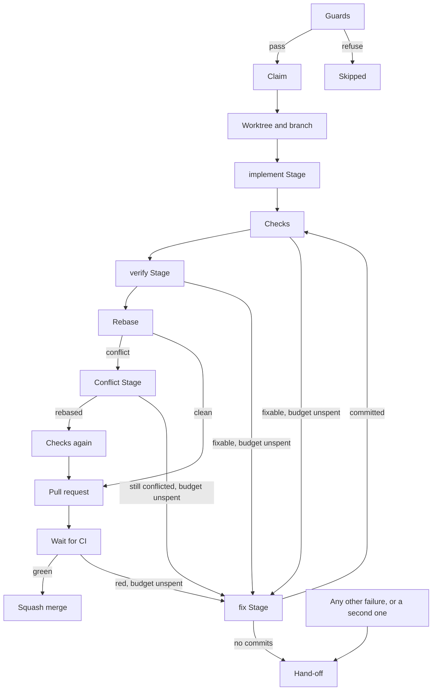
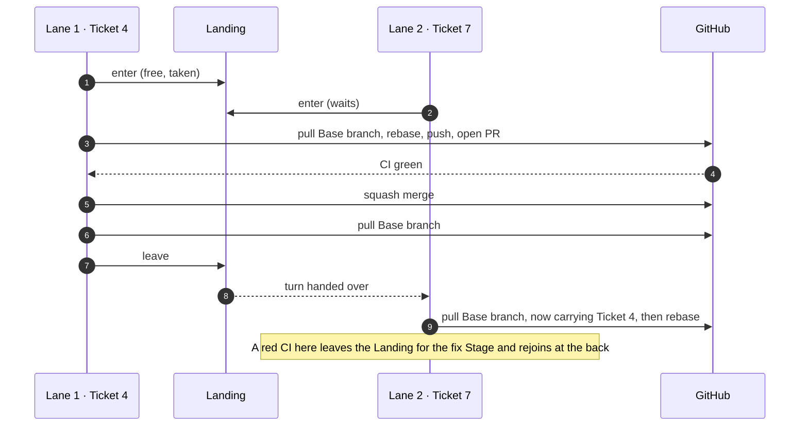

# From Ticket to merge

Nobody watches a Run, so nothing may merge on a single session's word. Every [Ticket](https://github.com/jjongs2/ticket-runner/blob/main/GLOSSARY.md) goes through the same gates in the same order: deterministic Checks, a second session that tries to prove the work wrong, and CI. A failure a fresh session could mend buys exactly one fix Stage; anything else goes to a human. The Tickets of a Run are implemented side by side, but they land one at a time, so what CI graded is what reaches the Base branch.

This page follows one Ticket from its Claim to its merge. What happens when it stops short, whether by a Hand-off, a Release, a Stop or a Run that never came back, is on [Hand-offs, stopping and resuming](./stopping-and-resuming.md).

| Step | What happens | Who decides |
|---|---|---|
| Claim | Guards, State file, assign, `ready-for-agent` → `in-progress` | the pipeline |
| Worktree | `agent/<n>-<slug>` in `.worktrees/ticket-<n>` | git |
| implement Stage | `/mattpocock-skills:implement` in the worktree | an agent |
| Checks | Nothing uncommitted, then each Check command | exit codes |
| verify Stage | Adversarial grading of the Acceptance Criteria | the pipeline, from the Verdict |
| fix Stage | One fresh session given the failure, once per Ticket | the Fix budget |
| Landing | Rebase, Conflict Stage, pull request, CI, squash merge | one Lane at a time |
| After the merge | Tick met criteria, clean up | the pipeline |


<!-- Sources: src/orchestrator.ts, src/lifecycle.ts -->

Every edge to the fix Stage is taken at most once per Ticket. A second failure of any kind, or any failure the fix Stage cannot act on, is a Hand-off. A Stage stopped by the rate limit, an API failure or the API budget, and a failure the Base branch shares ([below](#a-failure-the-base-branch-shares)), leave this diagram entirely: they [release](./stopping-and-resuming.md#release-on-a-rate-limit) the Ticket.

## The Claim

The [Guards](./planning.md) run before anything is written. An issue the pipeline will not take is never marked as taken.

Then, in this order:

1. The **State file** is written: the Ticket's branch, the state it reached (`claimed`) and whether the Fix budget is spent.
2. The Ticket is assigned to the `gh` user, `in-progress` goes on and `ready-for-agent` comes off. A Stranded Ticket already wears this Claim, so it is not written again.
3. Any hand-off comment still current on the Ticket is marked as history ([Handing a Ticket back](./stopping-and-resuming.md#handing-a-ticket-back)).

## The worktree and branch

| | Value |
|---|---|
| Branch | `agent/<n>-<slug>`: the title in lowercase kebab-case, cut at a word boundary to 40 characters |
| Worktree | `.worktrees/ticket-<n>` under the Target's root, gitignored |
| Branched from | The remote's Base branch, freshly fetched, with no upstream set |

A branch of that name that already exists is never reused. The Ticket is handed off at `setup`, and the comment says whose branch it is and the command that clears it. A resumed Ticket carries on in the branch its State file names instead; see [Hand-offs, stopping and resuming](./stopping-and-resuming.md).

## How a Stage runs

A [Stage](https://github.com/jjongs2/ticket-runner/blob/main/GLOSSARY.md) is one `claude -p` child process with one job ([ADR-0002](https://github.com/jjongs2/ticket-runner/blob/main/docs/adr/0002-claude-p-child-process-per-stage.md)).

Every Stage runs in the Ticket's worktree with `--permission-prompts none`, the configured `permissionMode`, and its own `model`, `effort`, `maxTurns` and `maxMinutes` (see [Configuration](./configuration.md)). The wall-clock limit is enforced by killing the process and everything it started.

**What a Stage sees.** The branch's files, the Target's `CLAUDE.md` among them, so what `init` wrote reaches a Stage once it is on the Base branch. No MCP server, the claude.ai connectors included, no auto memory, and none of the tools that act beyond the session, such as scheduling. Work that needs an MCP server cannot be done by a Stage.

| Stage | Prompt opens with | Structured answer |
|---|---|---|
| implement | `/mattpocock-skills:implement <issue URL>` | optional `title` and [`notes`](#notes) |
| verify | `Ticket: <issue URL>`, no skill | the Verdict, optional `notes` |
| fix | `Ticket: <issue URL>`, no skill | optional `title` and `notes` |
| conflict | `Ticket: <issue URL>`, no skill | none |

The prompt ends with the Stage's [`extraPrompt`](./configuration.md#stages).

**The Credential.** A Stage runs on the Claude login, with the Host's `ANTHROPIC_API_KEY` taken out of its environment, unless the Run was started with [`--api-key`](./running.md#api-key), when it runs on that key. When the session's `apiKeySource` says otherwise, the Run's log and summary name the Stage.

What each Stage leaves on disk is on [Logs and transcripts](./running.md#logs-and-transcripts).

**How a Stage can end.** The runner reads the session's last `result` event, never what the session talked about:

| Failure | Progress cell | Meaning |
|---|---|---|
| `timed-out` | `❌ timed out` | Killed at `maxMinutes` |
| `turn-capped` | `❌ turn capped` | Reached `maxTurns` |
| `out-of-budget` | `⏸ out of API budget` | The API key's credit or spend limit, met only on an `--api-key` Run. Releases the Ticket |
| `rate-limited` | `⏸ rate limited`, `⏸ API rate limited` on an `--api-key` Run | The plan's rate limit, or the API's on an `--api-key` Run. Releases the Ticket |
| `api-error` | `⏸ API failure` | A transient API failure the CLI gave up retrying. Releases the Ticket |
| `nonzero-exit` | `❌ exited non-zero` | Any other failed session |
| `invalid-result` | `❌ invalid result` | The verify Stage answered no Verdict at all |

## The implement Stage

The implement skill reads the Ticket, builds it and reviews it. When the session ends, the pipeline routes its [Notes](#notes), records its `title`, and pushes the branch if it has commits, so a Run on another Host can resume from it. Then:

- A Stage that did not finish is a Hand-off at `implement`.
- A branch with no commits beyond the Base branch is a Hand-off: an agent that gave up silently leaves nothing to grade.
- Otherwise the State file moves to `implemented`, so no later Run pays for this Stage again.

## The Checks

Two gates, run by the pipeline itself rather than by an agent:

1. **Nothing uncommitted.** A worktree holding changes no commit carries fails, naming every path. Gitignored files, such as installed dependencies, do not count.
2. **The Check commands**, in order, each through a shell in the worktree, each under `checkTimeoutMinutes` (default 15). The first failure stops the rest. A command killed at the limit is reported as timed out, with a line appended to its output saying it hung rather than failed.

The commands are [`checks`](./configuration.md#checks). Both failures spend the Fix budget. An empty `checks`, which only [`gates.checks`](./configuration.md#gates) off allows, runs nothing, so the row reads `⚠️ no checks` rather than `✅ passed`, here and after a Conflict Stage alike.

### A failure the Base branch shares

A test on the Base branch that starts failing, one that reads the wall clock say, fails on every branch at once. Charged to each Ticket, it costs every one its Fix budget, and each fix Stage mends it differently in its own pull request. So before a failure is charged, the pipeline asks whether the branch brought it or inherited it:

| What failed | Run at the merge-base |
|---|---|
| A Check command | that command |
| CI on the pull request | every Check command, stopping at the first that fails |

The merge-base, as the remote holds it, is checked out clean, and the command runs there under the same `checkTimeoutMinutes`, once per Run however many Lanes fail on it. Nothing is installed there: the command finds its dependencies in the main checkout, as a Ticket's worktree does, so a command that needs an install or a build step of its own fails there too, and the Note's output shows why.

| The merge-base | Progress cell | Result |
|---|---|---|
| passes | ``❌ `<command>` failed``, or CI's `❌ failed` | Spends the Fix budget, as above |
| fails too | ``⏸ `<command>` fails on the Base branch`` | A Release; the budget stays as it was, spent or not |
| could not be checked out or run | as if it passed | Spends the Fix budget, and the Run log says why |

The Release posts the pipeline's own Note on the standing Notes issue, naming the command and quoting the tail of its output. What to do next is on [Release over a failing Base branch](./stopping-and-resuming.md#release-over-a-failing-base-branch).

## The verify Stage and its Verdict

No human reviews the code before it merges, and the session that wrote it is the last one to trust on whether it works. So a fresh session, with no plugin skill, tries to prove each Acceptance Criterion is **not** met. It reads the criteria from the body and the comments, runs the code, may write throwaway tests, and must not commit. A criterion that cannot be met without overturning a documented decision or another criterion is `unmet`, with evidence saying a human decision is needed. Its scratch files are discarded afterwards, so they never reach the pull request.

The **Verdict** grades each criterion `met`, `unmet` or `unverifiable`, with evidence. The agent's own pass or fail is advisory; the pipeline decides for itself: **no criterion unmet and at least one met.**

| Verdict | Progress cell | Result |
|---|---|---|
| Passes | `✅ <k> met · <v> unverifiable` | On to the Landing |
| Some `unmet` | `❌ <u> unmet` | Spends the Fix budget; the fix Stage gets each unmet criterion with its evidence |
| All `unverifiable` | `❌ no evidence` | Hand-off: there is nothing to merge on |
| Missing or malformed | `❌ no Verdict` | Hand-off |

A verify after a fix for unmet criteria gets the first Verdict's unmet criteria and their evidence, and is told such a criterion is met only when that counterexample is gone and the whole criterion holds.

## The fix Stage and the Fix budget

The [Fix budget](https://github.com/jjongs2/ticket-runner/blob/main/GLOSSARY.md) is one fix Stage per Ticket, and whatever still fails after it goes to a human. The fix Stage is a fresh session on the same branch, with no plugin skill, given the failure and its evidence to mend that one defect. Sent in for unmet criteria, it commits nothing and says why when one cannot be met without overturning a documented decision or another criterion, which hands the Ticket to a human.

Only a defect a fresh session could mend spends the budget:

| Failure | At | Spends the budget? |
|---|---|---|
| Changes no commit carries | checks | Yes |
| A Check failed or timed out | checks | Yes |
| A Check failed that the merge-base fails too | checks | No, a Release |
| A criterion `unmet` | verify | Yes |
| The Conflict Stage did not finish the rebase | rebase | Yes |
| A pull request check failed | ci | Yes |
| A pull request check failed, and the merge-base fails a Check | ci | No, a Release |
| A Stage that did not finish (timed out, turn-capped, non-zero, invalid result) | its Stage | No, Hand-off |
| implement left no commits | implement | No, Hand-off |
| A Verdict with no evidence, or none at all | verify | No, Hand-off |
| The Conflict Stage could not be run, or git could not be asked | rebase | No, Hand-off |
| The Base branch could not be pulled | rebase | No, Hand-off |
| Pushing or opening the pull request failed | pr | No, Hand-off |
| CI timed out, found conflicting, or had no checks | ci | No, Hand-off |
| The merge failed | merge | No, Hand-off |
| A rate limit, a transient API failure or an API key out of budget, anywhere | any | No, a Release |

After a fix Stage, the Ticket starts again at the Checks. Every gate grades the fix, the verify Stage included, so a fix is held to the same bar as the first attempt. A fix Stage whose branch did not grow is a Hand-off straight away: re-grading an untouched branch could only fail the same way. A squashed or amended branch counts as not grown. Its hand-off comment carries the evidence the fix Stage was sent in with, so an unmet criterion left for a human arrives with the question its evidence asks.

A fix Stage stopped by the rate limit, an API failure or the API budget spends nothing. What budget a later Run starts with is on [Handing a Ticket back](./stopping-and-resuming.md#handing-a-ticket-back).

## Lanes and the Frontier refill

A Run holds one Ticket per [Lane](https://github.com/jjongs2/ticket-runner/blob/main/GLOSSARY.md) and refills a Lane the moment its Ticket ends. The order it fills them in is on [Running](./running.md#run), when more Lanes help on [`lanes`](./configuration.md#lanes), and what keeps two Tickets out of each other's way on [Blockers](./planning.md#blockers).

## The Landing

The [Landing](https://github.com/jjongs2/ticket-runner/blob/main/GLOSSARY.md), from the pull of the Base branch before the rebase to the pull after the merge, holds one Ticket at a time, in arrival order, so the Base branch cannot move between a Ticket's rebase and its merge, and what CI graded is what lands ([ADR-0005](https://github.com/jjongs2/ticket-runner/blob/main/docs/adr/0005-landing-is-a-serialized-section.md)). implement and verify, where the time goes, stay parallel. The cost is that one Lane's Conflict Stage or slow CI holds the others' Landing.


<!-- Sources: src/landing.ts, src/orchestrator.ts -->

A Ticket also leaves the Landing for a fix Stage, a Hand-off or a Release, so nobody waits behind a session.

### Rebase

The Base branch is first brought up to the remote's, then `git rebase <base>` runs in the worktree. A clean rebase goes straight to the pull request. A conflict is left exactly where git stopped, for the Conflict Stage.

### The Conflict Stage

A conflict is not a defect in the branch: the Base branch moved on underneath it. So one [Conflict Stage](https://github.com/jjongs2/ticket-runner/blob/main/GLOSSARY.md) runs in the stopped rebase with git's output and no plugin skill, and **it does not spend the Fix budget.** It is told to finish the rebase and never abort it, to keep both intents where they are compatible and the Ticket's where they are not, and to change a file the conflict did not touch only to repair what the merge broke, such as a renamed name or a moved field. It implements nothing new and changes no behaviour the criteria cover.

**The worktree decides, not the session's exit.** The rebase counts as resolved only when it has finished, the branch sits on top of the Base branch with no merge commit between them, and no unmerged path or conflict marker is left.

| What the worktree shows | Result |
|---|---|
| Resolved, however the session ended (even rate-limited or stopped by an API failure) | `✅ rebased`; push, then **the Checks again** |
| Unresolved, session rate-limited or stopped by an API failure or the API budget | Abort the rebase, Release |
| Unresolved otherwise | `❌ unresolved`; abort the rebase, spend the Fix budget |
| The Stage could not run, or git could not be asked | `❌ unknown`; abort the rebase, Hand-off |

The Checks run again because the resolution is code no gate has seen. verify is not asked again: the Stage changes no behaviour the criteria cover. An unresolved rebase hands the fix Stage the conflict and what is still wrong as its evidence. The abort always happens, so a fix Stage or a human never inherits a half-finished rebase.

### Pull request

The branch is pushed with `--force-with-lease`, since the rebase rewrote it. The pipeline opens a ready (non-draft) pull request against the Base branch, or updates the one it already has: a new title and body, and out of draft (a draft often runs no workflows, so a draft left from a Hand-off would read as "no checks").

**The title** is the first of these in the commit convention's shape, `<type>(<scope>): <summary>` on one line (a trailing `(#<n>)` is dropped):

1. The latest `title` the implement or fix Stage answered for the whole branch, in this Run or recorded in the State file by an earlier one.
2. The branch's first commit subject.
3. The Ticket title, as it is.

**The body** is `Closes #<n>`, the Verdict counts, the criteria in a folded list (evidence shown for any not `met`), and a line naming the Run. On a workstation that line also points at `.ticket-runner/runs/<runId>/<n>/`; a cloud Host's run directory does not outlive its session, so there it names the Run alone.

### CI wait and grace period

The pipeline polls the head commit's check runs and commit statuses until they settle or [`ciTimeoutMinutes`](./configuration.md#ci) runs out.

| What GitHub shows | Progress cell | Result |
|---|---|---|
| Every check passed or skipped | `✅ passed` | Merge |
| A check failed, was cancelled, timed out, needs action or could not start | `❌ failed` | Spends the Fix budget |
| The same, and the merge-base fails a Check command | ``⏸ `<command>` fails on the Base branch`` | A Release ([above](#a-failure-the-base-branch-shares)) |
| Checks still pending at the timeout | `❌ timed out` | Hand-off |
| No checks, and GitHub finds the pull request conflicting | `❌ conflicting` | Hand-off at once |
| No checks after the grace period, `gates.ci` on | `❌ no checks` | Hand-off |
| No checks after the grace period, `gates.ci` off | `⚠️ no checks` | Merge, with the warning row |

A failed check hands the fix Stage the tail of the failing Actions jobs' logs. A conflicting pull request is handed off without waiting, because GitHub runs no checks on it; only a human merging meanwhile can cause it.

**The grace period.** Right after a pull request opens, GitHub reports no checks for a while, so "no checks" counts only after [`ciGraceMinutes`](./configuration.md#ci).

### Squash merge and its commit

The pipeline squash-merges through GitHub's REST API with a commit message it composed itself:

```text
<title> (#<pr>)

Closes #<n>

Verdict: <k> met · <u> unmet · <v> unverifiable

- <branch commit subject>
- <branch commit subject>

Co-authored-by: <name> <email>
```

The subject is the pull request title. Commit subjects and `Co-authored-by` trailers are read after the rebase, since those are the commits that land. The per-criterion evidence stays in the pull request body.

### After the merge

The Ticket is merged, so nothing below can hand it off. Each step's failure is logged and the next step still runs:

1. Remove the State file, so the Ticket never looks resumable again.
2. Tick the met criteria (below).
3. Remove `in-progress`. The merge closed the issue.
4. Pull the Base branch. This ends the Landing, and the next Lane's Ticket rebases onto a Base branch that already carries this one.
5. Remove the worktree and the local branch, and delete the remote branch unless GitHub already did.

## What the board is told

**The Progress comment.** A Ticket gets one [Progress comment](https://github.com/jjongs2/ticket-runner/blob/main/GLOSSARY.md), rewritten in place as each step ends, so only the first write notifies anyone. It is posted when the first row is recorded. Each Run that works the Ticket has its own section below earlier Runs' sections, headed by the Version, the Run id and the branch:

```text
**ticket-runner** `0.4.0` · run `2026-09-17T09-00-00-000` · `agent/4-planning-guards`

| Stage | Outcome | Turns | Duration |
|---|---|---|---|
| implement | ✅ committed | 46 | 21m |
| checks | ❌ `npm test` failed | – | 2m |
| fix | ✅ committed | 12 | 6m |
| checks | ✅ passed | – | 2m |
| verify | ✅ 6 met · 1 unverifiable | 9 | 4m |
| ci | ✅ passed | – | 3m |
| merge | ✅ #31 | – | – |
```

Rows carry a few words only. Anything a human has to act on is its own comment, since those are worth a notification: a hand-off, a guard warning, a Note.

**Ticking met criteria.** After the merge, every criterion the Verdict marked `met` is ticked (`- [ ]` → `- [x]`) wherever it is written: the body, or any comment, such as the one triage posted its brief in. Matching forgives differences in whitespace and case only. An `unverifiable` criterion stays unticked, because nobody gathered evidence for it. A criterion the Stage reworded past matching is left unticked, and the Run log says how many were not matched.

## Notes

A Stage keeps meeting defects that are not its Ticket's. Fixing them widens the Ticket past what verify grades; ignoring them loses them in a transcript. So the implement, verify and fix Stages end with a list of [Notes](https://github.com/jjongs2/ticket-runner/blob/main/GLOSSARY.md), and the pipeline posts each one where a human will meet it. A Note is a defect outside the Ticket, never acted on in it; a defect the branch itself introduced is fixed, not noted. Notes are routed before the Stage's own outcome is judged, so a Stage that ran out of turns still reports what it noticed.

| The Note names | Where it goes |
|---|---|
| An open, unclaimed Ticket that is not a Spec | A comment on that Ticket |
| No Ticket, or the Stage's own Ticket (about to close) | The standing Notes issue |
| A closed, claimed (`in-progress`) or Spec issue | The standing Notes issue, saying which Ticket it was meant for and why it did not go there |
| A number that will not take the comment (invented, locked) | The standing Notes issue, with the number it was meant for |

**The standing Notes issue** is one open `needs-triage` issue, titled "Notes from the pipeline", that collects Notes as comments. It is found by a marker in its body, not by its title, so renaming it opens no second one. It is opened by the first Note that needs it and shared by every Lane of the Run. Work through it as triage does: turn each Note worth doing into a Ticket, or a comment on one, then close the issue. The next Note opens a fresh one. When one is open, each noting Stage's prompt carries its number, so the Stage can read what is already reported and add only what would change a reader's action.

A `- [ ]` at the head of a line in a Note is escaped, so a Note is never read as Acceptance Criteria. The Run summary lists each Note as a `noted` row under the Ticket that made it.

## Related pages

- [Planning](./planning.md): the Guards that run before the Claim, and how to write Acceptance Criteria verify can grade.
- [Running](./running.md): starting a Run, `--lanes`, `--api-key`, a narrowed Run, the summary, exit codes and transcripts.
- [Configuration](./configuration.md): `checks`, `gates`, the Stage limits, `ciTimeoutMinutes`, `ciGraceMinutes`.
- [Hand-offs, stopping and resuming](./stopping-and-resuming.md): Hand-off, Release, Stop, Stranded Tickets and handing a Ticket back.
- [Internals](./internals.md): the ports and adapters behind each step.

## References

- [`src/orchestrator.ts`](https://github.com/jjongs2/ticket-runner/blob/main/src/orchestrator.ts): `processTicket`, `takeTicket`, `verify`, `fix`, `resolveConflict`, `requireGreenCi`
- [`src/failing-base.ts`](https://github.com/jjongs2/ticket-runner/blob/main/src/failing-base.ts): the Checks run at a merge-base, once per Run
- [`src/run.ts`](https://github.com/jjongs2/ticket-runner/blob/main/src/run.ts), [`src/frontier.ts`](https://github.com/jjongs2/ticket-runner/blob/main/src/frontier.ts), [`src/landing.ts`](https://github.com/jjongs2/ticket-runner/blob/main/src/landing.ts)
- [`src/prompts.ts`](https://github.com/jjongs2/ticket-runner/blob/main/src/prompts.ts), [`src/self-hosting.ts`](https://github.com/jjongs2/ticket-runner/blob/main/src/self-hosting.ts), [`src/verdict.ts`](https://github.com/jjongs2/ticket-runner/blob/main/src/verdict.ts), [`src/title.ts`](https://github.com/jjongs2/ticket-runner/blob/main/src/title.ts), [`src/note-schema.ts`](https://github.com/jjongs2/ticket-runner/blob/main/src/note-schema.ts), [`src/lifecycle.ts`](https://github.com/jjongs2/ticket-runner/blob/main/src/lifecycle.ts)
- [`src/progress.ts`](https://github.com/jjongs2/ticket-runner/blob/main/src/progress.ts), [`src/criteria.ts`](https://github.com/jjongs2/ticket-runner/blob/main/src/criteria.ts), [`src/notes.ts`](https://github.com/jjongs2/ticket-runner/blob/main/src/notes.ts), [`src/templates.ts`](https://github.com/jjongs2/ticket-runner/blob/main/src/templates.ts), [`src/handoff.ts`](https://github.com/jjongs2/ticket-runner/blob/main/src/handoff.ts)
- [`src/stage-guard.ts`](https://github.com/jjongs2/ticket-runner/blob/main/src/stage-guard.ts), [`src/run-log.ts`](https://github.com/jjongs2/ticket-runner/blob/main/src/run-log.ts), [`src/startup.ts`](https://github.com/jjongs2/ticket-runner/blob/main/src/startup.ts), [`src/config.ts`](https://github.com/jjongs2/ticket-runner/blob/main/src/config.ts)
- [`src/adapters/claude-agent-runner.ts`](https://github.com/jjongs2/ticket-runner/blob/main/src/adapters/claude-agent-runner.ts), [`src/adapters/git-workspace.ts`](https://github.com/jjongs2/ticket-runner/blob/main/src/adapters/git-workspace.ts), [`src/adapters/gh-tracker.ts`](https://github.com/jjongs2/ticket-runner/blob/main/src/adapters/gh-tracker.ts), [`src/adapters/process-tree.ts`](https://github.com/jjongs2/ticket-runner/blob/main/src/adapters/process-tree.ts)
- [ADR-0002](https://github.com/jjongs2/ticket-runner/blob/main/docs/adr/0002-claude-p-child-process-per-stage.md): one `claude -p` child process per Stage
- [ADR-0005](https://github.com/jjongs2/ticket-runner/blob/main/docs/adr/0005-landing-is-a-serialized-section.md): the Landing is a serialized section
- [`docs/templates/`](https://github.com/jjongs2/ticket-runner/blob/main/docs/templates/README.md): the exact shapes of the Progress comment, pull request body, squash commit and Note comment
