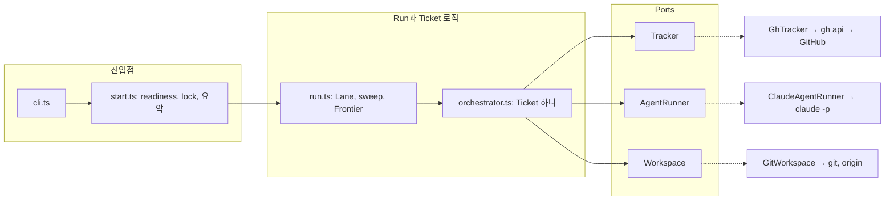
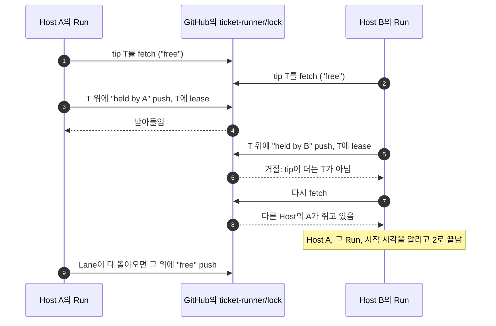

# 내부 구조

파이프라인이 바깥에서 건드리는 것은 셋입니다. GitHub, Claude, git. 셋 모두 orchestrator가 의존하는 인터페이스인 port를 거쳐서 닿습니다. 덕분에 무인으로 도는 흐름 전체를 메모리 안에서 테스트할 수 있습니다. 요금제 한도를 쓰지도, GitHub에 무언가를 쓰지도 않고요. port 뒤의 adapter는 얇게 유지합니다. 인자를 만들고 출력을 해석할 뿐이고, 판단은 그 위의 모듈이 맡습니다.

이 페이지는 파이프라인이 안에서 어떻게 도는지 궁금한 분을 위한 것이고, 이름을 대는 모듈마다 링크를 겁니다. 파이프라인을 쓰기만 하려면 [설치와 제거](./installation.md)부터 보세요.

## 한눈에 보기 {#at-a-glance}

| Port | 격리하는 부수 효과 | Adapter · 테스트용 fake |
|---|---|---|
| `Tracker` | GitHub: 이슈, 라벨, 코멘트, pull request, CI, merge | `GhTracker` · `FakeTracker` |
| `AgentRunner` | Claude: Stage 세션 하나 | `ClaudeAgentRunner` · `FakeAgentRunner` |
| `Workspace` | git: worktree, Check, rebase, push, State와 Run lock | `GitWorkspace` · `FakeWorkspace` |


<!-- Sources: src/cli.ts, src/start.ts, src/run.ts, src/orchestrator.ts, src/ports/tracker.ts, src/ports/agent-runner.ts, src/ports/workspace.ts -->

adapter를 만드는 곳은 CLI 하나뿐입니다. `start.ts`부터 아래는 모두 인터페이스로 받습니다.

## Adapter {#the-adapters}

### `GhTracker` {#ghtracker}

[`GhTracker`](https://github.com/jjongs2/ticket-runner/blob/main/src/adapters/gh-tracker.ts)는 GitHub 호출을 전부 `gh api`로 합니다.

- 클라우드 Host가 GraphQL을 아예 막으니, 모든 Host에서 REST를 씁니다.
- 예외는 pull request를 draft로 넣고 빼는 일 하나입니다. REST로는 할 수 없어서, 워크스테이션은 GraphQL mutation을, 클라우드 Host는 프록시의 `/pulls/{n}/ccr/convert_to_draft`와 `/ready_for_review` 경로를 씁니다.
- CI는 15초마다 확인합니다.

### `ClaudeAgentRunner` {#claudeagentrunner}

[`ClaudeAgentRunner`](https://github.com/jjongs2/ticket-runner/blob/main/src/adapters/claude-agent-runner.ts)는 Stage 하나를 자식 프로세스 하나로 실행합니다. `--json-schema`는 답할 스키마가 있는 Stage에만 붙습니다.

```text
claude --print <prompt> --output-format stream-json --verbose \
  --permission-prompts none --permission-mode … \
  --strict-mcp-config \
  --disallowedTools CronCreate CronDelete RemoteTrigger PushNotification ScheduleWakeup Workflow \
  --model … --effort … --max-turns … [--json-schema …]
```

- `--strict-mcp-config`로 세션에 MCP 서버를 하나도 주지 않습니다. Host 사용자 계정의 claude.ai connector도 빠집니다. `--disallowedTools`는 worktree와 세션 밖에서 일하는 도구를 막습니다.
- 자식의 환경을 이렇게 설정합니다.

  | 변수 | 값 | 이유 |
  |---|---|---|
  | `ANTHROPIC_API_KEY` | Run을 `--api-key`로 시작하지 않았으면 뺌 | `-p`에서는 키가 묻지도 않고 Claude 로그인보다 앞서니, 남은 키가 그대로 과금됨 |
  | `TICKET_RUNNER_STAGE` | Stage 이름 | [Stage mark](https://github.com/jjongs2/ticket-runner/blob/main/GLOSSARY.md). Stage 안에서는 CLI가 거절하게 함 |
  | `TICKET_RUNNER_SESSION` | Stage 세션마다 다른 UUID | [`maxMinutes`의 kill](#smaller-adapters)이 찾는 Session mark |
  | `CLAUDE_CODE_DISABLE_AUTO_MEMORY` | `1` | Host 사용자의 memory는 Target이 아닌 그 사람의 프로젝트에 관한 것 |
  | `CLAUDE_CODE_SHELL` | `/bin/bash`, 있을 때만 | zsh는 아무것도 맞지 않는 glob 하나에 명령 전체를 멈춤 |
  `ANTHROPIC_AUTH_TOKEN`을 비롯한 다른 변수는 그대로 물려받습니다.
- Stage가 시작되는 순간부터 [Stage의 파일](./running.md#logs-and-transcripts)을 쓰고, 거기에 키 값은 절대 적지 않습니다. 명령 파일은 Hand-off 때 Target의 remote로 가기 때문입니다.
- 세션의 `system/init` 이벤트에서 `apiKeySource`를 읽고, orchestrator가 이를 Run의 Credential과 맞춰 봅니다.
- `maxMinutes`가 지나면 자식과 자식이 띄운 프로세스를 모두 죽이고, 실패를 `rate-limited`, `api-error`, `out-of-budget`, `timed-out`, `turn-capped`, `nonzero-exit`, `invalid-result`로 분류합니다. 성공한 세션은 앞의 셋 중 어느 것도 아니고, 셋은 실패한 세션에서 이렇게 읽습니다.

  | 실패 | 읽는 곳 |
  |---|---|
  | `out-of-budget` | `api_error_status: 400`이고 메시지가 `credit balance is too low`나 `workspace API usage limits`를 말함. 지출 한도 메시지도 usage limit이라는 말을 담지만, 이것은 예산으로 읽음 |
  | `rate-limited` | `api_error_status: 429`, 상태가 `rejected`인 `rate_limit_event`(경고만 하는 이벤트는 멈춤이 아님), 또는 result나 stderr의 `usage limit`, `session limit`, `rate limit`, `rate_limit`. 이 문구는 바뀐 적이 있어서 마지막에 읽음 |
  | `api-error` | `terminal_reason: "api_error"`이고 `api_error_status`가 5xx이거나 없음 |

### `GitWorkspace` {#gitworkspace}

[`GitWorkspace`](https://github.com/jjongs2/ticket-runner/blob/main/src/adapters/git-workspace.ts)는 `.worktrees/` 아래의 worktree(Ticket의 것과, 실패한 Check를 merge-base에서 다시 돌리는 detached worktree)를 맡고, Check를 돌리고, rebase와 push를 하고, `ticket-runner/state`와 `ticket-runner/lock` branch를 관리합니다([Hand-off, 멈추고 이어 하기](./stopping-and-resuming.md)).

- git은 ref나 index lock이 잡혀 있으면 기다리지 않고 실패하므로, main checkout에서의 명령은 한 번에 하나씩 돌립니다. worktree 안의 명령은 병렬로 둡니다.
- state branch는 부모 없는 snapshot commit 하나로 다시 씁니다. git object와 임시 index만으로 만들기 때문에 main checkout의 tree는 건드리지 않습니다. 서명 없이, `--no-verify`와 읽어 온 tip에 대한 `--force-with-lease`로 push하고, 더 새 snapshot에 밀린 변경은 다시 얹습니다. 최대 세 번 시도합니다. 한 Run 안에서는 변경이 차례를 지키니, 두 Lane이 서로의 Ticket을 빠뜨린 snapshot을 올리는 일이 없습니다.
- lock은 compare-and-swap으로 잡습니다. 잡을 때도 풀 때도 읽어 온 tip 위에 commit하고, 그 tip에 lease를 걸어 push합니다.


<!-- Sources: src/adapters/git-workspace.ts, src/lock.ts, src/start.ts -->

### 작은 adapter들 {#smaller-adapters}

- [`exec.ts`](https://github.com/jjongs2/ticket-runner/blob/main/src/adapters/exec.ts)는 시간 제한과 스트리밍 sink를 붙여 자식 프로세스를 띄웁니다. 명령이 스스로 124로 끝날 수도 있으니 `timedOut`을 따로 알려 줍니다.
- [`process-tree.ts`](https://github.com/jjongs2/ticket-runner/blob/main/src/adapters/process-tree.ts)는 시간 한도에 걸린 명령을 하위 프로세스 전부, 그리고 이들이 리더인 프로세스 그룹과 함께 죽입니다. 먼저 SIGTERM을 보내고, 5초 뒤에도 남은 것은 SIGKILL로 끝냅니다. 명령 자신의 그룹만 죽여서는 부족합니다. Stage는 Run의 그룹을 같이 쓰고([ADR-0006](#adr-0006)), Claude Code는 Bash 명령마다 세션을 따로 만듭니다. 셸이 이미 끝난 백그라운드 프로세스는 부모를 따라가도 Stage에 닿지 않으므로, Stage의 Session mark를 가진 프로세스도 모두 함께 죽입니다.
- [`repo-root.ts`](https://github.com/jjongs2/ticket-runner/blob/main/src/adapters/repo-root.ts)는 worktree 안에서 실행해도 main checkout을 찾습니다. 그래서 lock, `.worktrees/`, 로그가 clone마다 한 곳에 모입니다.
- [`version.ts`](https://github.com/jjongs2/ticket-runner/blob/main/src/adapters/version.ts)는 이 사본이 어느 [Version](#versions)인지 읽습니다.

## `src/` 지도 {#a-map-of-src}

테스트는 각 모듈 옆에 `*.test.ts`로 있습니다.

**진입점**

| 모듈 | 한 줄 |
|---|---|
| [`cli.ts`](https://github.com/jjongs2/ticket-runner/blob/main/src/cli.ts) | Version을 읽고 `init`, `run`, `stop`, `remove`, `-v`로 나눔. adapter를 만듦 |
| [`command-line.ts`](https://github.com/jjongs2/ticket-runner/blob/main/src/command-line.ts) | 아무것도 보기 전에 인자를 해석함. 사용법 문구도 여기 있음 |
| [`stage-guard.ts`](https://github.com/jjongs2/ticket-runner/blob/main/src/stage-guard.ts) | Stage의 셸 안에서는 모든 명령을 거절(Stage mark) |
| [`start.ts`](https://github.com/jjongs2/ticket-runner/blob/main/src/start.ts) | 거절, Run lock, Stop 수신, 요약과 종료 코드 |
| [`startup.ts`](https://github.com/jjongs2/ticket-runner/blob/main/src/startup.ts) | merge를 막을 관문이 없는 Run을 거절하고, 꺼 둔 관문을 경고 |

**Run과 Ticket**

| 모듈 | 한 줄 |
|---|---|
| [`run.ts`](https://github.com/jjongs2/ticket-runner/blob/main/src/run.ts) | Stranded Ticket, 그다음 Frontier로 Lane을 채움. Release나 Stop이면 claim을 멈춤 |
| [`orchestrator.ts`](https://github.com/jjongs2/ticket-runner/blob/main/src/orchestrator.ts) | Ticket 하나를 Guard부터 merge, Hand-off, Release까지. Fix budget 포함 |
| [`frontier.ts`](https://github.com/jjongs2/ticket-runner/blob/main/src/frontier.ts) | Candidate를 Frontier와 막힌 것으로 나눔 |
| [`guards.ts`](https://github.com/jjongs2/ticket-runner/blob/main/src/guards.ts) | Candidate를 건너뛰는 이유: Guard와 거절 |
| [`landing.ts`](https://github.com/jjongs2/ticket-runner/blob/main/src/landing.ts) | Landing: rebase부터 pull까지 한 번에 한 Lane, 도착 순서대로 |
| [`lifecycle.ts`](https://github.com/jjongs2/ticket-runner/blob/main/src/lifecycle.ts) | Ticket이 어디서 실패했는지, fix Stage가 고칠 수 있는 실패는 무엇인지 |
| [`failing-base.ts`](https://github.com/jjongs2/ticket-runner/blob/main/src/failing-base.ts) | 실패한 Check를 merge-base에서 Run마다 commit마다 한 번 돌리고, 그 Note를 한 번 올림 |
| [`base-branch.ts`](https://github.com/jjongs2/ticket-runner/blob/main/src/base-branch.ts) | Run마다 한 번 Base branch를 정함 |
| [`branch.ts`](https://github.com/jjongs2/ticket-runner/blob/main/src/branch.ts) | `agent/<n>-<slug>`, `.worktrees/ticket-<n>`, `.worktrees/base-<commit>` |
| [`stranded.ts`](https://github.com/jjongs2/ticket-runner/blob/main/src/stranded.ts) | Stranded Ticket을 찾는 sweep |
| [`resume.ts`](https://github.com/jjongs2/ticket-runner/blob/main/src/resume.ts) | State file의 모양과 이름 |
| [`handoff.ts`](https://github.com/jjongs2/ticket-runner/blob/main/src/handoff.ts) | Ticket을 다시 가져갈 때 예전 Hand-off 코멘트를 지난 일로 표시 |
| [`stop.ts`](https://github.com/jjongs2/ticket-runner/blob/main/src/stop.ts) | `ticket-runner stop`, 그리고 Run 쪽에서 받는 SIGTERM |
| [`lock.ts`](https://github.com/jjongs2/ticket-runner/blob/main/src/lock.ts) | Run lock 파일의 내용, 쥔 쪽이 살아 있는지 |
| [`host.ts`](https://github.com/jjongs2/ticket-runner/blob/main/src/host.ts) | 워크스테이션인지 클라우드인지, 어느 것인지 |
| [`credential.ts`](https://github.com/jjongs2/ticket-runner/blob/main/src/credential.ts) | 요금제인지 API 키인지, Stage마다 보고해야 할 것, `--api-key`를 거절하는 경우 |

**Stage에 주는 것과 Stage가 답하는 것**

| 모듈 | 한 줄 |
|---|---|
| [`prompts.ts`](https://github.com/jjongs2/ticket-runner/blob/main/src/prompts.ts) | 각 Stage의 프롬프트. `/mattpocock-skills:<skill>`을 펼침 |
| [`self-hosting.ts`](https://github.com/jjongs2/ticket-runner/blob/main/src/self-hosting.ts) | Target이 파이프라인 자신의 저장소인지. Stage가 checkout에 대해 무엇을 듣는지 정함 |
| [`verdict.ts`](https://github.com/jjongs2/ticket-runner/blob/main/src/verdict.ts) | Verdict 스키마와 통과 여부 |
| [`title.ts`](https://github.com/jjongs2/ticket-runner/blob/main/src/title.ts) | pull request 제목: Stage의 답, 그다음 commit, 그다음 Ticket |
| [`note-schema.ts`](https://github.com/jjongs2/ticket-runner/blob/main/src/note-schema.ts), [`notes.ts`](https://github.com/jjongs2/ticket-runner/blob/main/src/notes.ts) | Note: Stage가 적는 방식과 보내지는 곳 |
| [`acceptance-criteria.ts`](https://github.com/jjongs2/ticket-runner/blob/main/src/acceptance-criteria.ts), [`criteria.ts`](https://github.com/jjongs2/ticket-runner/blob/main/src/criteria.ts) | 기준의 모양, merge 뒤 `met`인 것에 체크 |
| [`progress.ts`](https://github.com/jjongs2/ticket-runner/blob/main/src/progress.ts) | Ticket마다 하나인 Progress comment를 제자리에서 고침 |
| [`templates.ts`](https://github.com/jjongs2/ticket-runner/blob/main/src/templates.ts) | GitHub에 쓰는 모든 모양과 Run 요약. 원본은 `docs/templates/` |
| [`log-tail.ts`](https://github.com/jjongs2/ticket-runner/blob/main/src/log-tail.ts) | CI 발췌와 실패한 Base branch의 Note가 함께 인용하는 로그 끝부분. 40줄, 4,000자 이내 |
| [`run-log.ts`](https://github.com/jjongs2/ticket-runner/blob/main/src/run-log.ts) | `.ticket-runner/runs/<runId>/`와, Hand-off가 그중 무엇을 남기는지 |

**Target 준비**

| 모듈 | 한 줄 |
|---|---|
| [`init.ts`](https://github.com/jjongs2/ticket-runner/blob/main/src/init.ts) | `ticket-runner init`: 파일을 쓰고, GitHub를 설정하고, 나머지를 보고 |
| [`readiness.ts`](https://github.com/jjongs2/ticket-runner/blob/main/src/readiness.ts) | Target readiness. `init`이 갖추고 `run`이 확인 |
| [`conventions.ts`](https://github.com/jjongs2/ticket-runner/blob/main/src/conventions.ts) | conventions 문서의 본문과 Version 표시 |
| [`operator-skill.ts`](https://github.com/jjongs2/ticket-runner/blob/main/src/operator-skill.ts) | `init`이 Target에 써 넣는 Operator의 스킬 |
| [`labels.ts`](https://github.com/jjongs2/ticket-runner/blob/main/src/labels.ts) | triage 라벨 여섯 개와 그 색 |
| [`config.ts`](https://github.com/jjongs2/ticket-runner/blob/main/src/config.ts) | `ticket-runner.json`: 스키마와 기본값 |
| [`remove.ts`](https://github.com/jjongs2/ticket-runner/blob/main/src/remove.ts) | `ticket-runner remove` |

**Version**

| 모듈 | 한 줄 |
|---|---|
| [`version-number.ts`](https://github.com/jjongs2/ticket-runner/blob/main/src/version-number.ts) | 번호 비교. 모든 Version 질문이 함께 씀 |
| [`staleness.ts`](https://github.com/jjongs2/ticket-runner/blob/main/src/staleness.ts) | 새 Version 안내 줄과 conventions 문서 경고 |
| [`version-pr.ts`](https://github.com/jjongs2/ticket-runner/blob/main/src/version-pr.ts) | Version PR이 지켜야 할 것, GitHub Release에 올릴 Version notes |

**테스트 전용**: [`testing/`](https://github.com/jjongs2/ticket-runner/blob/main/src/testing/fakes.ts)에는 테스트가 orchestrator에 닿을 때 거치는 세 port의 메모리 fake가 있습니다. 층마다 어떻게 테스트하는지는 [`CONTRIBUTING.md`](https://github.com/jjongs2/ticket-runner/blob/main/CONTRIBUTING.md#code)에 있습니다.

## Version {#versions}

[Version](https://github.com/jjongs2/ticket-runner/blob/main/GLOSSARY.md)은 `main`이 `v<x.y.z>` 태그로 달고, npm에 올리고, GitHub Release로 공개하는 번호입니다. 설치된 사본이 이 번호를 알려 줍니다. 머신에는 `main`이 아니라 Version을 설치하니, `0.5.2`라고 말하는 두 머신은 같은 코드를 돌립니다([ADR-0007](https://github.com/jjongs2/ticket-runner/blob/main/docs/adr/0007-a-version-is-cut-by-a-human-and-installs-follow-tags.md)).

Version은 사람이 Version PR을 merge해서 끊고, 그 PR의 초안은 [`/cut-a-version`](https://github.com/jjongs2/ticket-runner/blob/main/.claude/skills/cut-a-version/SKILL.md)이 만듭니다. 단계와 거기 붙는 검사는 [`CONTRIBUTING.md`](https://github.com/jjongs2/ticket-runner/blob/main/CONTRIBUTING.md#versions)에 있습니다.

### 찍히는 번호 {#the-stamp}

Version은 CLI에서 한 번 정해서 아래로 넘깁니다. 그래서 한 Run이 찍는 번호는 모두 같은 문자열입니다.

| `-v` 출력 | 언제 |
|---|---|
| `0.5.2` | 설치된 사본. 번호가 전부 |
| `0.5.2+331d79c` | 깨끗한 개발 checkout |
| `0.5.2+331d79c.dirty` | commit하지 않은 변경이 있는 개발 checkout |
| `unknown` | 읽을 수 있는 `package.json`이 없음 |

같은 문자열이 찍히는 곳:

| 어디 | 왜 |
|---|---|
| Run 요약의 머리, `init` 보고의 첫 줄 | 어떤 파이프라인이 돌았는지 터미널이 말하도록 |
| Progress comment의 Run별 섹션 | 누가 썼는지 보드가 말하도록 |
| 각 State file의 `version` | 읽지 못하는 파일도 누가 썼는지 알 수 있도록 |
| Run 디렉터리의 `version.txt` | transcript가 그걸 쓴 파이프라인 곁에 있도록 |
| conventions 문서의 첫 줄(번호만) | `init`과 Run이 어느 쪽이 뒤처졌는지 알 수 있도록 |
| 설치본이 모르는 설정 키를 거절하는 문구 | 낡은 설치본과 잘못된 설정을 구별할 수 있도록 |

### 새 Version 확인 {#the-newer-version-check}

Run과 `init`은 파이프라인 자신의 저장소에서 공개된 가장 높은 Version을 찾아봅니다. 저장소는 `package.json`의 `repository` 필드에서 읽으니, fork는 자기 자신을 묻습니다. 조회는 태그가 아니라 GitHub Release를 읽되 draft와 prerelease는 뺍니다. 태그 워크플로는 npm에 Version이 올라간 뒤에야 Release를 만드니, Release가 있는 Version은 업그레이드로 설치할 수 있습니다. 번호만 비교하므로, 최신 Version보다 앞선 commit을 돌리는 checkout도 낡은 것으로 보지 않습니다.

무엇을 출력하는지는 [설치](./installation.md#install)에 있습니다.

## ADR 요약 {#the-adrs-in-brief}

전문은 [`docs/adr/`](https://github.com/jjongs2/ticket-runner/tree/main/docs/adr)에 있습니다. 여러 ADR에 개정 내용이 붙어 있고, 아래는 지금 기준의 정리입니다.

### [ADR-0001: Humans plan, the pipeline executes](https://github.com/jjongs2/ticket-runner/blob/main/docs/adr/0001-humans-plan-the-pipeline-executes.md) {#adr-0001}

- **결정**: 사람이 계획하고, 무인으로 도는 것은 Execution뿐입니다.
- **이유**: grilling 질문에 잘못 답하면, 걸러 줄 관문 없이 Spec, Ticket, merge된 코드로 굳어 버립니다.
- **비용**: Planning의 품질은 사람 몫입니다. 파이프라인은 알려진 결함만 막습니다.

### [ADR-0002: One `claude -p` child process per Stage](https://github.com/jjongs2/ticket-runner/blob/main/docs/adr/0002-claude-p-child-process-per-stage.md) {#adr-0002}

- **결정**: Stage마다 `claude -p` 자식 프로세스를 하나씩 둡니다.
- **이유**: 사용자 호출 전용 `/plugin:skill`을 펼쳐 주는 건 헤드리스 모드뿐입니다. 프로세스로 나누면 Stage별 한도, `--json-schema`, 다시 돌려 볼 명령줄도 얻습니다.
- **비용**: Stage마다 1–2초의 시작 비용이 듭니다. 공유하는 문맥이 없으니 Stage마다 Ticket과 branch를 읽습니다.

### [ADR-0003: Trust only GitHub-native issue relations](https://github.com/jjongs2/ticket-runner/blob/main/docs/adr/0003-github-native-relations-only.md) {#adr-0003}

- **결정**: GitHub 네이티브 blocker와 sub-issue만 인정합니다.
- **이유**: 진실의 원천이 둘이면, 낡은 본문이 몰래 일을 막거나 풀 수 있습니다.
- **비용**: 사람이 네이티브 연결을 만들어야 합니다. 본문에만 적힌 blocker는 경고와 함께 건너뜁니다.

### [ADR-0004: Resume state lives on the Target's remote, not in a tracker comment](https://github.com/jjongs2/ticket-runner/blob/main/docs/adr/0004-resume-state-lives-on-the-targets-remote.md) {#adr-0004}

- **결정**: 이어받기 상태는 보드 밖의 State file로 두고, 지금은 Target의 remote에 있습니다. Hand-off도 이를 남깁니다.
- **이유**: 보드는 사람을 위한 곳입니다. 클라우드 Host는 버려지니 상태가 Host보다 오래 살아야 합니다. 라벨 한 번 바꿔서 이어받을 수 있어야 합니다.
- **비용**: 예전 로컬 State는 옮겨 주지 않습니다. state branch는 `Workspace`를 거칩니다.

### [ADR-0005: Landing is a serialized section, not a merge queue](https://github.com/jjongs2/ticket-runner/blob/main/docs/adr/0005-landing-is-a-serialized-section.md) {#adr-0005}

- **결정**: Landing은 merge queue가 아니라, 한 번에 Lane 하나만 들어가는 구간입니다.
- **이유**: CI를 두 번 치르지 않고도 CI가 채점한 그대로 merge됩니다. GitHub merge queue는 저장소 설정 하나를 Target readiness의 일부로 만들었을 것입니다.
- **비용**: 느린 CI나 Conflict Stage 하나가 다른 모든 Lane의 Landing을 붙잡습니다.

### [ADR-0006: Stop is a signal, and Ctrl+C stays a kill](https://github.com/jjongs2/ticket-runner/blob/main/docs/adr/0006-stop-is-a-signal-and-ctrl-c-is-a-kill.md) {#adr-0006}

- **결정**: Stop은 SIGTERM뿐이고, Run이 도는 Host에서만 보낼 수 있습니다. Ctrl+C는 kill로 둡니다.
- **이유**: 신호는 바로 닿고 치울 것을 남기지 않습니다. Stage는 Run의 프로세스 그룹을 같이 쓰니 Ctrl+C는 모든 `claude` 세션에도 닿고, 이를 부드럽게 만들려면 Stage를 별도 그룹으로 떼어 내야 합니다.
- **비용**: Stop은 되돌릴 수 없고, 다른 Host의 Run은 여기서 멈출 수 없습니다.

### [ADR-0007: A Version is cut by a human, and installs follow tags](https://github.com/jjongs2/ticket-runner/blob/main/docs/adr/0007-a-version-is-cut-by-a-human-and-installs-follow-tags.md) {#adr-0007}

- **결정**: Version은 사람이 Version PR을 merge해서 끊고, 태그 워크플로가 npm에 올리며, 설치는 npm에서 합니다. GitHub 태그 범위로 설치해도 됩니다.
- **이유**: 언제 끊을지는 Planning의 결정입니다. 같은 번호의 두 머신이 같은 코드를 돌려야 번호가 쓸모 있는 표시가 됩니다.
- **비용**: Version notes는 에이전트의 도움을 받아 손으로 씁니다.

### [ADR-0008: A cloud Host is a Claude Code cloud session, and the Run lock lives on GitHub](https://github.com/jjongs2/ticket-runner/blob/main/docs/adr/0008-a-cloud-host-is-a-claude-code-cloud-session.md) {#adr-0008}

- **결정**: 클라우드 Host는 Operator가 있는 Claude Code 클라우드 세션이고, Run lock은 GitHub에 둡니다.
- **이유**: Actions 시간 비용이 없고, 앱에서 Run을 조종할 수 있습니다. 모든 Host가 lock을 봐야 합니다. 갱신하지 않으면 만료되는 lease 방식은 채택하지 않았습니다. 살아 있는 Run이 heartbeat 한 번 놓쳤다고 Target을 빼앗기게 되니까요.
- **비용**: REST만 씁니다. remote에 둔 어떤 것도 ref 삭제에 기대면 안 됩니다. 사라진 Host의 lock은 사람이 풀어야 합니다.

## 파이프라인 자체를 고치려면 {#working-on-the-pipeline-itself}

파이프라인을 고치려면 checkout에서 돌리면 됩니다. `bin/ticket-runner.js`가 `tsx`로 TypeScript를 바로 읽으니 빌드 단계가 없습니다.

```bash
git clone https://github.com/jjongs2/ticket-runner && cd ticket-runner
npm install
npm run ticket-runner -- run         # 이 저장소의 Frontier 비우기
npm run ticket-runner -- run 3 7     # #3과 #7로 좁힌 Run
npm test                             # vitest
npm run typecheck                    # tsc --noEmit
```

checkout은 번호 옆에 commit도 함께 알려 줍니다([찍히는 번호](#the-stamp) 참고). CI는 pull request마다 `npm run typecheck`와 `npm test`를 돌리고, 그 옆에서 Version PR 검사도 돌립니다.

이 저장소는 자기 파이프라인의 Target이기도 합니다. 이 저장소의 규칙은 [`CONTRIBUTING.md`](https://github.com/jjongs2/ticket-runner/blob/main/CONTRIBUTING.md)에 있습니다.

## 관련 페이지 {#related-pages}

- [Hand-off, 멈추고 이어 하기](./stopping-and-resuming.md): `GitWorkspace`가 맡는 state branch와 Run lock
- [Ticket 하나가 merge되기까지](./ticket-to-merge.md): `orchestrator.ts`가 이끄는 Ticket의 일생
- [실행하기](./running.md): `cli.ts`가 나눠 주는 명령들과 `-v`
- [설치](./installation.md): Version 설치, `init`, `remove`

## 참고 자료 {#references}

- [`src/ports/`](https://github.com/jjongs2/ticket-runner/tree/main/src/ports), [`src/adapters/`](https://github.com/jjongs2/ticket-runner/tree/main/src/adapters), [`src/testing/`](https://github.com/jjongs2/ticket-runner/tree/main/src/testing)
- [`src/cli.ts`](https://github.com/jjongs2/ticket-runner/blob/main/src/cli.ts), [`src/start.ts`](https://github.com/jjongs2/ticket-runner/blob/main/src/start.ts), [`src/run.ts`](https://github.com/jjongs2/ticket-runner/blob/main/src/run.ts), [`src/orchestrator.ts`](https://github.com/jjongs2/ticket-runner/blob/main/src/orchestrator.ts)
- [`src/adapters/version.ts`](https://github.com/jjongs2/ticket-runner/blob/main/src/adapters/version.ts), [`src/version-number.ts`](https://github.com/jjongs2/ticket-runner/blob/main/src/version-number.ts), [`src/version-pr.ts`](https://github.com/jjongs2/ticket-runner/blob/main/src/version-pr.ts), [`src/staleness.ts`](https://github.com/jjongs2/ticket-runner/blob/main/src/staleness.ts)
- [`scripts/version.ts`](https://github.com/jjongs2/ticket-runner/blob/main/scripts/version.ts), [`.github/workflows/`](https://github.com/jjongs2/ticket-runner/tree/main/.github/workflows)
- [`CONTRIBUTING.md`](https://github.com/jjongs2/ticket-runner/blob/main/CONTRIBUTING.md), [`CHANGELOG.md`](https://github.com/jjongs2/ticket-runner/blob/main/CHANGELOG.md)
- [ADR-0001](https://github.com/jjongs2/ticket-runner/blob/main/docs/adr/0001-humans-plan-the-pipeline-executes.md)부터 [ADR-0008](https://github.com/jjongs2/ticket-runner/blob/main/docs/adr/0008-a-cloud-host-is-a-claude-code-cloud-session.md)까지
