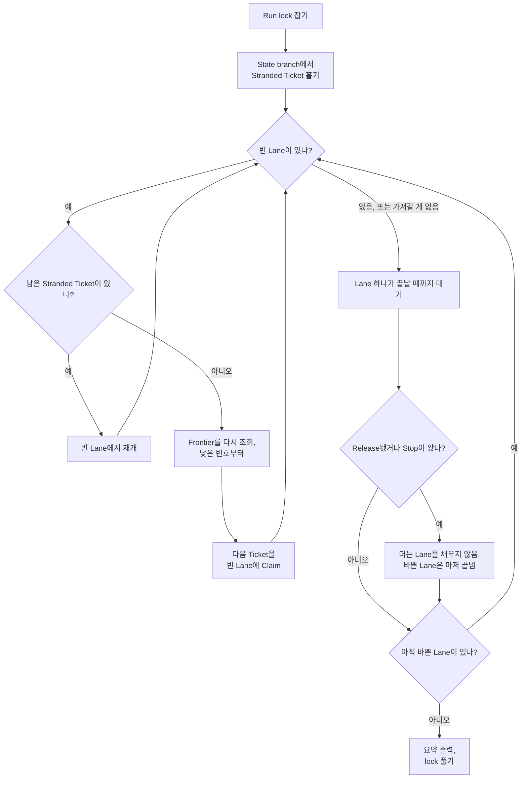

# 실행하기

[Run](https://github.com/jjongs2/ticket-runner/blob/main/GLOSSARY.md)은 명령 하나 걸어 두고 자리를 떠도 되게 하려고 있습니다. 준비된 Ticket을 모두 가져가 하나하나 merge나 사람에게까지 데려가고, 가져갈 게 더 없으면 알아서 끝납니다. 나중에 궁금할 만한 것은 요약과 보드, 그리고 디스크에 남긴 transcript에 다 있습니다.

| 명령 | 하는 일 | 종료 코드 |
|---|---|---|
| `ticket-runner run` | Frontier를 비움 | `0` · `1` Hand-off 있음 · `2` 가져간 것 없음 |
| `ticket-runner run 3 7` | 같은 Run을 #3과 #7로 좁힘 | 위와 같음 |
| `ticket-runner run --lanes 2` | 같은 Run을 Ticket 두 개씩 동시에 | 위와 같음 |
| `ticket-runner run --api-key` | 같은 Run을 셸이 export한 `ANTHROPIC_API_KEY`로 과금 | 위와 같음 |
| `ticket-runner stop` | 이 Target의 Run에게 쥔 것만 마치고 더 가져가지 말라고 요청 | `0` 보냄 · `2` 보낼 상대 없음 |
| `ticket-runner -v` | 이 사본의 Version을 출력 | `0` |
| `ticket-runner -h` | 사용법을 출력 | `0` (명령 없이 실행하면 `2`) |

`init`과 `remove`는 [설치와 제거](./installation.md)에 있습니다. 모르는 명령이나 옵션, 잘못된 인자는 사용법과 함께 종료 코드 `2`로 거절합니다.

## `/implement-spec`과 Run {#implement-spec-or-a-run}

플러그인의 `/implement-spec`도 Spec의 Ticket들을 코드로 옮깁니다. `/implement-spec`은 내 세션에서 돌고 Run은 무인으로 돌며, 나머지 차이는 모두 여기서 나옵니다.

| | `/implement-spec` | Run |
|---|---|---|
| 지켜보는 사람 | 나. 내 세션에서 보면서 방향을 틀 수 있음 | 없음. 끝난 뒤 요약과 보드를 읽음 |
| 일의 단위 | Spec 하나 전체를 세션 하나에서 | Ticket 하나. branch와 pull request가 Ticket마다 따로 |
| 관문 | skill이 밟는 단계, 그다음 나의 검토 | Ticket마다 Check, verify Stage, CI |
| 끝나는 모습 | 세션이 끝나면 Spec의 작업이 내 검토를 기다림 | Ticket마다 Base branch에 merge되거나 사람에게 넘어감 |
| 이어 하기 | 어디까지 했는지 보드에 남는 기록이 없어 남은 일은 내가 가려내야 함 | [Stranded Ticket](./stopping-and-resuming.md)을 다음 Run이 어느 Host에서든 이어 감 |
| 보드에 남는 표시 | 작업하는 동안 없음 | Run이 쥔 동안 `in-progress`와 담당자 |

둘이 한 Spec을 나눠 맡지는 않습니다. Spec에 `/implement-spec`을 돌리기 전에 그 Ticket들에서 `ready-for-agent`를 떼세요([라벨](./planning.md#labels)). skill이 단계마다 하는 일, pull request를 여는 조건, 알려진 약점은 [upstream 페이지](https://www.aihero.dev/skills-implement-spec)에 있습니다.

## `run` {#run}

`run`은 [Frontier](https://github.com/jjongs2/ticket-runner/blob/main/GLOSSARY.md)를 비웁니다. Frontier는 `ready-for-agent` 라벨이 붙은 열린 Ticket 중 담당자가 없고 네이티브 blocker가 모두 닫힌 것들입니다([계획](./planning.md)). 무언가를 가져가기 전에 [거절될](#refused-before-it-starts) 수 있고, 그때는 종료 코드 `2`로 끝나며 아무것도 남기지 않습니다.

그다음 [Lane](https://github.com/jjongs2/ticket-runner/blob/main/GLOSSARY.md)으로 Ticket을 가져갑니다. Lane 하나에 Ticket 하나, 기본은 Lane 하나입니다.


<!-- Sources: src/run.ts, src/start.ts, src/stranded.ts, src/frontier.ts -->

- **실패한 Ticket은 Hand-off되고** 그 Lane은 다음 Ticket을 가져갑니다. 나쁜 Ticket 하나 때문에 밤 전체를 잃지는 않습니다.
- **[Release](./stopping-and-resuming.md#release-on-a-rate-limit)가 일어나면 채우기를 멈춥니다.** 바쁜 Lane은 마저 끝내고, 다음 Run은 사람이나 Operator가 시작합니다.
- **Run이 끝나는 때**는 바쁜 Lane이 없고 가져갈 것도 남지 않았을 때입니다. Frontier가 비었거나, 남은 것이 모두 막혀 있을 때죠.
- **메인 체크아웃은 Run에게 맡겨 두세요.** Run은 rebase하기 전과 merge한 뒤마다 거기로 Base branch를 pull합니다. pull이 덮어쓸 commit하지 않은 변경이 있으면 Ticket이 Hand-off되고, checkout된 Base branch에 원격에 없는 commit이 있으면 다음 pull request에 rebase되어 들어갑니다. 그동안 작업은 따로 만든 worktree에서 하세요.

Lane 안에서 Ticket 하나에 일어나는 일은 [Ticket 하나가 merge되기까지](./ticket-to-merge.md)에 있습니다. Stranded Ticket과 Release는 [Hand-off, 멈추고 이어 하기](./stopping-and-resuming.md)에 있습니다.

### `--lanes` {#lanes}

`--lanes <n>`은 이번 Run에만 Lane `n`개를 주고, `ticket-runner.json`의 [`lanes`](./configuration.md#lanes)보다 우선합니다. Lane을 늘리면 무엇이 빨라지는지, 언제 하나로 둘지도 거기에 있습니다. Ticket 번호 앞에 둬도 뒤에 둬도 됩니다.

### `--api-key` {#api-key}

Stage는 모두 `claude -p` 세션입니다. `-p`에서는 `ANTHROPIC_API_KEY`가 묻지도 않고 Claude 로그인보다 앞서기 때문에, Run은 셸이 무엇을 export하든 그 키를 빼고 Stage를 시작합니다. 그래서 Stage는 요금제로 돕니다. `ANTHROPIC_AUTH_TOKEN`은 gateway나 프록시를 위해 그대로 넘깁니다.

`--api-key`를 주면 이 Run의 모든 Stage를 대신 셸이 export한 `ANTHROPIC_API_KEY`로 과금합니다. Max나 Team 요금제에 딸린 월간 API 크레딧은 키로 돌린 `claude -p`에만 쓰이니, 그 크레딧을 쓰는 방법이 이것입니다. 키를 export하지 않았거나 클라우드 Host라면 lock을 잡기 전에 거절합니다([시작 전에 거절되는 경우](#refused-before-it-starts)). 요금제 한도로 멈춘 Run이 알아서 키로 넘어가지는 않습니다.

| `--api-key` Run에서 | 일어나는 일 |
|---|---|
| 키의 조직에 크레딧이 없거나, 워크스페이스가 사용 한도에 닿음 | Ticket이 Release되고, Run은 `Out of API budget.`으로 끝남 |
| 429 | 요금제가 아니라 API의 rate limit으로 Release됨: `API rate limit` |

파이프라인은 예산을 따로 관리하지 않습니다. Console에서 키에 전용 워크스페이스를 주고 사용 한도를 거세요. 한도는 정확하지 않습니다. API가 거절하기 전에 Run이 한도를 넘겨 쓸 수 있고, Lane이 여럿이면 더 넘깁니다.

### 좁힌 Run {#a-narrowed-run}

`ticket-runner run 12 13 14`는 모든 면에서 같은 Run입니다(Lane, Landing, Run lock, Release, Stop 모두). 다만 Stranded Ticket에서든 Frontier에서든 #12, #13, #14만 가져갑니다. 다른 Ticket은 Stranded Ticket까지 포함해 있던 그대로 둡니다.

- 번호는 어떤 Ticket인지를 말할 뿐 순서를 정하지 않습니다. Stranded Ticket이 먼저, 나머지는 낮은 번호부터입니다.
- blocker는 그대로 유효합니다. 지정한 Ticket이 지정한 다른 Ticket에 막혀 있으면, 그 Ticket이 같은 Run에서 merge된 뒤에 가져갑니다.

지정했는데 Run이 가져가지 않은 Ticket에는 이유를 적은 `skipped` 줄이 붙습니다. 이슈에 코멘트까지 다는 것은 Guard의 이유뿐입니다.

| 줄 | 뜻 |
|---|---|
| `blocked` | Run이 끝날 때까지 열린 blocker가 막고 있었음 |
| `claimed` | 다른 누군가가 담당자로 지정되어 있음 |
| `not-ready` | `ready-for-agent` 라벨이 없거나 이미 닫힘 |
| `no-issue` | 그 번호의 이슈가 없음 |
| `pull-request` | 그 번호는 pull request |
| `spec`, `no-criteria`, `body-only-blockers` | [Guard](./planning.md#guards)가 거절함 |

Stop이나 Release 때문에 Run이 손대지 못한 지정 Ticket에는 줄이 없습니다. Run이 왜 멈췄는지는 요약의 마지막 줄이 말해 줍니다.

## `stop` {#stop}

```bash
ticket-runner stop
```

Stop은 Run에게 Lane이 쥐고 있는 Ticket만 merge나 Hand-off까지 마치고 더는 가져가지 말라고 하는 요청입니다. `stop`은 GitHub에서 Run lock을 읽어 거기 적힌 프로세스에 SIGTERM을 보내고, 어느 Run에게 요청했는지 알려 줍니다.

```text
`ticket-runner run` (run 2026-09-17T09-00-00-000, pid 4321) will stop once the Tickets it holds are finished. It claims no more.
Ctrl+C in that Run's own terminal stops it at once instead, at the cost of killing the Stages it is running and leaving their Tickets stranded for the next Run.
```

Target에서는 lock 말고 아무것도 필요 없습니다. 설정도, `gh` 로그인도, readiness도요.

| 찾은 것 | 출력 | 종료 코드 |
|---|---|---|
| 이 Host의 Run | 위의 두 줄 | `0` |
| lock을 잡은 Run이 없거나, 이 Host에서 lock이 가리키는 Run이 사라짐 | `No Run to stop: …`. 죽은 lock은 다음 Run이 넘겨받도록 그대로 둠 | `2` |
| 다른 Host의 Run. 그 Host만 신호를 보낼 수 있음 | 그 Host, Run, 시작 시각을 알려 주고 `Nothing was sent.` | `2` |
| 신호를 전달하지 못함 | `Could not ask … to stop: <reason>` | `2` |

`stop`을 두 번 해도 같은 내용을 출력하고, Run은 두 번째 신호를 무시합니다. Stop과 kill이 각각 남기는 것은 [Stop과 kill](./stopping-and-resuming.md#stop-and-kill)에 있습니다.

## `-v` {#v}

`-v` 또는 `--version`은 `0.5.2`처럼 이 사본의 Version을 출력합니다. Run이 쓰는 모든 것에 같은 문자열이 찍힙니다([찍히는 번호](./internals.md#the-stamp)).

## 시작 전에 거절되는 경우 {#refused-before-it-starts}

| 상황 | 보게 되는 것 |
|---|---|
| 이 Host의 다른 Run이 Target을 쥐고 있음 | ``Another ticket-runner is running on this Host: `ticket-runner run` as run … Wait for it to finish, or ask it to with `ticket-runner stop`.`` |
| 다른 Host의 Run이 Target을 쥐고 있음 | 그 Host, Run, 시작 시각, 그리고 그 Run이 사라졌을 때 lock을 푸는 방법 |
| 셸이 Stage의 것임 | ``Refusing to start: TICKET_RUNNER_STAGE is set to `implement`, …`` |
| 키를 export하지 않고 `--api-key` | `` `--api-key` runs every Stage on the `ANTHROPIC_API_KEY` this shell exports, and it exports none. … `` |
| 클라우드 Host에서 `--api-key` | `` `--api-key` needs a workstation Host: a cloud session runs every Stage on the subscription, … `` |
| Target이 준비되지 않았거나, 로컬 State 파일이 아직 있거나, Check가 없음 | [Target readiness](./installation.md#target-readiness-what-run-refuses) 참고 |

Target 하나에는 한 번에 Run 하나뿐입니다. 어느 Host에서 돌든 마찬가지입니다. lock을 언제 알아서 넘겨받는지, 다른 Host가 남긴 lock은 어떻게 푸는지는 [Run lock](./stopping-and-resuming.md#the-run-lock)에 있습니다.

## 요약 {#the-summary}

Run이 끝나면 Ticket마다 한 줄씩, Ticket이 끝난 순서대로 출력하고, 왜 멈췄는지 한 줄로 마무리합니다.

```text
ticket-runner 0.5.2 run 2026-09-17T09-00-00-000 · 84m · subscription

  merged   #4 Planning guards (PR #12)
  noted    #8 comment · from #4 implement · the CLI help drifts
  handed   #5 Fix Stage with a single retry · verify · 1 unmet
  skipped  #7 no-criteria
  skipped  #9 blocked

Frontier blocked.
```

머리 줄 끝은 Stage를 무엇으로 과금했는지입니다. `subscription`, 또는 `--api-key` Run이면 `API key`. 아무것도 가져가지 않은 Run은 줄 대신 `  nothing to do`를 출력합니다.

| 줄 | 뜻 |
|---|---|
| `merged` | merge됨. pull request 번호가 붙음 |
| `handed` | 사람에게 Hand-off됨. 멈춘 Stage와 이유가 붙음 |
| `released` | 해당 Stage에서 `rate limit`(`--api-key` Run이면 `API rate limit`), `API failure`, `out of API budget`으로, 또는 `checks`나 `ci`에서 `failing Base branch`로 Release됨. Ticket에 대해서는 누구도 할 일이 없음 |
| `skipped` | 이유와 함께 넘어감([Guard](./planning.md#guards), 또는 위의 표) |
| `billed` | 위 Ticket의 Stage가 `apiKeySource`로 머리 줄과 다른 과금처를 댐. 예를 들어 Host 설정의 `apiKeyHelper`가 준 키인데, 이것은 환경 변수로 뺄 수 없음 |
| `noted` | 바로 윗줄이 남긴 [Note](https://github.com/jjongs2/ticket-runner/blob/main/GLOSSARY.md)와 간 곳. Base branch 실패에 대한 파이프라인 자신의 Note면 `from #<n> pipeline`. 이미 있는 이슈(열려 있던 Notes 이슈 포함)면 `comment`, Notes 이슈를 새로 연 Note 하나만 `new` |

| 마지막 줄 | Run이 끝난 이유 |
|---|---|
| `Frontier empty.` | 가져갈 것이 남지 않음 |
| `Frontier blocked.` | 남은 것에 모두 열린 blocker가 있음 |
| `Rate limited · resets 2026-09-20 03:40 UTC.` | rate limit으로 Release되어 멈춤. 시각은 CLI가 알려 준, 한도가 풀리는 시각(UTC)이고, 알려 주지 않았으면 `Rate limited.`로 끝남. `--api-key` Run이면 `API rate limited` |
| `API failure.` | 일시적인 API 장애로 Release되어 멈췄고, 그 뒤 rate limit으로 Release된 Ticket이 없음. 마지막 줄에서는 rate limit이 API 장애보다 앞섬 |
| `Out of API budget.` | 키의 크레딧이나 사용 한도로 Release되어 멈춤. 사람이 손써야 하는 것은 이것뿐이라 rate limit과 API 장애보다 앞섬. Console을 확인하세요 |
| ``Base branch `main` fails `npm test` at 1a2b3c4.`` | Base branch 실패로 Release되어 멈춤. 실패한 Check와 merge-base를 알려 줌. Base branch에서 고치면 되고, 출력은 standing Notes 이슈의 Note에 있음 |
| `Stopped at 22:07 · finishing #4 #9.` | 그 시각(UTC)에 Stop이 왔고, 그때 그 Ticket들이 Lane에 있었음 |

Stop이나 Release로 끝난 Run은 Frontier 끝까지 가 보지 못했으니 `blocked` 줄을 출력하지 않습니다.

## 종료 코드 {#exit-codes}

| 코드 | `run` |
|---|---|
| `0` | Hand-off된 것이 없음. Release도 가져간 것으로 치고, 번호 없이 시작해 모두 건너뛴 Run도 마찬가지 |
| `1` | Hand-off된 Ticket이 하나 이상 |
| `2` | 아무것도 가져가지 않음: Run이 거절됐거나, 번호를 받았는데 하나도 가져가지 않음 |

멈춘 Run도 평소처럼 결과에 따른 코드로 끝납니다. 다른 명령의 종료 코드는 이 페이지 맨 위의 표에, `init`과 `remove`의 것은 [설치와 제거](./installation.md)에 있습니다.

## 로그와 transcript {#logs-and-transcripts}

Run 자신의 출력은 터미널로 갑니다. Ticket에 관한 줄은 모두 그 번호로 시작하니, Lane들의 출력이 섞여 있어도 Ticket 하나씩 따라 읽을 수 있습니다.

```text
ticket-runner run 2026-09-17T09-00-00-000 · 1 lane
#4 claimed · agent/4-planning-guards
#4 verified · 6 met · 1 unverifiable
#4 merged · PR #12
```

Stage가 도는 동안이나 CI를 기다리는 동안에는 아무것도 출력하지 않고, 이 시간은 한 시간이 될 수도 있습니다. Stage 자신의 출력은 아래의 `.stdout` 파일에 있습니다. 좁힌 Run이면 첫 줄에 지정한 Ticket이 덧붙고, 재개한 Ticket은 `claimed` 대신 `resumed from <state>`라고 출력합니다. Run과 다른 과금처로 돈 Stage는 돌아오는 대로 이름을 댑니다. `#4 implement ran on apiKeySource apiKeyHelper, not the subscription (none)`. 경고와 거절은 stderr로 갑니다.

Stage가 한 일은 모두 Target의 gitignore된 `.ticket-runner/` 아래 디스크에 남습니다. run id는 UTC 시작 시각입니다. 예를 들면 `2026-09-17T09-00-00-000`.

| `.ticket-runner/runs/<runId>/` 아래 경로 | 담는 것 |
|---|---|
| `version.txt` | 돌린 Version. 첫 Stage 전에 씀 |
| `<n>/<stage>.command` | 환경 변수까지 포함한 정확한 명령줄. 그대로 붙여 넣으면 Stage를 다시 돌릴 수 있음. 키 없이 돈 Stage는 `env -u ANTHROPIC_API_KEY …`, 키로 돈 Stage는 `ANTHROPIC_API_KEY="$ANTHROPIC_API_KEY" …`로 시작하고, 키 값은 적지 않음 |
| `<n>/<stage>.stdout`, `<n>/<stage>.stderr` | Stage가 출력하는 대로 실시간으로 덧붙인 출력 |
| `<n>/<stage>.transcript.jsonl` | 세션의 stream-json 이벤트 |
| `<n>/retry/` | fix Stage와, 그 덕에 한 번 더 도는 시도. 실패한 시도의 파일은 옆에 그대로 남음 |

명령줄은 Stage가 시작되기 전에, 출력은 나오는 대로 쓰니, Stage 도중에 kill된 Run도 거기까지 한 것은 남깁니다. Stage가 셸이 export한 `ANTHROPIC_API_KEY`를 출력한 곳에서는 파일에 그 값 대신 `<ANTHROPIC_API_KEY>`가 적힙니다. Hand-off된 Ticket의 명령줄과 transcript는 Target의 원격에도 남습니다([무엇이 어디에 남나](./stopping-and-resuming.md#what-stays-where)).

## Claude 앱에서 실행하기 {#from-the-claude-app}

워크스테이션에서는 Run이 그 머신이 켜져 있는 동안만 돕니다. 머신이 잠들거나, 재부팅되거나, 꺼지면 다시 돌아올 때까지 Frontier가 줄지 않고, Run을 들여다보거나 멈추는 것도 시작한 터미널에서만 할 수 있습니다. Claude 앱에서 시작한 Run은 내 머신이 꺼져 있어도 계속 돌고, 어느 기기에서든 따라볼 수 있습니다. 다만 VM이 회수될 수는 있습니다(아래 참고). 앱에서 Target으로 Claude Code 클라우드 세션을 열고 "run it"이라고 말하면 됩니다. 그 세션의 Claude가 [Operator](https://github.com/jjongs2/ticket-runner/blob/main/GLOSSARY.md)입니다. 클라우드 세션은 저장소 말고는 아무것도 가져오지 않으니, Operator는 `init`이 Target에 써 둔 스킬 `.claude/skills/ticket-runner/SKILL.md`를 따릅니다([ADR-0008](https://github.com/jjongs2/ticket-runner/blob/main/docs/adr/0008-a-cloud-host-is-a-claude-code-cloud-session.md)).

앱에서 첫 Run을 하기 전에:

1. 워크스테이션에서 `init`을 실행하고, 쓴 내용을 commit해서 Base branch에 push하세요. 클라우드 세션은 저장소만 봅니다.
2. 클라우드 환경이 npm, GitHub, apt, 그리고 Target 자체의 패키지 레지스트리에 닿을 수 있게 하세요. Host를 준비할 때 거기서 설치합니다.

`gh`는 따로 할 게 없습니다. 클라우드 세션이 인증해 줍니다.

| 이렇게 말하면 | Operator는 |
|---|---|
| "run it" | Host를 준비한 뒤 `ticket-runner run`을 백그라운드로 시작 |
| "12번이랑 14번 돌려 줘" | `ticket-runner run 12 14`를 시작 |
| "세 개씩 동시에" | `--lanes 3`을 넘김. 그래서 클라우드는 워크스테이션과 다른 수를 감당할 수 있음 |
| "API 키로 돌려 줘" | 요청할 때만 `--api-key`를 넘기고, 그런 Run에는 워크스테이션이 필요하다고 알려 줌. 클라우드 Host는 거절함 |
| "멈춰" | `ticket-runner stop`을 실행하고, Run이 끝날 때까지 계속 보고 |
| "lock 풀어 줘" | 자기 Run이 돌고 있지 않을 때만, `ticket-runner/lock`에 빈 `lock.json`을 commit |

Host 준비는 클라우드 환경의 setup script가 설치하지 않은 것만 채웁니다.

1. **파이프라인.** setup script가 설치한 사본이 있으면 Version과 상관없이 그대로 씁니다. 없으면 Target의 conventions 문서에 찍힌 Version을 설치합니다. 찍힌 Version이 없으면 아무것도 설치하지 않고, 워크스테이션에서 `init`을 실행해 달라고 합니다.
2. **`mattpocock-skills` 플러그인**, 공식 마켓플레이스에서.
3. **`gh`**, apt에서.
4. **Target 자체의 의존성**, 메인 체크아웃에. 모든 worktree의 Check가 거기서 찾아 씁니다.

Run이 Ticket을 끝낼 때마다 보고하고, 끝나면 요약과 종료 코드의 뜻을 전합니다.

클라우드 Host는 몇 가지가 워크스테이션과 다르고, 파이프라인은 그것을 감안합니다.

- **원격에서 아무것도 지울 수 없습니다.** 그래서 `init`이 merge 때 pull request branch를 지우는 설정을 켜고, `remove`는 클라우드 Host에서 실행을 거절합니다.
- **이슈 본문, 코멘트, pull request 본문마다 "Generated by Claude Code" 줄이 붙습니다.** 프록시가 덧붙이는 것이라 끌 수 없습니다. squash commit은 파이프라인이 직접 작성하니 base branch에는 들어가지 않습니다.
- **회수된 VM은 kill입니다.** Stranded Ticket을 남기고, 다음 Run이 어느 Host에서든 재개합니다. 남은 lock은 다른 Host가 죽었다고 단정하지 않으니 사람이 풀어야 합니다. Operator를 통해서든 GitHub에서든요.
- **transcript는 VM과 함께 사라집니다.** Hand-off된 Ticket의 것만 State branch에 남습니다.
- **Stage는 늘 요금제로 돕니다.** 클라우드 세션은 `ANTHROPIC_API_KEY`를 무시하니, `--api-key`를 받아 놓고 지키지 못하는 대신 거절합니다.

## 관련 페이지 {#related-pages}

- [일 계획하기](./planning.md): Ticket이 Frontier에 오르려면.
- [설정](./configuration.md): Run이 쓰는 `lanes`, Check, Stage 한도.
- [Ticket 하나가 merge되기까지](./ticket-to-merge.md): Lane이 Ticket 하나로 하는 일.
- [Hand-off, 멈추고 이어 하기](./stopping-and-resuming.md): Stop과 kill, Release, Stranded Ticket, Run lock.
- [설치와 제거](./installation.md): 시작하기 전에 Run이 거절하는 것.

## 참고 자료 {#references}

- [`src/cli.ts`](https://github.com/jjongs2/ticket-runner/blob/main/src/cli.ts), [`src/command-line.ts`](https://github.com/jjongs2/ticket-runner/blob/main/src/command-line.ts), [`src/start.ts`](https://github.com/jjongs2/ticket-runner/blob/main/src/start.ts), [`src/run.ts`](https://github.com/jjongs2/ticket-runner/blob/main/src/run.ts)
- [`src/credential.ts`](https://github.com/jjongs2/ticket-runner/blob/main/src/credential.ts), [`src/adapters/claude-agent-runner.ts`](https://github.com/jjongs2/ticket-runner/blob/main/src/adapters/claude-agent-runner.ts)
- [`src/stop.ts`](https://github.com/jjongs2/ticket-runner/blob/main/src/stop.ts), [`src/lock.ts`](https://github.com/jjongs2/ticket-runner/blob/main/src/lock.ts), [`src/stage-guard.ts`](https://github.com/jjongs2/ticket-runner/blob/main/src/stage-guard.ts), [`src/host.ts`](https://github.com/jjongs2/ticket-runner/blob/main/src/host.ts)
- [`src/templates.ts` · `runSummary`](https://github.com/jjongs2/ticket-runner/blob/main/src/templates.ts), [`src/run-log.ts`](https://github.com/jjongs2/ticket-runner/blob/main/src/run-log.ts), [`src/adapters/version.ts`](https://github.com/jjongs2/ticket-runner/blob/main/src/adapters/version.ts)
- [`docs/templates/run-summary.txt`](https://github.com/jjongs2/ticket-runner/blob/main/docs/templates/run-summary.txt), [`docs/templates/stop-report.txt`](https://github.com/jjongs2/ticket-runner/blob/main/docs/templates/stop-report.txt), [`docs/templates/operator-skill.md`](https://github.com/jjongs2/ticket-runner/blob/main/docs/templates/operator-skill.md)
- [ADR-0006](https://github.com/jjongs2/ticket-runner/blob/main/docs/adr/0006-stop-is-a-signal-and-ctrl-c-is-a-kill.md), [ADR-0007](https://github.com/jjongs2/ticket-runner/blob/main/docs/adr/0007-a-version-is-cut-by-a-human-and-installs-follow-tags.md), [ADR-0008](https://github.com/jjongs2/ticket-runner/blob/main/docs/adr/0008-a-cloud-host-is-a-claude-code-cloud-session.md)
