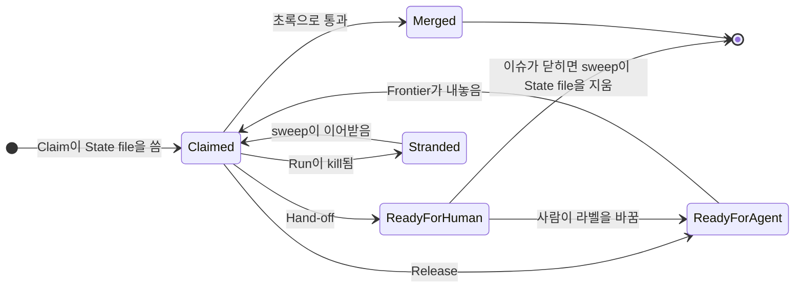
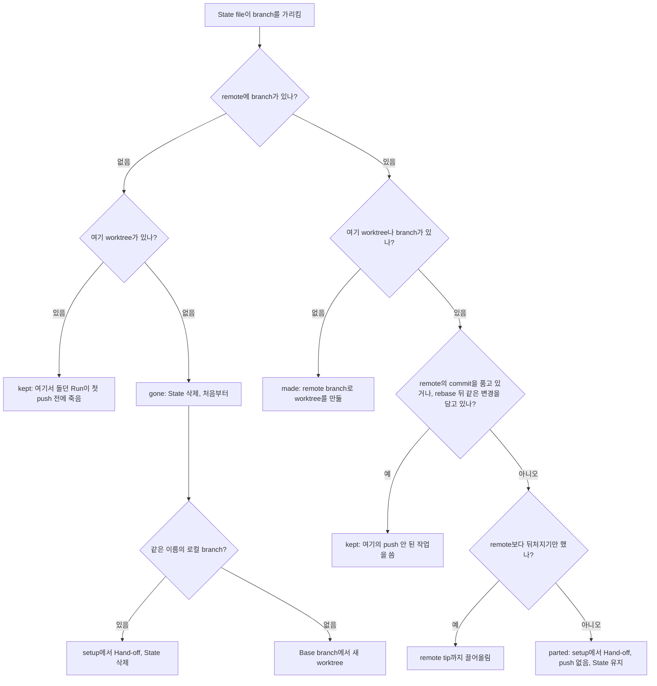

# Hand-off, 멈추고 이어 하기

Run은 아무도 지켜보지 않는 사이에 돌아가니, 일이 틀어졌을 때도 깔끔하게 끝나야 합니다. 끝내지 못한 Ticket, 바닥난 요금제 한도나 API 키, 그만 멈추라는 사람의 요청, 갑자기 사라진 머신 같은 경우 말이지요. 어느 경우든 Ticket은 다음 Run이 이어받을 수 있는 자리에 남습니다. 같은 Host든 다른 Host든 상관없습니다. 이어받은 Run은 이미 끝낸 Stage에 비용을 다시 치르지 않고, 사람이 라벨을 먼저 손봐 줄 필요도 없습니다.

## 한눈에 보기 {#at-a-glance}

| 끝맺음 | 원인 | 남는 것 |
|---|---|---|
| merge | 모든 게이트를 초록으로 통과 | 닫힌 이슈. branch와 State file은 사라짐 |
| [Hand-off](#hand-off) | Fix budget으로 감당할 수 없는 실패 | `ready-for-human`, 코멘트, draft pull request. 작업과 State 유지 |
| [Release](#release-on-a-rate-limit) | 요금제나 API의 rate limit, 일시적인 API 장애, [API 키의 예산 소진](#release-out-of-api-budget), 또는 [Base branch 실패](#release-over-a-failing-base-branch) | `ready-for-agent`, Ticket에 코멘트 없음. 작업과 State 유지 |
| [Stop](#stop-and-kill) | `ticket-runner stop`(SIGTERM) | 새로 남는 것 없음 |
| [kill](#stop-and-kill) | Ctrl+C, SIGKILL, 사라진 Host | Claim, 마지막 push 시점의 작업, State |

merge나 Hand-off 뒤에는 Run이 그 Lane을 다시 채웁니다. Release나 Stop 뒤에는 더 claim하지 않고, 바쁜 Lane만 맡은 일을 마칩니다. kill이면 그 자리에서 끝납니다.

아직 끝나지 않은 Ticket은 저마다 한 갈래 길로 돌아옵니다. 어느 길인지는 보드가 정합니다.


<!-- Sources: src/orchestrator.ts, src/stranded.ts, src/run.ts, src/resume.ts -->

## Hand-off {#hand-off}

[Hand-off](https://github.com/jjongs2/ticket-runner/blob/main/GLOSSARY.md)는 Ticket을 사람에게 넘기는 일입니다. merge도 Release도 아닌 끝은 모두 Hand-off입니다. Fix budget을 쓴 뒤의 두 번째 실패, 시간을 넘긴 Stage, 끝나지 않은 CI, setup에서 앞을 막은 branch 같은 경우입니다.

Hand-off가 남기는 것:

- push할 작업이 있으면, branch의 작업을 담은 draft pull request. 이미 열려 있던 pull request는 draft로 되돌아갑니다.
- 아래의 hand-off 코멘트. Ticket이 어디서, 왜 실패했는지 알려 줍니다.
- `in-progress` 대신 `ready-for-human`, 그리고 담당자 없음
- 각 Stage의 명령줄과 transcript. `ticket-runner/state` branch의 `ticket-<n>/<runId>/` 아래에 남습니다.

State file은 남겨 두니, 라벨만 바꾸면 Ticket을 이어 갑니다([Ticket 돌려주기](#handing-a-ticket-back)). 이 Run의 Stage가 작업을 남겼을 리 없는 경우는 예외입니다(아래 참고).

코멘트는 [`docs/templates/handoff-comment.md`](https://github.com/jjongs2/ticket-runner/blob/main/docs/templates/handoff-comment.md)의 모양을 따릅니다.

```md
<!-- ticket-runner:handoff -->
**Handed off.** Failed at **verify**, after the fix budget was used.

- Failure: 1 of 6 criteria unmet
- Branch `agent/8-rate-limit-release` on the remote · worktree `/home/me/acme/.worktrees/ticket-8` · PR #31 (draft)
- Transcripts: `ticket-8/2026-09-17T09-00-00-000/` on the `ticket-runner/state` branch

<details><summary>Evidence</summary>
…
</details>
```

Failure 줄은 무엇이 Ticket을 멈췄는지 말합니다. 그에 따라 할 일은 이렇습니다.

| Failure | 돌려주기 전에 바꿀 것 |
|---|---|
| Stage가 분 한도를 넘겼거나 턴 한도에 닿음 | [`stages`](./configuration.md#stages)에서 그 Stage의 `maxMinutes`나 `maxTurns`를 늘리거나, Ticket을 나누기 |
| implement가 commit을 남기지 않음 | transcript를 읽고, Ticket을 더 작게 또는 더 분명하게 고치기 |
| fix 뒤에도 Check, 기준, CI가 여전히 실패 | 코멘트의 근거를 읽고 branch에서 코드를 손으로 고치기. 기준이라면 다음 행처럼 다시 쓰기 |
| fix 뒤에도 기준이 충족되지 않음, 또는 근거 없음 | 코드를 손으로 고치거나, 세션이 코드를 돌려 보거나 읽어서 확인할 수 있게 기준을 다시 쓰기([Acceptance Criteria](./planning.md#acceptance-criteria)) |
| CI 시간 초과 | [`ciTimeoutMinutes`](./configuration.md#ci)를 늘리기 |
| check 없음 | CI 워크플로를 추가하거나, check가 늦게 등록되면 `ciGraceMinutes`를 늘리거나, [`gates.ci`](./configuration.md#gates)를 끄기 |
| pull request가 충돌 상태 | 할 일 없음. 다음 Run이 다시 rebase하고, 충돌은 Conflict Stage가 맡음 |
| Base branch를 pull하지 못함 | main checkout에서 걸리는 것을 치우기([실행하기](./running.md#run)) |
| merge 실패 | GitHub가 거절하며 가리킨 저장소 설정을 바로잡기. branch protection rule 같은 것 |
| 앞을 막은 branch, 또는 갈라진 사본 | Failure 줄이 알려 주는 명령을 실행하기 |
| git이나 GitHub 단계가 실패함: pull request의 push, 열기, draft에서 꺼내기, rebase 중의 git 명령, worktree 준비 | Failure 줄의 오류가 가리키는 것을 바로잡고(git 단계라면 그 단계를 돌린 Host에서) 돌려주기. 누군가 손으로 닫은 pull request는 작업을 멈추라는 뜻입니다. |
| 그 밖의 Stage 실패. 0이 아닌 종료 코드, 스키마가 거절한 답 같은 것 | 그 Stage의 transcript를 읽기([무엇이 어디에 남나](#what-stays-where)) |

### Hand-off가 덜 하는 경우 {#when-a-hand-off-does-less}

`setup`에서의 Hand-off는 아무것도 push하지 않습니다. push할 것이 없거나, 앞을 막은 것이 사람의 작업이거나 다른 Host의 작업일 수 있기 때문입니다.

| 경우 | draft pull request | State file |
|---|---|---|
| 이어 갈 것 없이 새로 시작했는데, worktree를 만들기 전에 실패 | 없음: push할 것이 없음 | **삭제**: 만들어진 branch가 없음 |
| 새로 시작했는데, 같은 이름의 로컬 branch가 있음 | 없음 | **삭제**: 이 Run의 Stage가 거기서 일한 적 없음 |
| 이어받았는데 이 Host의 branch가 remote의 것과 갈라짐 | 새로 열지 않음. 열린 것은 draft로 | 유지: 양쪽 다 파이프라인의 작업 |
| worktree가 준비된 뒤의 모든 실패 | 새로 열거나, 열린 것을 draft로 되돌림 | 유지 |

코멘트는 worktree가 있으면 늘 알려 줍니다. 이 Run의 worktree이거나, 앞을 막은 branch가 checkout된 worktree입니다. Failure 줄에 해야 할 일이 적혀 있습니다. 예를 들면 `delete it with git branch -D <branch> if the work on it is abandoned, or finish it by hand, then relabel the Ticket ready-for-agent` 같은 식입니다.

### 무엇이 어디에 남나 {#what-stays-where}

사람이 들여다볼 즈음에는 작업하던 Host가 이미 없을 수도 있습니다. 클라우드 Host의 VM이 그렇습니다. 그래서 사람이나 다음 Run에 필요한 것은 모두 Target의 remote에 둡니다.

| 무엇 | 어디 | 언제까지 |
|---|---|---|
| Ticket의 commit | remote의 `agent/<n>-<slug>` branch | merge되며 삭제될 때까지 |
| State file | `ticket-runner/state`의 `ticket-<n>.json` | 작업이 merge되거나 파이프라인의 몫이 아니게 될 때까지([아래](#the-state-file)) |
| Hand-off된 Stage의 transcript | `ticket-runner/state`의 `ticket-<n>/<runId>/` | State file이 사라질 때까지 |
| worktree | 그 Host의 `.worktrees/ticket-<n>` | merge되거나 사람이 지울 때까지 |
| 모든 Stage의 전체 로그(stdout, stderr 포함) | 그 Host의 `.ticket-runner/runs/<runId>/<n>/` | 사람이 지울 때까지 |

state branch는 바뀔 때마다 다시 쓰이니, 로컬 branch가 아니라 fetch한 것에서 읽으세요.

```bash
git fetch origin ticket-runner/state
git ls-tree -r --name-only FETCH_HEAD ticket-8/
git show FETCH_HEAD:ticket-8/2026-09-17T09-00-00-000/verify.transcript.jsonl
```

commit하는 Stage는 매번 branch를 push합니다. 그래서 Run이 돌고 있지 않을 때는 `.worktrees/`와 `.ticket-runner/`를 언제 지워도 괜찮습니다. Run에 필요한 것은 모두 remote에 있고, 다음 Run이 거기서 worktree를 다시 만듭니다.

## Ticket 돌려주기 {#handing-a-ticket-back}

Hand-off된 Ticket은 네 가지 중 하나로 끝내면 됩니다.

| 할 일 | 그다음 |
|---|---|
| Ticket이나 기준, 설정을 바꾸고 돌려주기 | 다음 Run이 그때 이슈에 적힌 대로 판정함 |
| remote의 branch에 commit을 push하고 돌려주기 | 다음 Run이 자기 사본을 그 tip까지 끌어올림. 이력을 다시 쓰면 그 대신 사본이 갈라짐 |
| 직접 마무리하기: draft를 ready로 바꾸고 merge | 이슈가 닫힘. `ready-for-human`은 직접 떼고, worktree와 로컬 branch는 그것을 만든 Host에서 지우기 |
| 버리기: 이슈를 닫음 | draft pull request와 branch는 직접 닫고 지울 때까지 남음 |

```bash
gh issue edit 8 --remove-label ready-for-human --add-label ready-for-agent   # 돌려주기
```

Ticket을 파이프라인에 돌려주려면 라벨을 `ready-for-human`에서 `ready-for-agent`로 바꾸면 됩니다. 다음 Run이 Frontier에서 그 Ticket을 찾아 State file을 읽고, 도달해 있던 곳에서 이어 갑니다. `implemented`까지 갔던 Ticket은 바로 Check로 가니, implement Stage에 두 번 비용을 치르지 않습니다.

넘겼던 Run 때와 달라지는 점이 몇 가지 있습니다.

- **Fix budget**: 새로 채워집니다. Ticket이 사람 손을 거쳤으니, 그 사람이 한 일에 새 budget을 쓰라는 뜻입니다. 예전 코멘트에는 budget을 썼다고 그대로 남습니다. 실제로 썼으니까요.
- **draft pull request**: CI를 기다리기 전에 draft를 풉니다. draft에서는 워크플로가 아예 돌지 않는 일이 많아서, 그대로 기다리면 "no checks"로 읽히기 때문입니다. 사람이 닫아 버린 pull request처럼 draft가 풀리지 않으면 `pr`에서 Hand-off합니다. 닫았다는 건 이어 가지 말라는 뜻이니까요.
- **hand-off 코멘트**: 각 코멘트의 마커 바로 아래에 `_Taken again by a later Run; this hand-off is history._`가 붙습니다. 알림은 가지 않습니다.
- **Progress comment**: 새로 하나 답니다. 사람이 읽었던 코멘트는 읽은 모습 그대로 둡니다.

라벨을 바꾸기 전까지 State file은 가만히 있습니다. 어떤 Frontier도 `ready-for-human` Ticket을 내놓지 않고, sweep은 아무 말 없이 지나가며, 번호를 지정한 Run은 `not-ready`로 건너뜁니다. 이슈가 닫히면 다음 Run의 sweep이 파일과 transcript를 지웁니다.

## rate limit이나 API 장애로 멈췄을 때의 Release {#release-on-a-rate-limit}

rate limit에 걸린 Stage는 무언가를 잘못한 게 아닙니다. API가 자기 쪽 문제로 멈춰 세운 Stage도 마찬가지입니다. 이걸 Hand-off로 처리하면 아무 문제 없는 Ticket의 라벨을 사람이 다시 바꿔야 하고, fix Stage를 돌려 봐야 같은 한도나 같은 장애에 또 걸릴 뿐입니다. 그래서 Ticket을 [Release](https://github.com/jjongs2/ticket-runner/blob/main/GLOSSARY.md)합니다. Ticket은 보드로 돌아가고, 다음 Run은 마지막으로 끝낸 Stage에서부터 Fix budget도 그대로인 채 이어 갑니다.

`--api-key` 없이 시작한 Run에서는 요금제의 한도이고, `--api-key`로 시작한 Run에서는 API의 한도입니다. 일시적인 API 장애는 상태 코드가 5xx이거나 아예 없는 API 오류입니다. `529 Overloaded` 같은 경우인데, CLI가 이미 재시도한 뒤이므로 Stage를 그 자리에서 다시 돌리지 않습니다. 그 밖의 오류는 Stage 자신의 실패입니다. 세션에서 각각을 어떻게 가려내는지는 [`ClaudeAgentRunner`](./internals.md#claudeagentrunner)에 있습니다.

Release가 하는 일:

- Progress comment에 `⏸ rate limited`나 `⏸ API failure` 줄을 하나 남깁니다. 보고는 이게 전부입니다.
- State file을 최신으로 맞춥니다. implement Stage가 멈췄으면 `claimed`, 그 뒤의 Stage가 멈췄으면 `implemented`입니다. Fix budget은 그대로 가져가되, 이렇게 멈춘 게 fix Stage 자신이면 쓴 것으로 치지 않습니다.
- Claim을 되돌립니다. `ready-for-agent`를 붙이고, `in-progress`를 떼고, 담당자를 해제합니다.
- 코멘트를 달지 않고, draft pull request도 열지 않습니다.

그 뒤로 Run은 더 claim하지 않습니다. 한 Stage를 멈춘 원인은 다음 Stage도 멈출 테니까요. 바쁜 Lane은 자기 Ticket을 끝까지 마치고, Run은 한도가 풀리기를 기다리지 않고 끝납니다. 마지막 줄이 그 이유를 말하고, CLI가 알려 준 경우에는 한도가 풀리는 시각도 담습니다([요약](./running.md#the-summary)). Release된 Ticket도 가져간 것으로 치니, Hand-off가 없으면 종료 코드는 `0`입니다.

한도가 풀리거나 API가 회복된 뒤 Run을 시작하면 그 Ticket이 Frontier에 돌아와 있고, State file에서 이어 갑니다.

## API 예산 소진으로 인한 Release {#release-out-of-api-budget}

[`--api-key`](./running.md#api-key)로 시작한 Run의 Stage는 키의 조직에 크레딧이 없거나, 워크스페이스가 Console에서 건 지출 한도에 닿으면 거절당할 수 있습니다. 어느 쪽도 Ticket 탓이 아니니 rate limit 때처럼 Release하되, 다음이 다릅니다.

- Progress 줄은 `⏸ out of API budget`, Run의 마지막 줄은 `Out of API budget.`입니다.
- 지출 한도 메시지에는 접근이 돌아오는 시각이 있지만 요약은 말하지 않습니다. Console을 확인한 뒤 다음 Run을 시작하세요.

## Base branch가 실패할 때의 Release {#release-over-a-failing-base-branch}

Check나 CI가 실패했는데 branch의 merge-base에서도 실패하면, branch가 들여온 것이 아니라 물려받은 실패입니다([Base branch도 함께 실패할 때](./ticket-to-merge.md#a-failure-the-base-branch-shares)). 이때는 rate limit 때처럼 Ticket을 Release하되, 다른 점은 이렇습니다.

- Progress 줄에 ``⏸ `<command>` fails on the Base branch``라고 적고, Run의 마지막 줄은 그 명령과 merge-base를 밝힙니다.
- 상설 Notes 이슈에 명령 출력의 끝부분을 담은 Note 하나를 올립니다. Ticket 자체에는 코멘트를 달지 않습니다.
- 다음 Run은 Check 전에 branch를 Base branch 위로 rebase합니다.

Fix budget은 썼든 안 썼든 그대로입니다. budget을 이미 쓴 Ticket도 Hand-off가 아니라 Release됩니다. 열려 있던 pull request는 그대로 두고, 다음 Run이 갱신합니다.

Base branch에서 Check를 고친 뒤 Run을 시작하세요. Release된 Ticket은 Check 전에 고친 Base branch 위로 rebase됩니다. rebase가 충돌하면 Conflict Stage로 가고, 해결하지 못하면 Landing에서처럼 Fix budget을 씁니다. Base branch를 고치기 전에 Run을 시작하면 Ticket은 다시 Release됩니다.

## Stop과 kill {#stop-and-kill}

Run을 일찍 끝내는 방법은 두 가지이고, 남기는 것은 정반대입니다([ADR-0006](https://github.com/jjongs2/ticket-runner/blob/main/docs/adr/0006-stop-is-a-signal-and-ctrl-c-is-a-kill.md)).

| | Stop | kill |
|---|---|---|
| 보내는 방법 | SIGTERM. `ticket-runner stop`이나 Operator가 보냄 | Ctrl+C, SIGKILL, 메모리 부족, 사라진 Host |
| 바쁜 Lane | merge, Hand-off, Release까지 마무리 | Run과 함께 끝남 |
| 새 Ticket | Frontier에서도 Stranded Ticket에서도 가져가지 않음 | 없음 |
| 남는 것 | stranded된 것 없음 | 바빴던 Lane마다 [Stranded Ticket](#stranded-tickets-and-the-sweep) 하나, 그리고 Run lock |
| 보드에 쓰는 것 | 없음 | 없음. Claim이 그대로 남을 뿐 |
| 종료 코드 | 평소처럼 결과대로 | 없음 |

`ticket-runner stop`은 Run이 도는 그 Host에서만 통하고, 클라우드 Host라면 Operator가 신호를 보냅니다. kill이 남긴 lock은 같은 Host의 다음 Run이 스스로 넘겨받고, 다른 Host에서는 사람이 풀어 줄 때까지 기다립니다([Run lock](#the-run-lock)).

Stop은 되돌릴 수 없습니다. Lane이 모두 끝날 때까지 lock은 잡힌 채로 있고, 이어 하려면 새 Run을 시작해야 합니다. 번호를 지정한 Run이 그중 하나도 가져가기 전에 Stop되면 `2`로 끝납니다.

Ctrl+C는 일부러 kill로 남겨 두었습니다([ADR-0006](./internals.md#adr-0006)). Run을 부드럽게 끝내려면 [`ticket-runner stop`](./running.md#stop)을 쓰세요.

## Stranded Ticket과 sweep {#stranded-tickets-and-the-sweep}

kill된 Run은 아무것도 놓아주지 않습니다. 그 Ticket들은 Claim을 그대로 달고 있고, 작업은 마지막으로 push한 시점까지 remote에 있습니다. 그래서 State file은 Release가 아니라 Claim과 함께 씁니다. kill된 Run에게는 파일을 쓸 기회가 없으니까요.

[Stranded Ticket](https://github.com/jjongs2/ticket-runner/blob/main/GLOSSARY.md)은 State file이 아직 있고, 이 파이프라인의 Claim(현재 `gh` 사용자가 담당자로 지정됨 + `in-progress` 라벨)도 그대로 달린 Ticket입니다. 이미 claim된 상태라 Frontier는 이런 Ticket을 내놓지 않습니다. 그래서 모든 Run은 Frontier를 보기 전에 State file부터 훑습니다.

| State file의 Ticket | sweep이 하는 일 |
|---|---|
| 아직 이 사용자의 Claim을 달고 있음 | stranded. 줄을 세워 그 자리에서 이어받음. Claim은 건드리지 않고 아무에게도 알리지 않음 |
| Claim이 떨어짐(`ready-for-agent`나 `ready-for-human`) | 아무것도 안 함. 앞의 것은 Frontier가 가져가고, 뒤의 것은 사람을 기다림 |
| 닫힘 | State file과 남겨 둔 transcript를 지움 |
| 다른 사람이 담당자로 지정됨 | `#<n> is resumable, but <user> holds it now`를 로그에 남기고 그대로 둠 |
| 트래커에 물어볼 수 없음 | 로그만 남기고 그대로 둠. 짐작으로 Ticket을 이어받거나 잊지 않음 |
| State file을 읽을 수 없음 | `#<n> has a State file this Version cannot use, written by <version>`를 로그에 남기고 파일도 Claim도 그대로 둠 |

읽을 수 없는 State file은 아마 더 새 파이프라인이 쓴 파일입니다.

Stranded Ticket은 Frontier가 내놓는 것보다 먼저 빈 Lane을 채웁니다([실행하기](./running.md#run)).

그래도 kill은 Stop보다 비쌉니다. Stage가 아직 commit하고 push하지 못한 것은 사라집니다. rebase 도중에 멈춘 worktree는 Check가 판정하기 전에 rebase를 abort해 branch tip으로 되돌립니다.

## State file {#the-state-file}

Ticket이 어디까지 갔는지 기록이 없으면, Release되거나 stranded된 Ticket은 돌아올 때마다 처음부터 다시 시작합니다. implement Stage 비용을 또 치르고, 이미 쓴 Fix budget도 새로 채워지겠지요. State file이 바로 그 기록입니다.

파이프라인 없이도 사람이 읽을 수 있는 JSON입니다.

```json
{
  "ticket": 8,
  "branch": "agent/8-rate-limit-release-and-resume",
  "state": "implemented",
  "fixUsed": false,
  "pullRequest": 31,
  "title": "feat: release a rate-limited Ticket (#8)",
  "rebaseFirst": true,
  "runId": "2026-09-17T09-00-00-000",
  "version": "0.5.2",
  "updatedAt": "2026-09-17T10:14:02.511Z"
}
```

| 필드 | 뜻 |
|---|---|
| `ticket` | 파일만 봐도 알 수 있게 한 번 더 적은 Ticket 번호 |
| `branch` | 작업이 있는 곳. 제목에서 다시 만들지 않고 이 값을 그대로 씀 |
| `state` | `claimed`(implement Stage가 끝나지 않음) 또는 `implemented`(그 작업이 branch에 있음) |
| `fixUsed` | Fix budget을 썼는지. 이어받는다고 기회가 한 번 더 생기지는 않음. 단, Hand-off 뒤는 예외 |
| `pullRequest` | 이미 열린 pull request. 이어받은 Run이 하나를 더 열지 않도록 |
| `title` | implement나 fix Stage가 branch 전체에 대해 마지막으로 준 제목. pull request 제목이 됨 |
| `rebaseFirst` | Base branch 실패로 Release된 뒤에만 있음. Check 전에 Base branch 위로 rebase할 것 |
| `runId`, `version`, `updatedAt` | 어느 Run과 어느 [Version](./internals.md#versions)이 언제 썼는지 |

상태는 둘뿐입니다. implement Stage 다음의 모든 것(Check, Verify, rebase, pull request, CI, merge)은 `implemented`에서 이어받은 Run이 Check부터 다시 돌립니다.

파일은 Ticket이 merge되거나, 이슈가 닫히거나, branch가 여기 worktree에도 remote에도 없을 때 사라집니다.

### `ticket-runner/state` branch {#the-ticket-runner-state-branch}

State는 Target의 remote에 두니, 어느 Host의 Run이든 다른 Host가 남긴 Ticket을 이어받을 수 있습니다([ADR-0004](./internals.md#adr-0004)). 바뀔 때마다 branch를 snapshot commit 하나로 다시 씁니다([`GitWorkspace`](./internals.md#gitworkspace)). Run이 도는 동안에는 이 branch에 손으로 commit하지 마세요.

## Run lock {#the-run-lock}

어느 Host에서 돌든 Target 하나는 한 번에 Run 하나만 잡습니다. 모든 Host와 모든 사람이 볼 수 있는 Target의 GitHub 저장소에 lock을 두고 그렇게 합니다([ADR-0008](./internals.md#adr-0008)).

lock은 `ticket-runner/lock` branch tip의 `lock.json`입니다. 이 branch는 Run이 한 번 시작된 뒤로 늘 존재합니다. 파일에는 잡은 쪽이 적힙니다. `host`(kind, id, name), `pid`, `command`, `runId`, `startedAt`, 그리고 OS가 알려 주는 프로세스 시작 시각입니다. 아무도 잡지 않았다면 `{ "held": false }`입니다. commit 메시지도 같은 내용을 말로 적습니다. 예를 들면 ``Held by run 2026-09-17T09-00-00-000 on the workstation `desk`: ticket-runner run``이나 `Free`입니다.

state branch와 달리 lock은 이력을 남기니, GitHub에서 누가 언제 Target을 잡았는지 볼 수 있습니다. 두 Run이 동시에 잡으려 할 때 어떻게 가려내는지는 [`GitWorkspace`](./internals.md#gitworkspace)에 있습니다.

누군가 잡고 있는 lock을 Run이 어떻게 보느냐는 잡은 쪽이 어디 있느냐에 달려 있습니다.

| 잡은 쪽 | 판정 | 새 Run은 |
|---|---|---|
| 이 Host, 프로세스가 살아 있고 시작 시각도 같음 | running | 거절: `Another ticket-runner is running on this Host: …` |
| 이 Host, 프로세스가 없음(또는 그 pid를 다른 프로그램이 다시 씀) | abandoned | 스스로 넘겨받음. Ctrl+C로 끝난 Run은 아무 비용도 남기지 않음 |
| 다른 Host | elsewhere | 거절. 죽었다고 넘겨짚지 않음 |

한 Host에서는 다른 Host의 프로세스를 볼 수 없으니, 다른 Host가 남긴 lock은 사람이 풀 때까지 그대로 있습니다. GitHub에 있는 lock의 마지막 commit이 잡은 쪽을 `Held by run <id> on <host>: …`처럼 밝힙니다. 그 Host를 확인하고, 그 Run이 사라진 뒤에만 lock을 푸세요. Operator에게 부탁하거나, GitHub에서 그 branch에 `{ "held": false }`인 `lock.json`을 commit하면 됩니다. 단, 돌고 있는 Run이 없을 때만 그렇게 하세요. Run 도중 클라우드 VM이 회수되면 딱 이 한 번의 해제가 필요합니다.

클라우드 Host는 세션 id로 구별합니다. 세션을 알려 주지 않는 클라우드 Host는 무작위 id를 받으니, 그 Host의 다음 Run조차 그 lock을 남의 것으로 봅니다. 끝날 때 lock을 풀지 못한 Run은 그렇다고 알리되, 자기 종료 코드는 그대로 지킵니다.

## worktree로 이어받기 {#resuming-into-a-worktree}

Ticket의 작업을 Host 사이로 옮기는 것은 remote의 branch입니다. 그래서 이어받은 Ticket은 이 Host에 있는 것이 아니라 remote branch에서 출발합니다.

이어받기 전에, kill된 Run이 남긴 진행 중인 rebase를 abort합니다. 그다음 이 Host의 사본과 remote branch를 비교합니다.


<!-- Sources: src/adapters/git-workspace.ts, src/orchestrator.ts -->

"parted"는 양쪽이 각자 상대에게 없는 commit을 들고 있다는 뜻입니다. 이 Host가 push하지 못한 작업을 들고 있는 사이, 다른 Host가 앞으로 나아간 것이지요. 파이프라인은 한쪽을 조용히 고르지 않습니다. hand-off 문구가 두 사본을 모두 알려 주고, 하나로 합치는 두 가지 방법을 안내합니다. 알려 주는 명령으로 이 Host의 사본을 버리거나, 그 worktree에서 remote의 것 위로 force-push(`git push --force-with-lease origin <branch>`)하면 됩니다. 그런 다음 Ticket의 라벨을 바꾸세요. 두 사본 모두 파이프라인의 작업이라 State file은 남아 있고, 다음 Run은 사람이 남긴 쪽에서 이어 갑니다.

## 관련 페이지 {#related-pages}

- [Ticket 하나가 merge되기까지](./ticket-to-merge.md): 이 끝맺음들이 끊고 들어가는 Ticket의 생명 주기, Fix budget, Landing
- [실행하기](./running.md): `run`, `stop`, 번호를 지정한 Run, 요약과 종료 코드, 클라우드 Host의 Operator
- [설정](./configuration.md): Stage를 언제 "끝까지 가지 못한" 것으로 볼지 정하는 Stage 한도와 시간 제한
- [내부 구조](./internals.md): State와 lock을 맡는 `Workspace` port, 그리고 이 페이지 뒤의 ADR

## 참고 자료 {#references}

- [`src/orchestrator.ts`](https://github.com/jjongs2/ticket-runner/blob/main/src/orchestrator.ts): `takeTicket`, `resumable`, `ResumeRecord`, `rebaseFirst`, `release`, `noteFailingBase`, `handOff`
- [`src/failing-base.ts`](https://github.com/jjongs2/ticket-runner/blob/main/src/failing-base.ts): `BaseBranchChecks`
- [`src/run.ts`](https://github.com/jjongs2/ticket-runner/blob/main/src/run.ts): `processRun`
- [`src/stranded.ts`](https://github.com/jjongs2/ticket-runner/blob/main/src/stranded.ts): `strandedTickets`, `holdsClaim`
- [`src/resume.ts`](https://github.com/jjongs2/ticket-runner/blob/main/src/resume.ts): `readStateFile`, `STATE_BRANCH`, `localStateTickets`
- [`src/handoff.ts`](https://github.com/jjongs2/ticket-runner/blob/main/src/handoff.ts): `markHandoffsTaken`, `carriesCurrentHandoff`
- [`src/stop.ts`](https://github.com/jjongs2/ticket-runner/blob/main/src/stop.ts): `requestStop`, `StopSignal`, `listenForStop`
- [`src/lock.ts`](https://github.com/jjongs2/ticket-runner/blob/main/src/lock.ts), [`src/host.ts`](https://github.com/jjongs2/ticket-runner/blob/main/src/host.ts), [`src/start.ts`](https://github.com/jjongs2/ticket-runner/blob/main/src/start.ts): `startRun`
- [`src/adapters/git-workspace.ts`](https://github.com/jjongs2/ticket-runner/blob/main/src/adapters/git-workspace.ts): `worktreeFromRemote`, `changeState`, `acquireLock`, `keepTranscripts`
- [`src/adapters/claude-agent-runner.ts`](https://github.com/jjongs2/ticket-runner/blob/main/src/adapters/claude-agent-runner.ts): `rateLimited`, `outOfBudget`
- [`src/run-log.ts`](https://github.com/jjongs2/ticket-runner/blob/main/src/run-log.ts): `transcriptFiles`
- [`docs/templates/handoff-comment.md`](https://github.com/jjongs2/ticket-runner/blob/main/docs/templates/handoff-comment.md), [`docs/templates/draft-pr-body.md`](https://github.com/jjongs2/ticket-runner/blob/main/docs/templates/draft-pr-body.md), [`docs/templates/stop-report.txt`](https://github.com/jjongs2/ticket-runner/blob/main/docs/templates/stop-report.txt)
- [ADR-0004](https://github.com/jjongs2/ticket-runner/blob/main/docs/adr/0004-resume-state-lives-on-the-targets-remote.md), [ADR-0006](https://github.com/jjongs2/ticket-runner/blob/main/docs/adr/0006-stop-is-a-signal-and-ctrl-c-is-a-kill.md), [ADR-0008](https://github.com/jjongs2/ticket-runner/blob/main/docs/adr/0008-a-cloud-host-is-a-claude-code-cloud-session.md)
