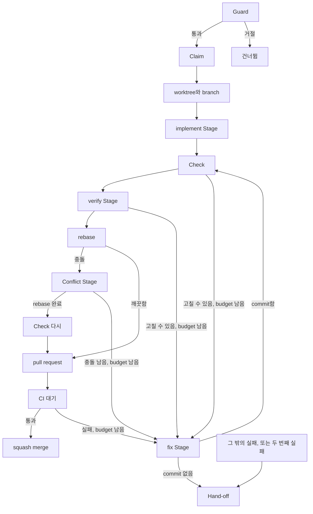
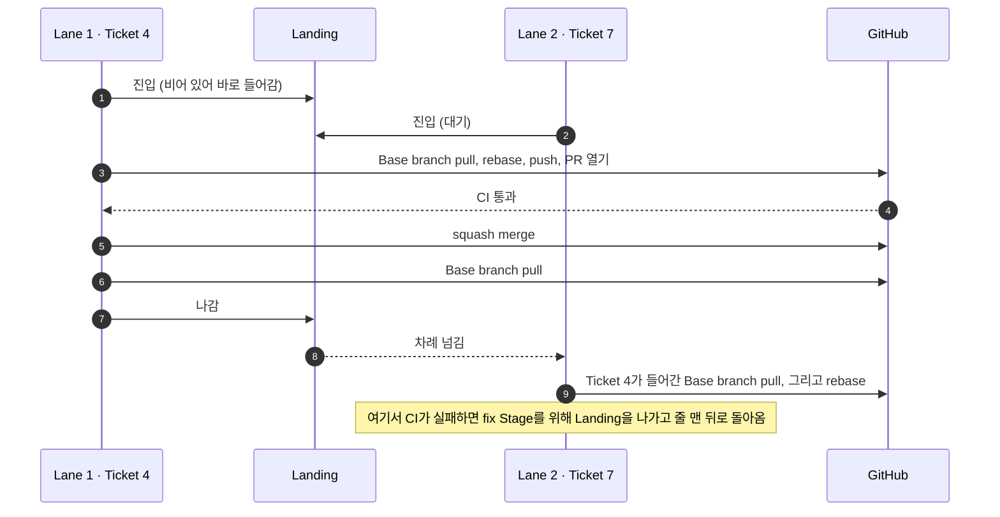

# Ticket 하나가 merge되기까지

Run은 아무도 지켜보지 않으니, 세션 하나의 말만 믿고 merge할 수는 없습니다. 그래서 모든 [Ticket](https://github.com/jjongs2/ticket-runner/blob/main/GLOSSARY.md)은 같은 관문을 같은 순서로 지납니다. 결과가 늘 같은(결정론적) Check, 작업이 틀렸음을 증명하려 드는 두 번째 세션, 그리고 CI입니다. 새 세션이 고칠 수 있는 실패라면 fix Stage를 딱 한 번 얻고, 그 밖의 실패는 사람에게 넘어갑니다. 한 Run의 Ticket들은 나란히 구현되지만 merge는 하나씩 하므로, CI가 채점한 코드가 그대로 Base branch에 들어갑니다.

이 페이지는 Ticket 하나를 Claim부터 merge까지 따라갑니다. Hand-off, Release, Stop, 돌아오지 못한 Run처럼 중간에 멈추는 경우는 [Hand-off, 멈추고 이어 하기](./stopping-and-resuming.md)에서 다룹니다.

| 단계 | 하는 일 | 판단 주체 |
|---|---|---|
| Claim | Guard, State file, 담당자 지정, `ready-for-agent` → `in-progress` | 파이프라인 |
| worktree | `.worktrees/ticket-<n>`에 `agent/<n>-<slug>` | git |
| implement Stage | worktree에서 `/mattpocock-skills:implement` 실행 | 에이전트 |
| Check | commit 안 된 변경이 없는지 본 뒤 Check 명령을 하나씩 실행 | 종료 코드 |
| verify Stage | Acceptance Criteria를 적대적으로 채점 | Verdict를 읽은 파이프라인 |
| fix Stage | 실패 내용을 받은 새 세션, Ticket당 한 번 | Fix budget |
| Landing | rebase, Conflict Stage, pull request, CI, squash merge | 한 번에 Lane 하나 |
| merge 이후 | 충족된 기준에 체크, 정리 | 파이프라인 |


<!-- Sources: src/orchestrator.ts, src/lifecycle.ts -->

fix Stage로 가는 화살표는 Ticket당 한 번만 탈 수 있습니다. 종류와 상관없이 두 번째 실패, 또는 fix Stage가 손쓸 수 없는 실패는 Hand-off입니다. rate limit, API 장애, API 예산으로 멈춘 Stage와 Base branch도 똑같이 겪는 실패([아래](#a-failure-the-base-branch-shares))는 이 그림을 아예 벗어나 Ticket을 [Release](./stopping-and-resuming.md#release-on-a-rate-limit)합니다.

## Claim {#the-claim}

아무것도 쓰기 전에 [Guard](./planning.md)부터 실행됩니다. 파이프라인이 맡지 않을 이슈에 '가져감' 표시가 남는 일은 없습니다.

그다음 이 순서로 진행합니다.

1. **State file**을 씁니다. Ticket의 branch, 도달한 상태(`claimed`), Fix budget을 썼는지가 담깁니다.
2. `gh` 사용자를 Ticket의 담당자로 지정하고, `in-progress`를 붙이고 `ready-for-agent`를 뗍니다. Stranded Ticket은 이미 이 Claim을 달고 있으니 다시 쓰지 않습니다.
3. Ticket에 아직 유효한 Hand-off 코멘트가 있으면 지난 일로 표시합니다([Ticket 돌려주기](./stopping-and-resuming.md#handing-a-ticket-back)).

## worktree와 branch {#the-worktree-and-branch}

| | 값 |
|---|---|
| branch | `agent/<n>-<slug>`: 제목을 소문자 kebab-case로 바꾸고, 40자 이내에서 단어 경계로 자름 |
| worktree | Target 루트 아래 `.worktrees/ticket-<n>`, gitignore됨 |
| 분기 기준 | 방금 fetch한 remote의 Base branch, upstream은 설정하지 않음 |

같은 이름의 branch가 이미 있으면 절대 재사용하지 않습니다. Ticket은 `setup`에서 Hand-off되고, 코멘트에 누구의 branch인지와 치우는 명령이 적힙니다. 재개되는 Ticket은 State file에 적힌 branch에서 이어 갑니다. 자세한 내용은 [Hand-off, 멈추고 이어 하기](./stopping-and-resuming.md)를 보세요.

## Stage가 도는 방식 {#how-a-stage-runs}

[Stage](https://github.com/jjongs2/ticket-runner/blob/main/GLOSSARY.md)는 일 하나만 맡는 `claude -p` 자식 프로세스입니다([ADR-0002](https://github.com/jjongs2/ticket-runner/blob/main/docs/adr/0002-claude-p-child-process-per-stage.md)).

모든 Stage는 Ticket의 worktree에서 `--permission-prompts none`, 설정된 `permissionMode`, 그리고 Stage별 `model`, `effort`, `maxTurns`, `maxMinutes`로 실행됩니다([설정](./configuration.md) 참고). 시간 한도는 프로세스와 그 프로세스가 띄운 것을 모두 kill해서 지킵니다.

**Stage가 보는 것.** branch의 파일들이고, Target의 `CLAUDE.md`도 그중 하나입니다. 그래서 `init`이 쓴 것은 Base branch에 들어간 뒤에야 Stage에 닿습니다. MCP 서버는 claude.ai connector까지 포함해 하나도 없고, auto memory도, 예약처럼 세션 밖에서 작동하는 도구도 없습니다. MCP 서버가 필요한 일은 Stage가 할 수 없습니다.

| Stage | 프롬프트 첫머리 | 구조화된 답변 |
|---|---|---|
| implement | `/mattpocock-skills:implement <issue URL>` | 선택 항목 `title`과 [`notes`](#notes) |
| verify | `Ticket: <issue URL>`, 스킬 없음 | Verdict, 선택 항목 `notes` |
| fix | `Ticket: <issue URL>`, 스킬 없음 | 선택 항목 `title`과 `notes` |
| conflict | `Ticket: <issue URL>`, 스킬 없음 | 없음 |

프롬프트 마지막에는 Stage별 [`extraPrompt`](./configuration.md#stages)가 붙습니다.

**Credential.** Stage는 Host의 `ANTHROPIC_API_KEY`를 환경에서 뺀 채 Claude 로그인으로 돌아갑니다. Run을 [`--api-key`](./running.md#api-key)로 시작했으면 그 키로 돌아갑니다. 세션의 `apiKeySource`가 다른 곳을 말하면 Run의 로그와 요약이 그 Stage를 짚습니다.

Stage마다 디스크에 무엇을 남기는지는 [로그와 transcript](./running.md#logs-and-transcripts)에 있습니다.

**Stage가 끝나는 방식.** runner는 세션이 무슨 말을 했는지가 아니라 마지막 `result` 이벤트를 읽습니다.

| 실패 | Progress 칸 | 뜻 |
|---|---|---|
| `timed-out` | `❌ timed out` | `maxMinutes`에서 kill됨 |
| `turn-capped` | `❌ turn capped` | `maxTurns`에 도달함 |
| `out-of-budget` | `⏸ out of API budget` | API 키의 크레딧이나 지출 한도. `--api-key` Run에서만 겪음. Ticket을 Release함 |
| `rate-limited` | `⏸ rate limited`, `--api-key` Run이면 `⏸ API rate limited` | 요금제의 rate limit, `--api-key` Run이면 API의 rate limit. Ticket을 Release함 |
| `api-error` | `⏸ API failure` | CLI가 재시도를 포기한 일시적인 API 장애. Ticket을 Release함 |
| `nonzero-exit` | `❌ exited non-zero` | 그 밖에 실패한 세션 |
| `invalid-result` | `❌ invalid result` | verify Stage가 Verdict를 아예 내놓지 않음 |

## implement Stage {#the-implement-stage}

implement 스킬이 Ticket을 읽고, 만들고, 리뷰합니다. 세션이 끝나면 파이프라인은 [Note](#notes)를 보내고, `title`을 기록하고, commit이 있으면 branch를 push합니다. 다른 Host의 Run도 거기서 이어 갈 수 있게 하려는 것입니다. 그다음은 이렇습니다.

- 끝까지 가지 못한 Stage는 `implement`에서 Hand-off됩니다.
- Base branch보다 commit이 하나도 늘지 않은 branch도 Hand-off됩니다. 조용히 포기한 에이전트는 채점할 거리를 남기지 않기 때문입니다.
- 그 외에는 State file이 `implemented`로 넘어가, 이후 어떤 Run도 이 Stage 비용을 다시 치르지 않습니다.

## Check {#the-checks}

에이전트가 아니라 파이프라인이 직접 여는 관문이 둘 있습니다.

1. **commit 안 된 변경 없음.** 어떤 commit에도 없는 변경이 worktree에 있으면 실패이고, 해당 경로를 전부 알려 줍니다. 설치한 의존성 같은 gitignore 파일은 세지 않습니다.
2. **Check 명령**을 순서대로, worktree의 셸에서, 각각 `checkTimeoutMinutes`(기본 15분) 안에 실행합니다. 처음 실패한 곳에서 멈춥니다. 한도에서 kill된 명령은 timed out으로 보고되고, 실패가 아니라 멈춰 있었다는 한 줄이 출력 뒤에 붙습니다.

명령은 [`checks`](./configuration.md#checks)에 적은 것입니다. 두 실패 모두 Fix budget을 씁니다.

### Base branch도 함께 실패할 때 {#a-failure-the-base-branch-shares}

Base branch의 테스트 하나가 실패하기 시작하면(현재 시각을 읽는 테스트가 그런 예입니다), 모든 branch에서 한꺼번에 실패합니다. 이를 Ticket마다 물리면 모두가 Fix budget을 잃고, fix Stage마다 자기 pull request에서 제각각 고칩니다. 그래서 실패를 물리기 전에, branch가 들여온 실패인지 물려받은 실패인지 확인합니다.

| 실패한 것 | merge-base에서 돌리는 것 |
|---|---|
| Check 명령 | 그 명령 |
| pull request의 CI | 모든 Check 명령. 처음 실패하는 데서 멈춤 |

remote에 있는 그대로의 merge-base를 깨끗하게 checkout하고, 같은 `checkTimeoutMinutes`로 거기서 명령을 돌립니다. 몇 개의 Lane이 거기서 실패하든 Run마다 한 번만 돌립니다. 거기에는 아무것도 설치하지 않습니다. 명령은 Ticket의 worktree처럼 main checkout에서 의존성을 찾으므로, 자기만의 설치나 빌드 단계가 필요한 명령은 거기서도 실패하고, 그 이유는 Note의 출력에 드러납니다.

| merge-base 결과 | Progress 칸 | 결과 |
|---|---|---|
| 통과 | ``❌ `<command>` failed``, 또는 CI의 `❌ failed` | 위와 같이 Fix budget을 씀 |
| 함께 실패 | ``⏸ `<command>` fails on the Base branch`` | Release. budget은 썼든 안 썼든 그대로 |
| checkout하거나 돌리지 못함 | 통과한 것으로 봄 | Fix budget을 쓰고, 이유는 Run 로그에 남김 |

Release는 상설 Notes 이슈에 파이프라인 자신의 Note를 올리고, 거기에 명령 이름과 출력의 끝부분을 담습니다. 다음에 할 일은 [Base branch가 실패할 때의 Release](./stopping-and-resuming.md#release-over-a-failing-base-branch)에 있습니다.

## verify Stage와 Verdict {#the-verify-stage-and-its-verdict}

merge 전에 코드를 리뷰하는 사람이 없고, 코드를 쓴 세션은 그 코드가 제대로 도는지 물어보기에 가장 믿기 어려운 상대입니다. 그래서 플러그인 스킬 없이 새로 띄운 세션이 각 Acceptance Criterion이 충족되지 **않았음**을 증명하려고 합니다. 이 세션은 본문과 코멘트에서 기준을 읽고, 코드를 돌려 보고, 버릴 테스트를 써도 되지만 commit은 하면 안 됩니다. 문서로 남은 결정이나 다른 기준을 뒤집지 않고는 충족할 수 없는 기준은 `unmet`으로 두고, 근거에 사람의 결정이 필요하다고 적습니다. 임시 파일은 끝난 뒤 버리므로 pull request에 섞이지 않습니다.

**Verdict**는 기준마다 `met`, `unmet`, `unverifiable` 중 하나를 근거와 함께 매깁니다. 에이전트 자신의 통과 여부 판단은 참고일 뿐이고, 파이프라인이 직접 판단합니다. 통과 조건은 **`unmet`이 하나도 없고 `met`이 하나 이상**인 것입니다.

| Verdict | Progress 칸 | 결과 |
|---|---|---|
| 통과 | `✅ <k> met · <v> unverifiable` | Landing으로 |
| `unmet`이 있음 | `❌ <u> unmet` | Fix budget을 씀. fix Stage는 충족되지 않은 기준과 그 근거를 받음 |
| 전부 `unverifiable` | `❌ no evidence` | Hand-off. merge할 근거가 없음 |
| 없거나 형식이 틀림 | `❌ no Verdict` | Hand-off |

`unmet` 기준 때문에 fix를 거친 뒤의 verify는 첫 Verdict의 `unmet` 기준과 그 근거를 받습니다. 그 반례가 사라지고 기준 전체가 성립해야만 충족이라는 말도 함께 듣습니다.

## fix Stage와 Fix budget {#the-fix-stage-and-the-fix-budget}

[Fix budget](https://github.com/jjongs2/ticket-runner/blob/main/GLOSSARY.md)은 Ticket당 fix Stage 한 번이고, 그 뒤에도 실패하면 사람에게 넘어갑니다. fix Stage는 같은 branch에서 플러그인 스킬 없이 새로 띄운 세션이고, 실패와 그 근거를 받아 그 결함 하나를 고칩니다. `unmet` 기준 때문에 불려 왔는데 그중 하나라도 문서로 남은 결정이나 다른 기준을 뒤집어야만 충족된다면, 아무것도 commit하지 말고 이유를 밝히라고 합니다. 그러면 Ticket이 사람에게 넘어갑니다.

새 세션이 고칠 수 있는 결함만 budget을 씁니다.

| 실패 | 위치 | budget을 쓰나? |
|---|---|---|
| 어떤 commit에도 없는 변경 | checks | 예 |
| Check가 실패하거나 시간 초과 | checks | 예 |
| 실패한 Check가 merge-base에서도 실패 | checks | 아니요, Release |
| `unmet` 기준 | verify | 예 |
| Conflict Stage가 rebase를 끝내지 못함 | rebase | 예 |
| pull request check 실패 | ci | 예 |
| pull request check 실패, merge-base도 Check에 실패 | ci | 아니요, Release |
| 끝까지 가지 못한 Stage(시간 초과, 턴 한도, 0이 아닌 종료 코드, 잘못된 결과) | 해당 Stage | 아니요, Hand-off |
| implement가 commit을 남기지 않음 | implement | 아니요, Hand-off |
| 근거가 없는 Verdict, 또는 Verdict 없음 | verify | 아니요, Hand-off |
| Conflict Stage를 띄우지 못했거나 git에 상태를 물을 수 없음 | rebase | 아니요, Hand-off |
| Base branch를 pull하지 못함 | rebase | 아니요, Hand-off |
| push나 pull request 열기가 실패 | pr | 아니요, Hand-off |
| CI 시간 초과, 충돌, check 없음 | ci | 아니요, Hand-off |
| merge 실패 | merge | 아니요, Hand-off |
| 어디서든 rate limit, 일시적인 API 장애, API 키의 예산 소진 | 어디든 | 아니요, Release |

fix Stage가 끝나면 Ticket은 Check부터 다시 시작합니다. verify Stage를 포함해 모든 관문이 수정본을 다시 채점하므로, 수정본도 처음 구현과 같은 기준을 통과해야 합니다. fix Stage 후 branch가 자라지 않았다면 곧바로 Hand-off입니다. 아무도 건드리지 않은 branch를 다시 채점해 봐야 똑같이 실패할 뿐이기 때문입니다. squash하거나 amend한 branch도 자라지 않은 것으로 봅니다. 이때 Hand-off 코멘트에는 fix Stage가 받았던 근거가 실리므로, 사람에게 넘어간 `unmet` 기준은 그 근거가 묻는 질문과 함께 도착합니다.

rate limit, API 장애, API 예산으로 멈춘 fix Stage는 Fix budget을 쓰지 않습니다. 다음 Run이 어떤 budget으로 시작하는지는 [Ticket 돌려주기](./stopping-and-resuming.md#handing-a-ticket-back)에 있습니다.

## Lane과 Frontier 다시 채우기 {#lanes-and-the-frontier-refill}

Run은 [Lane](https://github.com/jjongs2/ticket-runner/blob/main/GLOSSARY.md) 하나에 Ticket 하나를 쥐고, Lane의 Ticket이 끝나는 즉시 다시 채웁니다. 어떤 순서로 채우는지는 [실행하기](./running.md#run)에, Lane을 늘리면 언제 도움이 되는지는 [`lanes`](./configuration.md#lanes)에, 두 Ticket이 서로 방해하지 않게 하는 것은 [Blocker](./planning.md#blockers)에 있습니다.

## Landing {#the-landing}

rebase 직전의 Base branch pull부터 merge 직후의 pull까지인 [Landing](https://github.com/jjongs2/ticket-runner/blob/main/GLOSSARY.md)에는 한 번에 Ticket 하나만, 도착한 순서대로 들어갑니다. 그래서 Ticket의 rebase와 merge 사이에 Base branch가 움직일 수 없고, CI가 채점한 그대로 merge됩니다([ADR-0005](https://github.com/jjongs2/ticket-runner/blob/main/docs/adr/0005-landing-is-a-serialized-section.md)). 시간이 많이 드는 implement와 verify는 계속 병렬로 돌아갑니다. 대신 한 Lane의 Conflict Stage나 느린 CI가 다른 Lane의 Landing을 붙잡아 둡니다.


<!-- Sources: src/landing.ts, src/orchestrator.ts -->

Ticket은 fix Stage, Hand-off, Release 때도 Landing을 나가므로, 누구도 세션 하나를 기다리며 서 있지 않습니다.

### rebase {#rebase}

먼저 Base branch를 remote에 맞추고, 그다음 worktree에서 `git rebase <base>`를 실행합니다. 깨끗하게 끝나면 바로 pull request로 갑니다. 충돌이 나면 git이 멈춘 그 자리에 그대로 두고 Conflict Stage에 넘깁니다.

### Conflict Stage {#the-conflict-stage}

충돌은 branch의 결함이 아닙니다. 그 아래에서 Base branch가 앞으로 나간 것뿐입니다. 그래서 멈춘 rebase 안에서 [Conflict Stage](https://github.com/jjongs2/ticket-runner/blob/main/GLOSSARY.md) 하나가 플러그인 스킬 없이 git 출력을 받아 돌고, **Fix budget은 쓰지 않습니다.** 이 Stage에는 rebase를 끝까지 마치고 절대 abort하지 말 것, 양쪽이 양립하면 두 의도를 모두 살리고 아니면 Ticket 쪽을 따를 것, 충돌하지 않은 파일은 바뀐 이름이나 옮겨진 필드처럼 merge가 망가뜨린 것을 고칠 때만 손댈 것을 요청합니다. 새로 구현하는 것은 없고, 기준이 다루는 동작도 바꾸지 않습니다.

**판단은 세션의 종료 상태가 아니라 worktree가 합니다.** rebase가 끝났고, branch가 Base branch 위에 있으며 둘 사이에 merge commit이 없고, unmerged 경로도 충돌 마커도 남지 않았을 때만 rebase가 해결된 것으로 봅니다.

| worktree 상태 | 결과 |
|---|---|
| 해결됨, 세션이 어떻게 끝났든(rate limit이나 API 장애여도) | `✅ rebased`. push한 뒤 **Check를 다시 돌림** |
| 해결 안 됨, 세션이 rate limit, API 장애, API 예산으로 멈춤 | rebase를 abort하고 Release |
| 그 밖의 이유로 해결 안 됨 | `❌ unresolved`. rebase를 abort하고 Fix budget을 씀 |
| Stage를 띄우지 못했거나 git에 물을 수 없음 | `❌ unknown`. rebase를 abort하고 Hand-off |

Check를 다시 돌리는 건 해결 내용이 어떤 관문도 본 적 없는 코드이기 때문입니다. verify는 다시 하지 않습니다. 이 Stage는 기준이 다루는 동작을 바꾸지 않도록 지시받기 때문입니다. 해결하지 못한 rebase는 충돌 내용과 남은 문제를 근거로 fix Stage에 넘깁니다. abort는 항상 실행되므로, fix Stage나 사람이 반쯤 끝난 rebase를 물려받는 일은 없습니다.

### pull request {#pull-request}

rebase로 branch가 다시 쓰였으니 `--force-with-lease`로 push합니다. Base branch를 향한 ready(draft 아님) pull request를 새로 열거나, 이미 있는 것을 갱신합니다. 갱신할 때는 제목과 본문을 새로 쓰고 draft에서 꺼냅니다. draft에서는 워크플로가 아예 돌지 않는 경우가 많아서, Hand-off 때 남은 draft를 그대로 두면 "no checks"로 읽히기 때문입니다.

**제목**은 아래 후보 가운데 commit 컨벤션 형식(`<type>(<scope>): <summary>`, 한 줄)에 맞는 첫 번째 것입니다. 끝의 `(#<n>)`는 떼어 냅니다.

1. implement나 fix Stage가 branch 전체에 대해 마지막으로 답한 `title`. 이번 Run의 것이든, 이전 Run이 State file에 기록한 것이든 상관없습니다.
2. branch의 첫 commit 제목.
3. Ticket 제목 그대로.

**본문**은 `Closes #<n>`, Verdict 집계, 접힌 기준 목록(`met`이 아닌 것은 근거 표시), 그리고 Run을 밝히는 한 줄입니다. 워크스테이션에서는 그 줄이 `.ticket-runner/runs/<runId>/<n>/`도 가리킵니다. 클라우드 Host의 Run 디렉터리는 세션과 함께 사라지므로 거기서는 Run만 밝힙니다.

### CI 대기와 유예 시간 {#ci-wait-and-grace-period}

파이프라인은 head commit의 check run과 commit status를 계속 확인합니다. 결과가 정해지거나 [`ciTimeoutMinutes`](./configuration.md#ci)가 다 될 때까지입니다.

| GitHub 상태 | Progress 칸 | 결과 |
|---|---|---|
| 모든 check가 통과하거나 건너뜀 | `✅ passed` | merge |
| check가 실패, 취소, 시간 초과, 조치 필요, 시작 실패 중 하나 | `❌ failed` | Fix budget을 씀 |
| 위와 같고, merge-base도 Check 명령에 실패 | ``⏸ `<command>` fails on the Base branch`` | Release([위](#a-failure-the-base-branch-shares) 참고) |
| 시간 초과 시점에 check가 아직 대기 중 | `❌ timed out` | Hand-off |
| check가 없고 GitHub가 pull request를 충돌로 판단 | `❌ conflicting` | 곧바로 Hand-off |
| 유예 시간이 지나도 check 없음, `gates.ci` 켬 | `❌ no checks` | Hand-off |
| 유예 시간이 지나도 check 없음, `gates.ci` 끔 | `⚠️ no checks` | 경고 행과 함께 merge |

check가 실패하면 실패한 Actions job들의 로그 끝부분을 근거로 fix Stage에 넘깁니다. 충돌 난 pull request는 기다리지 않고 바로 Hand-off합니다. GitHub는 이런 pull request에 check를 돌리지 않기 때문입니다. 이런 충돌은 그사이 사람이 merge했을 때만 생깁니다.

**유예 시간.** pull request가 막 열린 직후에는 GitHub가 한동안 check가 없다고 답합니다. 그래서 "no checks"는 [`ciGraceMinutes`](./configuration.md#ci)가 지난 뒤에야 인정합니다.

### squash merge와 commit 메시지 {#squash-merge-and-its-commit}

파이프라인은 GitHub REST API로 squash merge하며, commit 메시지는 직접 조립합니다.

```text
<title> (#<pr>)

Closes #<n>

Verdict: <k> met · <u> unmet · <v> unverifiable

- <branch commit subject>
- <branch commit subject>

Co-authored-by: <name> <email>
```

제목은 pull request 제목입니다. commit 제목들과 `Co-authored-by` trailer는 rebase 이후에 읽습니다. rebase한 뒤의 commit이 실제로 들어가기 때문입니다. 기준별 근거는 pull request 본문에만 둡니다.

### merge 이후 {#after-the-merge}

Ticket은 이미 merge됐으니 여기서부터는 Hand-off될 수 없습니다. 단계마다 실패하면 로그만 남기고 다음 단계로 넘어갑니다.

1. State file을 지웁니다. Ticket이 다시는 재개 가능해 보이지 않게 하려는 것입니다.
2. 충족된 기준에 체크합니다(아래 참고).
3. `in-progress`를 뗍니다. 이슈는 merge로 이미 닫혔습니다.
4. Base branch를 pull합니다. 여기서 Landing이 끝나고, 다음 Lane의 Ticket은 이 Ticket이 들어간 Base branch 위로 rebase합니다.
5. worktree와 로컬 branch를 지우고, GitHub가 아직 지우지 않았으면 remote branch도 지웁니다.

## 보드에 남기는 기록 {#what-the-board-is-told}

**Progress comment.** Ticket마다 [Progress comment](https://github.com/jjongs2/ticket-runner/blob/main/GLOSSARY.md)가 하나 있습니다. 단계가 끝날 때마다 제자리에서 고쳐 쓰므로, 알림은 첫 작성 때만 갑니다. 첫 행이 기록될 때 처음 올라갑니다. Ticket을 다룬 Run마다 섹션이 하나씩 생겨 이전 Run의 섹션 아래에 붙고, 섹션 머리글에는 Version, Run id, branch가 적힙니다.

```text
**ticket-runner** `0.4.0` · run `2026-09-17T09-00-00-000` · `agent/4-planning-guards`

| Stage | Outcome | Turns | Duration |
|---|---|---|---|
| implement | ✅ committed | 46 | 21m |
| checks | ❌ `npm test` failed | – | 2m |
| fix | ✅ committed | 12 | 6m |
| checks | ✅ passed | – | 2m |
| verify | ✅ 6 met · 1 unverifiable | 9 | 4m |
| ci | ✅ passed | – | 3m |
| merge | ✅ #31 | – | – |
```

행에는 몇 단어만 적습니다. 사람이 행동해야 하는 것은 알림을 받을 가치가 있으니 따로 코멘트로 올립니다. Hand-off, Guard 경고, Note가 그렇습니다.

**충족된 기준에 체크.** merge 뒤에는 Verdict가 `met`으로 판정한 기준마다, 그것이 적힌 곳이 본문이든 코멘트든(예: triage가 브리프를 올린 코멘트) 찾아서 체크합니다(`- [ ]` → `- [x]`). 공백과 대소문자 차이만 봐줍니다. `unverifiable` 기준은 아무도 근거를 모으지 않았으니 체크하지 않습니다. Stage가 문구를 크게 바꿔 맞출 수 없는 기준도 그대로 두고, 몇 개를 맞추지 못했는지 Run 로그에 남깁니다.

## Note {#notes}

Stage는 자기 Ticket과 상관없는 결함을 자주 만납니다. 고치면 verify가 채점하는 범위를 넘어 Ticket이 넓어지고, 무시하면 transcript 속에 묻혀 버립니다. 그래서 implement, verify, fix Stage는 [Note](https://github.com/jjongs2/ticket-runner/blob/main/GLOSSARY.md) 목록을 남기며 끝나고, 파이프라인은 각 Note를 사람이 볼 만한 곳에 올립니다. Note는 Ticket 밖의 결함이고, 그 Ticket 안에서는 손대지 않습니다. branch 스스로 만든 결함은 Note로 남기지 않고 고칩니다. Note는 Stage 자체의 결과를 판정하기 전에 보내므로, 턴이 바닥난 Stage도 알아챈 것은 전합니다.

| Note가 가리키는 곳 | 가는 곳 |
|---|---|
| 열려 있고, claim되지 않았고, Spec이 아닌 Ticket | 그 Ticket의 코멘트 |
| Ticket 없음, 또는 Stage 자신의 Ticket(곧 닫힐 것) | 상설 Notes 이슈 |
| 닫혔거나, claim됐거나(`in-progress`), Spec인 이슈 | 상설 Notes 이슈. 원래 어느 Ticket 몫이었고 왜 그쪽으로 가지 않았는지 함께 적음 |
| 코멘트를 받지 않는 번호(지어낸 번호, 잠긴 이슈) | 상설 Notes 이슈. 원래 가려던 번호와 함께 |

**상설 Notes 이슈**는 Note를 코멘트로 모으는, 열린 `needs-triage` 이슈 하나입니다. 제목은 "Notes from the pipeline"입니다. 제목이 아니라 본문의 마커로 찾으므로, 이름을 바꿔도 두 번째 이슈가 생기지 않습니다. 필요한 첫 Note가 열고, Run의 모든 Lane이 함께 씁니다. triage하듯 처리하세요. 할 만한 Note는 Ticket으로 만들거나 기존 Ticket에 코멘트로 옮긴 다음, 이슈를 닫습니다. 다음 Note가 새로 엽니다. 열려 있는 동안에는 Note를 쓰는 Stage의 프롬프트에 그 번호가 들어갑니다. 그래서 Stage는 이미 보고된 내용을 읽고, 독자가 할 일을 바꿀 만한 것만 덧붙일 수 있습니다.

Note 안의 줄 머리 `- [ ]`는 escape되므로, Note가 Acceptance Criteria로 읽히는 일은 없습니다. Run 요약에는 각 Note가 그것을 만든 Ticket 아래 `noted` 행으로 나옵니다.

## 관련 페이지 {#related-pages}

- [일 계획하기](./planning.md): Claim 전에 도는 Guard, verify가 채점할 수 있는 Acceptance Criteria 쓰는 법.
- [실행하기](./running.md): Run 시작, `--lanes`, `--api-key`, 범위를 좁힌 Run, 요약, 종료 코드, transcript.
- [설정](./configuration.md): `checks`, `gates`, Stage 한도, `ciTimeoutMinutes`, `ciGraceMinutes`.
- [Hand-off, 멈추고 이어 하기](./stopping-and-resuming.md): Hand-off, Release, Stop, Stranded Ticket, Ticket 돌려주기.
- [내부 구조](./internals.md): 각 단계 뒤의 port와 adapter.

## 참고 자료 {#references}

- [`src/orchestrator.ts`](https://github.com/jjongs2/ticket-runner/blob/main/src/orchestrator.ts): `processTicket`, `takeTicket`, `verify`, `fix`, `resolveConflict`, `requireGreenCi`
- [`src/failing-base.ts`](https://github.com/jjongs2/ticket-runner/blob/main/src/failing-base.ts): merge-base에서 Run마다 한 번 돌리는 Check
- [`src/run.ts`](https://github.com/jjongs2/ticket-runner/blob/main/src/run.ts), [`src/frontier.ts`](https://github.com/jjongs2/ticket-runner/blob/main/src/frontier.ts), [`src/landing.ts`](https://github.com/jjongs2/ticket-runner/blob/main/src/landing.ts)
- [`src/prompts.ts`](https://github.com/jjongs2/ticket-runner/blob/main/src/prompts.ts), [`src/self-hosting.ts`](https://github.com/jjongs2/ticket-runner/blob/main/src/self-hosting.ts), [`src/verdict.ts`](https://github.com/jjongs2/ticket-runner/blob/main/src/verdict.ts), [`src/title.ts`](https://github.com/jjongs2/ticket-runner/blob/main/src/title.ts), [`src/note-schema.ts`](https://github.com/jjongs2/ticket-runner/blob/main/src/note-schema.ts), [`src/lifecycle.ts`](https://github.com/jjongs2/ticket-runner/blob/main/src/lifecycle.ts)
- [`src/progress.ts`](https://github.com/jjongs2/ticket-runner/blob/main/src/progress.ts), [`src/criteria.ts`](https://github.com/jjongs2/ticket-runner/blob/main/src/criteria.ts), [`src/notes.ts`](https://github.com/jjongs2/ticket-runner/blob/main/src/notes.ts), [`src/templates.ts`](https://github.com/jjongs2/ticket-runner/blob/main/src/templates.ts), [`src/handoff.ts`](https://github.com/jjongs2/ticket-runner/blob/main/src/handoff.ts)
- [`src/stage-guard.ts`](https://github.com/jjongs2/ticket-runner/blob/main/src/stage-guard.ts), [`src/run-log.ts`](https://github.com/jjongs2/ticket-runner/blob/main/src/run-log.ts), [`src/startup.ts`](https://github.com/jjongs2/ticket-runner/blob/main/src/startup.ts), [`src/config.ts`](https://github.com/jjongs2/ticket-runner/blob/main/src/config.ts)
- [`src/adapters/claude-agent-runner.ts`](https://github.com/jjongs2/ticket-runner/blob/main/src/adapters/claude-agent-runner.ts), [`src/adapters/git-workspace.ts`](https://github.com/jjongs2/ticket-runner/blob/main/src/adapters/git-workspace.ts), [`src/adapters/gh-tracker.ts`](https://github.com/jjongs2/ticket-runner/blob/main/src/adapters/gh-tracker.ts), [`src/adapters/process-tree.ts`](https://github.com/jjongs2/ticket-runner/blob/main/src/adapters/process-tree.ts)
- [ADR-0002](https://github.com/jjongs2/ticket-runner/blob/main/docs/adr/0002-claude-p-child-process-per-stage.md): Stage마다 `claude -p` 자식 프로세스 하나
- [ADR-0005](https://github.com/jjongs2/ticket-runner/blob/main/docs/adr/0005-landing-is-a-serialized-section.md): Landing은 직렬화된 구간
- [`docs/templates/`](https://github.com/jjongs2/ticket-runner/blob/main/docs/templates/README.md): Progress comment, pull request 본문, squash commit, Note 코멘트의 정확한 모양
